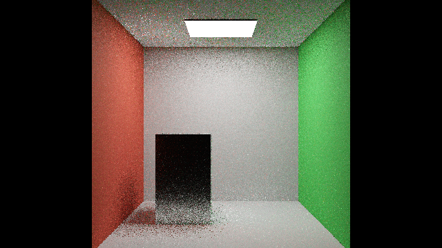
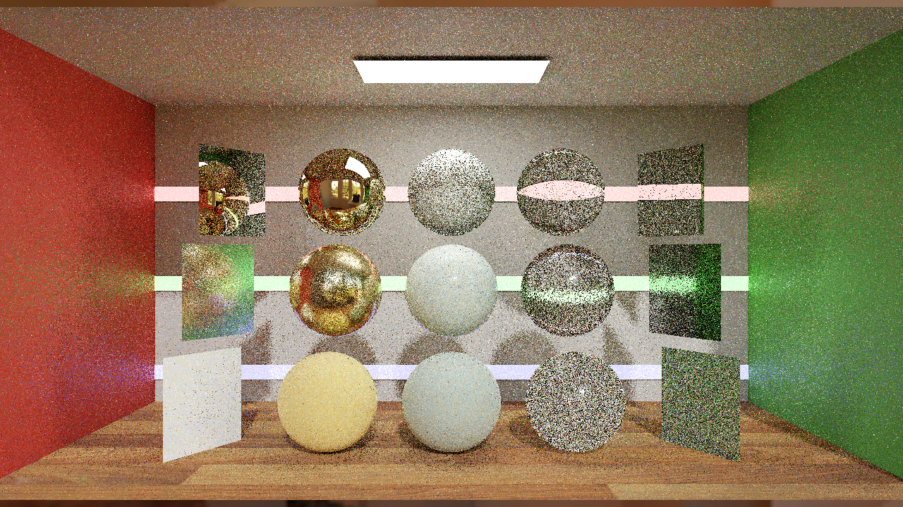
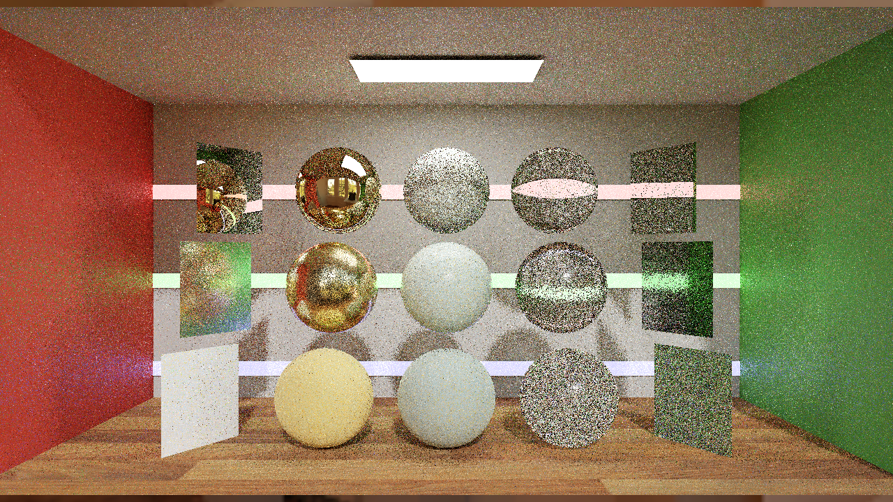
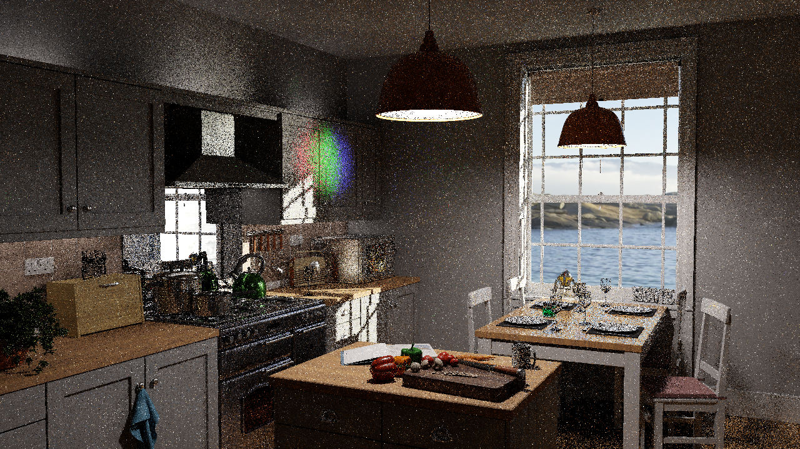

# B10 development: duplication-based temporal history reduction

## Summary and lessons learned

The application now implements a real duplication-map producer and connects the previous frame's counts to RTXDI3.1 temporal history reduction. **Six64-frame GPU cases pass**, with the feature on/off across Room, original Convergence and original Kitchen. All three enabled maps match an independent CPU count oracle exactly, and temporal reuse reads nonzero counts. The feature is an opt-in, deliberately biased B10 development mode; **full B10 and B11 remain incomplete**.

The scoped comparison is now complete:18three-seed64-frame quality sequences and18uncapped timing processes. Results show a convergence/quality tradeoff with little Room/Convergence timing change and a small Kitchen cost. Startup reliability remains unresolved; the full PT++ implementation and canonical promotion are still pending.

## Implementation

### Correspondence to the paper and NVIDIA reference

Source review: PT++ §5, pp9–10, and the pinned NVIDIA runtime `PT/DuplicationMap.hlsli` / `PT/TemporalResampling.hlsli`, with the SDK's [integration guidance](https://github.com/NVIDIA-RTX/RTXDI/blob/a6efab966b7c3b272da0461578eb56ac61c7cbff/Doc/RestirPT.md#duplication-based-history-reduction). This is a scoped temporal-cap integration, not the whole paper or SDK decorrelation pipeline.

| Published/reference behavior | Current application correspondence | Difference or limit |
|---|---|---|
| Paper §5: identify repeated samples by reservoir random seed; count a17×17 neighborhood after resampling; reproject the prior map | Final selected reservoir seed, radius8 count producer, prior-frame temporal callback | Integer buffer replaces the SDK's texture storage; decoded counts are validated exactly |
| Paper §5: normalize by288 and interpolate the history cap toward1 using exponent0.1 | Existing SDK temporal-cap function; strength0.5 gives exponent0.1 | Retains the SDK count saturation at255; this is not the paper's unrestricted0–288 count range |
| Paper §5: default cap is configurable;20 is an example | Current control retains the application's SDK default cap8 | Matched on/off comparison isolates reduction; it is not a reproduction of the paper's cap20 experiment |
| Paper §5: sample-dependent confidence changes introduce bias | Explicit opt-in deliberately biased mode | No unbiasedness or measured quality gain claimed |
| NVIDIA integration: temporal and spatial reduction parameters cooperate with spatial recovery | Temporal consumer is active and validated | Spatial boost integration is not enabled; the current paired pilot fixes both ordinary and recovery neighbor counts to1. This remains an open integration item |

Paper §6.1 separately requires primary-vertex NEE to participate in unified path selection, including its supplementary MIS/source-PDF changes. Adding separate DI/GI/PT outputs is not that method. The remaining unified-reservoir implementation must follow that prescription and supporting derivation; it must not be replaced by an unlabelled merge heuristic.

`ComputeDuplicationMap.hlsl` counts other pixels sharing the selected reservoir's nonzero sample ID in a17×17 neighborhood. A16×16 compute group loads a32×32 shared tile including its radius8 halo. Bounds checks exclude out-of-view taps; empty IDs are ignored; the center is excluded; counts are capped at255 to match the supplied RTXDI3.1 map's range. This integrates the supplied behavior into the application; it is not a new paper algorithm.

The integer map has its own buffer and bindingu27, separate from the vector-shading/CGNS scratch storage. Temporal reuse consumes the previous completed map. The producer runs after current final resampling, with UAV barriers before subsequent use. Resource/history resets clear the map; the disabled path binds a minimum-size dummy and dispatches no producer. Changing reduction settings invalidates PT history. Static startup/history is tested; moving-camera, resize and interactive reset stress remain pending.

`--pt-duplication-history-validation` selects the development feature in the capture tool. It uses the existing SDK temporal reduction strength0.5 and keeps spatial duplication/decorrelation controls disabled. Standalone strict controls keep the feature off. The queue diagnostics retain sticky sequence failures in slots92–95; four new map counters occupy96–99.

The count oracle validates exactly what the GPU produced, using independently decoded final packed reservoir IDs and weights. Each enabled case also rejects a one-count corruption in memory. This establishes producer and consumer activation, not correctness of the underlying transport estimator or an unbiasedness result for a deliberately biased history cap.

## GPU gates

| Case | Resolution | Nonzero current-map pixels | Maximum current count | Temporal map reads | Nonzero temporal reads |
|---|---:|---:|---:|---:|---:|
| Room on |177×91|1,196|6|8,645|1,166|
| Convergence on |1280×720|158,104|59|752,110|157,727|
| Kitchen on |1280×720|222,571|25|808,152|222,554|

Disabled controls have zero map production and reads. All six cases compare64queued-history frames with zero packed reservoir/RGB scheduling mismatches or overflow:384frames total. Final map counts and temporal reads refer to different frames by design. Room uses footprint reconnection; original scenes retain full-prefix replay. Both policies retain B8 GI3, DI reuse, paired Gaussian spatial reuse, initial-only roulette0.8 and one neighbor.

[Exact statistics and scope](../../Benchmarks/development/2026-10-30-duplication-history/diagnostics.json) · [Source overlay](../../Benchmarks/development/2026-10-30-duplication-history/source.json) · [Excluded attempts](../../Benchmarks/development/2026-10-30-duplication-history/excluded-attempts.json)

## Completed scoped comparison

Three seeds47/1019/4093 ×two policies ×three scenes ×64frames:18quality sequences and1152frames. A separate rotated cohort has18uncapped timing processes, three per policy/scene,30s warmup and15s record. All used the exact preserved executable `a3f44cb37000e2f23d39259d2b8c21d211bafa9b6e172a753fbe585493f4ca89` and renderer source `0bd96933236d753a932cb3046e4899a18056f176`. Timing freezes verified700shader inputs/cache files; every cap restoration and the final source/runtime restoration passed.

|Scene|GPU busy off, ms|GPU busy on, ms|Change|CPU cadence off/on, ms|
|---|---:|---:|---:|---:|
|Room|2.2482|2.2539|+0.25%|2.1848 / 2.2062|
|Convergence|10.1788|10.0866|-0.91%|10.1314 / 10.0747|
|Kitchen|11.7713|11.9683|+1.67%|11.7579 / 11.9800|

Process GPU busy is not complete frame latency or an FPS estimate. Small changes in Room and Convergence sit within overlapping three-run bootstrap ranges; Kitchen adds about1.67%GPU busy. No universal speedup or equal-quality speedup is established. Full run distributions and definitions are in the portable timing evidence.

|Scene|Mean per-frame MSE change|64-frame-average MSE change|Frame64 HDR-FLIP off/on|Frame64 LDR-FLIP off/on|
|---|---:|---:|---:|---:|
|Room|+1.81%|+3.05%|0.109858 / 0.110409|0.076308 / 0.076419|
|Convergence|-6.40%|-24.47%|0.314260 / 0.316410|0.211553 / 0.212666|
|Kitchen|+2.23%|-26.79%|0.461613 / 0.464505|0.274109 / 0.275442|

Lower error is better. MSE changes are ratios of three-seed means; FLIP entries are medians of three frame64 evaluations. The running-average image is a CPU average of64unreconstructed real-time frames, not renderer64spp accumulation. Three-seed paired differences/SE are retained; matching seeds does not imply identical paths. These are static fixed-frame comparisons, not equal-time, moving-camera or disocclusion tests.

Averaged-image MSE improves in Convergence and Kitchen, while Room worsens slightly. Individual-frame MSE worsens in Room/Kitchen, and frame64 HDR-FLIP is slightly higher in all scenes. Bias changes can also affect averaged error; temporal covariance was not separately measured. This remains a quality tradeoff, not a universal improvement or proof of reduced correlation. Extended SMAPE/MAPE/RelMSE and luminance measurements are retained in per-seed mean-image records.

|Scene|Duplication off, seed47/frame64|Duplication on, seed47/frame64|
|---|---|---|
|Room|||
|Convergence|||
|Kitchen|||

Representative pictures use the original captured colors and exposure. The images show one seed; aggregate metrics use all three. [Complete quality data](../../Benchmarks/development/2026-10-30-duplication-history/quality.json) · [Paired uncertainty](../../Benchmarks/development/2026-10-30-duplication-history/paired-quality.json) · [Timing comparison](../../Benchmarks/development/2026-10-30-duplication-history/timing-comparison.json).

### Preserved failures and acquisition scope

Startup reliability remains unresolved. Earlier0xC0000409failures occurred with duplication both off and on. Live-symbol debugger runs timed out at120/300s; a lightweight diagnostic reached58frames before its bound; four console-logging diagnostics and one detached-console diagnostic completed but remain excluded. No diagnostic output substitutes for a benchmark result. Two source-matched Convergence continuations completed onD; the final two Kitchen sequences completed onC after a space preflight and were losslessly archived toD with every file hash verified. Image-writing quality captures are separate from all18no-image-write timing processes. Every failed attempt and recovery is retained; the earlier14/18status is archived in pre-completion-summary.json.

### Remaining full B10 work

Full B10 is still partial. [Paper-native unified lighting](B10_UNIFIED_LIGHTING.md) now has eight exact finite-domain prerequisite tests, but primary NEE/full-path ownership is not implemented in the renderer. Dual-motion recovery, broader temporal/multiple-neighbor queues and motion/reset/resize validation remain pending. B11 CGNS is not active. Brightness investigation remains user-deferred.

Changelog:2026-10-30 — completed scoped convergence/quality/timing, preserved all excluded attempts and source restoration; full B10 remains partial.
