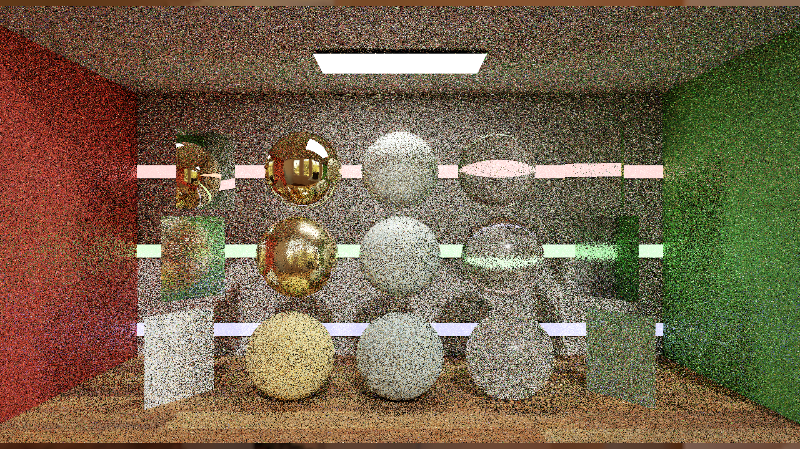
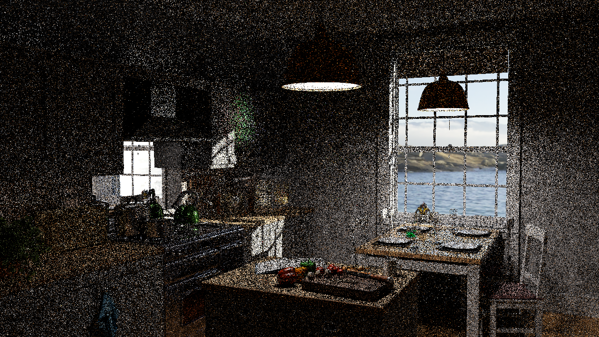

# B10 development: Gaussian reciprocal pairing on the GPU

**Newer checkpoint:** [272-frame replay-queue history validation](B10_QUEUE_HISTORY.md) preserves queued history and retains earlier failures. Full B10 remains partial; [B11 integration](B11_INTEGRATION.md) is pending.

Three Gaussian-scale reciprocal tables now execute on the GPU, with frame-wide integer flips, rotations and offsets. The renderer selects **one table per frame** and retains the existing one-neighbor pair-MIS/vector estimator. This extends the [adjacent-pair pilot](B10_PAIRED_PILOT.md); it does not implement simultaneous three-neighbor reuse or complete PT++. Brightness work remains deferred.

## Implementation and controls

`--ptGaussianPairingValidation true` requires the explicit paired-spatial development path. The previous adjacent policy remains the default/control. Table-policy changes invalidate PT history and recreate the corresponding resources. Original scenes, materials, baseline refs and submodules are unchanged.

The application independently implements the [PT++ paper's section3 link-shuffle construction](https://cwyman.org/papers/i3d26_ReSTIRPT++.pdf): duplicated link IDs, alternating offset2×2 shuffles, race-free CPU pair resolution and signed periodic offsets. Its three deterministic tables have sizes254,230 and210, with declaredσ16. They use `RG32_SINT`, eight bytes per entry, totaling **1,292,128 bytes**. The inactive legacy/adjacent path binds an eight-byte dummy resource. This is not the paper's compact16-bit storage; packing remains a separate optimization.

| Table size | Entries | Measured RMS x | Measured RMS y | Mean radial distance |
|---|---:|---:|---:|---:|
| 254 | 64,516 | 15.904 | 16.052 | 20.020 |
| 230 | 52,900 | 15.949 | 15.868 | 19.909 |
| 210 | 44,100 | 16.015 | 16.155 | 20.164 |

These are finite generated-table moments, consistent with the declared scale, not a formal statistical proof of normality. A native C++ fixture tests the actual producer, deterministic bytes, reciprocal/non-self links and radial bounds. An independent NumPy validator checks the payload and matrix-conjugated frame transforms, including negative coordinates and tile seams. An adjacent-table negative control fails the Gaussian-scale gate.

The shader uses the **same global transform for every pixel in a frame**, then applies its inverse after table lookup. It preserves reciprocity across periodic tiles. Out-of-view links retain the original pixel estimate; they are not clamped into other pairs. Pair ownership now uses the full linear pixel index, allowing partners on different rows. The disabled policy has an explicit branch around table access, protecting the dummy-resource control path. Final captures exercise both policies; the Gaussian packed PT state is byte-identical before/after this guard at the same frame index. Separate-process HDR totals differ beginning at DI, so this does not establish whole-image equality. Cohort and final-guard source/cache identities are archived separately.

## GPU and boundary gates

GPU readback of all three tables is byte-identical to the native producer in every diagnostic run: SHA256 `661e8fddc377bef59f419be9377492473b27aef082af943e630b9cc2652f00dc`. The shader also checks reverse links and records nonlocal pair use, proving that the new policy executes rather than retaining adjacent offsets.

| Diagnostic | Resolution | Material-compatible pairs | Fallback pixels | Directed shifts |
|---|---|---:|---:|---:|
| Odd-height room | 176×91 | 1,161 | 13,694 | 1,319 |
| Room cap1 | 640×360 | 44,530 | 141,340 | 0 |
| Room cap2 | 640×360 | 44,530 | 141,340 | 0 |
| Room cap4 | 640×360 | 44,837 | 140,726 | 49,123 |
| Original Convergence | 1280×720 | 310,275 | 301,050 | 244,410 |
| Original Kitchen | 1280×720 | 280,570 | 360,460 | 41,042 |
| Room, temporal + limited PT++ | 640×360 | 44,837 | 140,726 | 88,829 |

All seven diagnostics have zero reverse-link failures and zero nonfinite vector/positive-weight reservoir outputs. Every output pixel is accounted for by **2×pairs + fallback pixels**; directed shifts never exceed two per eligible pair. Empty sources require no trace. Positive-weight PT paths retain light-inclusive length≥4, and cap1/2 PT-long output remains exactly zero.

The combined temporal/footprint/0.8-survival run recorded210,046 initial roulette tests and zero replay roulette tests. The first odd-height run measured6,384 nonlocal in-view pairs and a maximum squared link distance4,360. These are work/activation counters, not GPU timings.

GI remains initial-only. The original scenes use their original14/2 total/diffuse limits under the existing full-prefix replay guard. The room uses cap4/4. All diagnostics retain raw same-frame component captures locally.

## Quality: mixed result, not promoted

Two64-frame **640×360** room sequences compare adjacent versus Gaussian pairing under the same one-neighbor/vector-shading configuration, DI initial sampling, GI-short initial sampling and PT spatial-only reuse. The native reference is2048spp at cap4/4. These are single sequences without independent process/seed replication.

| Policy | Mean frame linear RGB MSE | Mean frame HDR-FLIP | Mean frame display-FLIP | MSE of64-frame mean |
|---|---:|---:|---:|---:|
| Adjacent reciprocal pair | 0.0393616 | 0.160266 | 0.098267 | 0.000494731 |
| One transformed Gaussian table per frame | 0.0412007 | 0.159373 | 0.096257 | 0.000521918 |

Gaussian pairing raises mean frame RGB MSE by about **4.7%**, while the two FLIP measures decrease slightly. It remains an experimental tradeoff. Broader links also encounter more surface/boundary rejection; this cohort does not establish their causal contribution. The paper's simultaneous multiple-neighbor configuration is still absent, and no general quality or speed improvement is inferred.

The following original-resolution captures are single1spp images after eight warm-up frames, **not accumulated8spp** and not temporal-reuse results:

| Scene | Linear RGB MSE | HDR-FLIP | Display-FLIP |
|---|---:|---:|---:|
| Convergence | 2.95359 | 0.536508 | 0.351035 |
| Kitchen | 0.899919 | 0.752397 | 0.406308 |

They use the preserved4096-spp native references with matching scene hashes, dimensions, exposure and14/2 budgets. Their substantial remaining error is visible; they are development coverage, not scene acceptance or a bias/convergence proof. No brightness adjustment is applied.

Official `flip-evaluator1.7` computes raw HDR and actual renderer-PNG metrics. Each reference fixes its own ppd67/ACES exposure sweep once for all associated candidates; display-FLIP uses sRGB/ppd67. Per-frame hashes, evaluator identity and fixed parameters are retained. These640×360 results are a new cohort and must not be numerically merged with the earlier176×90 pilot.

| Room640×360 | Original Convergence1280×720 | Original Kitchen1280×720 |
|---|---|---|
|  |  |  |

## Remaining implementation and comparison work

Explicit replay compaction is next: preserve cheap-shift work, compact actual pixel–neighbor replay requests, retain capacity/overflow handling, dispatch the compacted queue, and compare complete output/history against the direct schedule under identical inputs. All passes, barriers and queues must count toward performance and memory.

Also pending: simultaneous multi-neighbor paired reuse, unified primary direct/indirect ownership, duplication-map production, dual-motion recovery and general secondary-radiance reevaluation for GI reuse. Full B8/B9/B10 acceptance still needs replicated quality, motion/reset tests, convergence/equal-time comparisons and accepted total-frame timing.

Application cap receipts show vsync, limiter, reflex cap and frame generation off. The subsequent timing cohort below verifies driver/RTSS cap boundaries; it measures process GPU busy/cadence, not complete GPU critical-path latency or FPS. Table-generation time, shader work counters and capture duration are not substituted for it.

## Summary and lessons learned

Reciprocity survived native generation, GPU upload, frame transforms, tile boundaries and full-resolution scene dispatch. The one-neighbor room result demonstrates why MSE and perceptual metrics must both remain visible: the new policy trades them rather than uniformly improving quality. Preserve the adjacent control and isolate scheduling next, before attributing any performance gain to Gaussian pairing or full PT++.

[Sanitized evidence and reproduction](../../Benchmarks/development/2026-10-29-gaussian-pairing/README.md) includes table bytes, source/executable identities, GPU counters, selected raw HDR, official metrics and exclusions. Large reservoir snapshots/raw sequences remain locally retained with hashes. The final identity is post-cohort; this is not represented as a pre-frozen timing experiment.

The bounded Release build, native CTest fixture and **211 Python tests** pass. These checks do not establish full PT++ or canonical acceptance.

## Frozen adjacent versus Gaussian timing

The fresh cohort uses three process repetitions per policy and required scene,45seconds warmup plus30seconds measurement, with no image capture scheduled. Policy order alternates adjacent/Gaussian, Gaussian/adjacent, adjacent/Gaussian. All18runs pass source/executable/682shader-cache identity, process-filtered trace completeness, no reported trace loss, zero image writes, application/NVIDIA/RTSS cap boundaries and verified restoration after every process. Source1f64042 and executable90e6dafa remain fixed throughout.

|Scene|Adjacent GPU busy ms|Gaussian GPU busy ms|Change|Adjacent CPU cadence ms|Gaussian CPU cadence ms|
|---|---:|---:|---:|---:|---:|
|opaque-room|1.5873|1.5915|+0.27%|1.6524|1.6623|
|convergence|7.2950|7.1838|-1.52%|7.2683|7.2136|
|kitchen|8.4429|8.2623|-2.14%|8.4238|8.2345|

GPU busy is time with at least one target-process GPU engine active; CPU cadence is the interval between CPU frame starts. Neither inverse GPU busy nor displayed-frame cadence is renderer FPS. Last600 Original/NotSet process/swapchain rows are selected and final16 excluded. Per-run medians and bootstrap ranges are retained in the comparison JSON; three process repeats are exploratory. Room and Convergence process-median ranges overlap. Kitchen shows a lower Gaussian median in this cohort, but neither its small timing difference nor the mixed room MSE/FLIP tradeoff establishes a general or equal-quality speedup.

Both policies use one spatial neighbor, DI initial sampling, GI-short initial sampling and spatial PT-long reuse, seed47, strict DI/exact NEE MIS, MIP0, no AA/denoiser/cache. Room is640x360,4/4; original Convergence/Kitchen1280x720,14/2, exposure0/2. Full GI reuse, simultaneous multiple neighbors and replay compaction are absent.

The timing harness now schedules no capture for uncapped runs, using the existing unfocused-render guard. This avoids the repaired static capture clock reaching a scheduled image during a long measurement. The prior compatibility path remains explicit for frozen older builds. The availability probe and earlier no-event attempts are excluded from timing statistics.

[Timing evidence, complete traces and sanitized receipts](../../Benchmarks/development/2026-10-29-gaussian-timing/README.md). Original-scene adjacent quality snapshots now accompany the retained Gaussian snapshots; both are single1spp images after eight warm-up frames, not eight accumulated samples or replicated scene acceptance.

|Original scene|Adjacent linear MSE|Gaussian linear MSE|Adjacent HDR-FLIP|Gaussian HDR-FLIP|Adjacent display-FLIP|Gaussian display-FLIP|
|---|---:|---:|---:|---:|---:|---:|
|convergence|2.67638|2.95359|0.532309|0.536508|0.350750|0.351035|
|kitchen|0.72231|0.899919|0.748246|0.752397|0.406818|0.406308|

These original-scene quality rows use the same finite references and fixed reference-only HDR-FLIP parameters. Process acquisition and warm-up remain distinct from the steady-state timing windows. No brightness correction or acceptance waiver is applied.

### Original-scene pairing pictures — same settings

Each picture is one1spp image after eight warm-up frames;1280x720, original14/2 budgets, identical finite-reference/metric settings. These are development snapshots, not independent quality repetitions or equal-time results.

|Scene|Adjacent pair/vector|Gaussian pair/vector|
|---|---|---|
|Convergence|||
|Kitchen|||

## Replay compaction — active implementation checkpoint

The opt-in one-neighbor spatial replay queue now passes11captured-frame GPU oracles, including Convergence244654replays and Kitchen41032replays. Every packed-history word and vector-radiance bit matches its same-frame direct control. Native and direct-pair queue-disabled regressions pass. Queue performance, queue-only temporal-history sequences and full B10 acceptance remain pending.

The prototype classifies each eligible directed spatial shift once, executes cheap reconnections directly, enqueues actual random-replay sources and dispatches the compacted list indirectly. One source request per pixel bounds capacity; unexpected overflow evaluates a direct fallback and fails validation. The two directed shifts remain shared by both paired outputs. This is the one-neighbor spatial increment; temporal compaction and simultaneous multiple-neighbor reuse remain pending.

|Case|Resolution|Compared pixels|Replay requests|Cheap shifts|Packed / RGB mismatches|
|---|---:|---:|---:|---:|---|
|room-first|176x90|15840|0|4484|0 / 0|
|room-h8|176x90|15840|0|4554|0 / 0|
|zero-cap1|176x90|15840|0|0|0 / 0|
|zero-cap2|176x90|15840|0|0|0 / 0|
|odd-edge|177x91|16107|0|4594|0 / 0|
|tiny-edge|177x3|531|0|1|0 / 0|
|gaussian|176x90|15840|0|1332|0 / 0|
|temporal|176x90|15840|0|7809|0 / 0|
|roulette|176x90|15840|148|2047|0 / 0|
|convergence|1280x720|921600|244654|0|0 / 0|
|kitchen|1280x720|921600|41032|0|0 / 0|

**Scope:** these are exact same-frame, last-captured-frame snapshots over immutable input/frame/RNG, not a proof for every warmup frame or an independent queue-only history sequence. The diagnostic control overwrites the final history after comparison; persistent error accumulation and independent multi-frame histories remain a required next gate. All16packed32-bit words and three RGB bit patterns are compared with no epsilon or word mask. Raw captured RGB is finite/nonnegative. Captures execute the diagnostic control and cannot supply queue performance.

Declared temporary payload is104Nbytes for unpacked shifted reservoirs,4Nbytes for source indices,76Nbytes for the diagnostic oracle and48bytes for control/indirect arguments:184N+48bytes, about161.72MiB at1280x720. The oracle buffer remains allocated in this prototype even with diagnostics off. These are buffer payloads, excluding placement/alignment, existing histories and readback; renderer-exclusive VRAM is not measured. Ordinary history retains the64-byte ABI.

**Shared metadata policy:** absent zero-length/zero-weight/zero-target path normals use a deterministic placeholder while preserving M. Hybrid spatial shifts never change the reconnection normal, so both schedules preserve its original encoded source bits instead of normalizing/re-quantizing it through different shader contraction boundaries. This shared policy is separate from queue scheduling and differs from historical1f64042 history encoding. The old timing/quality cohort remains untouched; no old/new image-equality or queue speedup is inferred. Brightness normalization is not applied.

The strict gate exposed and retained: initial UAV60/61 overlap with native GI (fixed by free22–26);163absent-path normal mismatches; a5pixel window request silently expanded to176pixels (rejected and replaced by177x3); rare one-unit snorm history differences; and a rejected precise-arithmetic experiment that propagated into transport. The [Microsoft precise-variable rules](https://learn.microsoft.com/en-us/windows/win32/direct3dhlsl/dx-graphics-hlsl-variable-syntax) explain why arithmetic restrictions can affect upstream computations. No precise-arithmetic transport change was retained.

[Sanitized evidence, rejected-attempt counters, complete source overlay and reproduction](../../Benchmarks/development/2026-10-29-replay-queue/README.md). The portable11-case GPU runner ships in Benchmarks/tools/run_replay_queue_oracles.py. Post-cohort source/executable/cache identities are retained; this is not a pre-frozen timing experiment.

## Remaining B10 work after this checkpoint

Next: queue-only multi-frame/warmup error tracking, cap-verified queue/direct performance and memory, then multi-neighbor reuse and temporal scheduling. Full GI reuse, unified primary DI/indirect reservoirs, duplication-map production, dual-motion recovery and complete micro-optimization/equal-time/convergence validation remain pending. B8/B9/B10 remain unpromoted.
