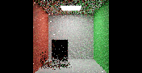
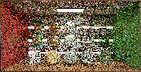
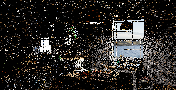

# B10 development: GPU reciprocal pairs and vector shading

**Retained adjacent-pair checkpoint.** The subsequent [Gaussian GPU implementation](B10_GAUSSIAN_PAIRING.md) adds resident tables, frame transforms and larger-resolution diagnostics. The measurements and remaining-work list here describe this earlier checkpoint.

The first B10 GPU pilot now executes **pair-owned reciprocal spatial shifts and separate vector-weight shading**. It builds on the disjoint initial-GI/PT-long foundation. It is a partial development implementation, not full PT++ or canonical B10 acceptance. Brightness work remains deferred.

## Implemented scope

Each adjacent reciprocal pair reads immutable source reservoirs, evaluates A→B and B→A once, and shares both results when producing the two destination estimates. Pair-MIS uses source target values, source sample counts and the two directed shift Jacobians. The Jacobians belong to different sampled paths; the implementation does not assume they are reciprocals.

The scalar reservoir still selects one history path. A separate RGB sum marginalizes that index choice for final shading, using the evaluated pair candidates and their MIS/shift weights. This is the section6.3 vector-weight mechanism over this two-candidate pilot. The finite CPU oracle checks its conditional selection mean independently.

The pilot uses **one adjacent paired neighbor**, not the paper's multiple Gaussian pairing textures. Normal/depth/material compatibility must pass in both directions. Invalid or incomplete pairs retain the appropriate original estimate. An out-of-view neighbor is never clamped into a different pair.

The inactive CGNS neighbor buffer has an explicit development-only scratch alias for vector output. Simultaneous CGNS storage is rejected. Its existing capacity covers four uints per reservoir; a UAV barrier separates spatial writes from final shading. Host guards require spatial reuse, one ordinary/boosted neighbor, and different input/output reservoir arrays. The flag also changes the PT history contract, preventing reuse of history from a different estimator.

## GPU evidence

All captures here are actual **176×90** development images. They preserve original scene materials/cameras, including the original Convergence/Kitchen14/2 total/diffuse budgets under the existing explicit full-prefix replay guard. The registered room uses cap4/4. These checks do not establish full-scene correctness or original-resolution acceptance.

| Capture | Eligible pairs | Fallback pixels | Directed source shifts | Output pixels |
|---|---:|---:|---:|---:|
| Room, cap1 | 4,067 | 7,706 | 0 | 15,840 |
| Room, cap2 | 4,067 | 7,706 | 0 | 15,840 |
| Room, cap4 | 4,067 | 7,706 | 4,554 | 15,840 |
| Original Convergence | 6,151 | 3,538 | 4,792 | 15,840 |
| Original Kitchen | 6,022 | 3,796 | 855 | 15,840 |
| Room, temporal + limited PT++ | 4,067 | 7,706 | 7,757 | 15,840 |

Every row satisfies **2×pairs + fallback pixels = output pixels**, and issued shifts never exceed two per eligible pair. Empty/zero-weight sources require no shift. All vector outputs and stored positive-weight reservoir targets/weights are finite; positive-weight PT paths retain light-inclusive length≥4. The cap1/2 PT-long output remains zero.

The temporal/limited combination used DI/PT combined reuse, footprint reconnection and0.8 roulette survival. Its captured frame recorded13,243 initial roulette tests and **zero replay roulette tests**. A final build additionally exercised the runtime scratch/mode/input-output guards.

The captured vector output differs from the selected scalar reservoir's RGB at thousands of pixels, confirming that the separate shading path executes. This activation difference is not a transport-mean proof.

| Room pair/vector pilot | Original Convergence development | Original Kitchen development |
|---|---|---|
|  |  |  |

## Preliminary quality comparison

Each configuration has one64-frame room sequence against a native2048-spp cap4/4 reference. Both use DI initial sampling, GI-short initial sampling, PT spatial reuse, one spatial neighbor and no temporal reuse. The pilot changes both neighbor policy and shading marginalization; this table does not isolate their individual effects or control total runtime.

| Configuration | Mean frame linear RGB MSE | Mean frame HDR-FLIP | Mean frame display-FLIP | MSE of64-frame mean |
|---|---:|---:|---:|---:|
| Random spatial neighbor + selected scalar shading | 0.0382035 | 0.160276 | 0.092404 | 0.000520690 |
| Adjacent reciprocal pair + vector shading | 0.0357071 | 0.157753 | 0.092361 | 0.000482357 |

Official `flip-evaluator1.7` evaluated raw HDR and actual renderer PNGs. HDR uses ppd67 and ACES with exposure bounds computed once from the reference and then fixed for both configurations. Display-FLIP uses ppd67 and sRGB input. No external brightness fit or correction is applied. Per-frame hashes/metrics, fixed parameters and evaluator identity are retained in the evidence.

These low-resolution, single-sequence values do not establish a general quality gain, unbiasedness, convergence rate or speedup. Required independent seeds/processes, higher-resolution references, moving/disoccluded scenes, equal-time/error comparisons, memory accounting and accepted uncapped total GPU timing remain pending. App caps were disabled; no new presentation timing is accepted here.

## Remaining full B10 work

- Upload/use multiple Gaussian reciprocal pairing textures and verify their finite-image/frame transforms. The current CPU texture constructor is a prerequisite, not an active GPU texture path.
- Explicit replay compaction: real pixel–neighbor work queues, capacity/overflow behavior, cheap-shift preservation, scheduling, dependencies and barriers. The current kernel calls shifts directly.
- Unified primary direct/indirect reservoirs with revised ownership and delta/light-measure tests. Separate DI is still active here.
- Real duplication-map production and separately labelled biased history reduction.
- True surface/occluder dual-motion recovery with moving-geometry tests.
- General secondary-radiance reevaluation for GI reuse, complete B8/B9 validation, and controlled full PT++ comparisons.

Runtime packing and forced terminal NEE reconnection remain inherited features. This pilot does not relabel them as new B10 work. The broader [remaining PT++ plan](B4_IMPLEMENTATION.md) and [B8 partition design](B8_PARTITION_DESIGN.md) retain their individual gates.

## Evidence

[Sanitized paired/vector evidence](../../Benchmarks/development/2026-10-29-b10-paired-vector-pilot/README.md) includes raw component captures, packed reservoirs, GPU counters, two64-frame aggregates, official FLIP results and executable/source identities. Earlier executable phases retain their own hashes; the final snapshot is explicitly post-cohort. The final guard capture uses the final executable.

The Release build and **204 Python tests** pass. GPU ownership/finite checks and reference comparisons are separate evidence from the CPU oracle tests. No submodule, original scene, baseline ref or historical numeric result changes.
