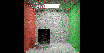
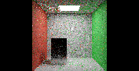
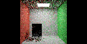
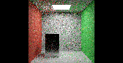
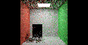
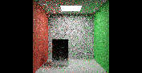

# B10 unified lighting: paper correspondence and estimator gates

## Summary and lessons learned

The remaining unification work follows PT++ §6.1 and the authors' supplement, especially §§1 and5. An independent exact finite-domain oracle now passes eight tests for RIS/NEE MIS and conversion to primary sample space. **Those tests are mathematical prerequisites. The restricted finite-light GPU pilot below is separate and is not a full B10 result.**

The paper's full target uses one PT reservoir over direct and indirect path lengths. Accordingly, the paper-native B10 preset must let unified PT own primary direct lighting and all indirect paths, replacing standalone DI/GI resampling and shading passes. The existing B8 short-GI/long-PT split remains a preserved control. Retaining short-GI separately while merging only direct and long-PT paths would be a hybrid adaptation, and must be labelled as such rather than called a complete reproduction of §6.1. The user-confirmed B10/B11 numbering stays unchanged.

## Primary sources

- [PT++ paper](https://cwyman.org/papers/i3d26_ReSTIRPT++.pdf), §6.1: include primary-surface NEE in the initial path tree and allow a direct path to win initial resampling.
- [Authors' supplementary document](https://research.nvidia.com/labs/rtr/publication/lin2026restirptenhanced/lin2026restirptenhanced_supplemental.pdf), §§1 and5: lobe-indexed PSS, multi-candidate NEE MIS and UCW conversion. The privately cached supplement has13pages and SHA256 `6c43cf0d8cc01d0352a85800c00477ad3179fa9d5ab78dc217dfb23408e650b5`.
- Pinned NVIDIA runtime `PT/InitialSamplingPathTracerContext.hlsli`, `PT/InitialSampling.hlsli`, `PT/HybridShift.hlsli` and the SDK shader/application bridge documentation define the integration interfaces. Presence of those interfaces does not establish application-side unification.

## Finite multi-candidate RIS/PSS integration — 2026-10-30

A new opt-in mode now implements PT++ supplement §5 for **uniform finite-light RIS**: multiple NEE candidates, the complementary M-sample BSDF/NEE MIS weights, and explicit RIS-to-PSS UCW conversion. It keeps the hypothetical single-sample PSS target separate from the unknown RIS-selected distribution. Direct and indirect paths still compete in one PT reservoir; standalone DI/GI shading remains off. This is a restricted B10 integration, not full PT++ acceptance.

For N indexed lights, define the uniform index mass p=1/N. The conditional light sampler's solid-angle density converts the reflected lighting contribution to square-UV measure. RIS uses an unshadowed target and traces visibility only for its selected light. If its returned weight in index/UV measure is W_RIS, the explicit PSS weight is W_U=W_RIS p. The initial weighted estimate is the single-proposal PSS integrand times W_U; the SDK target-removal parameter receives 1/W_U, not an invented RIS-selected PDF. Both NEE and BSDF-hit MIS weights use the actual candidate count M. M is the number of light proposals per vertex, not paths per pixel or spp.

The application adapter preserves prefix random numbers and the terminal light's square UV. In this **full-prefix, fixed-light-domain PSS mode**, the terminal shift therefore has unit PSS Jacobian. The legacy M1 mixed-measure control keeps its existing SDK Jacobian. This is a parameterization change scoped to the new mode, not a clamp, an exposure adjustment or a claim that the earlier mid-path issue is fixed. Animated/changing light domains and general mid-path reconnection are outside this checkpoint.

### Focused GPU evidence

Six source/executable-checked static Room snapshots use177×91,4/4bounces,seed47 and8warmupframes. M=4 exercises all reuse modes; M=1 checks no reuse and combined temporal/spatial reuse in the new PSS parameterization.

|NEE candidates|Reuse mode|Initial BSDF-hit paths|Initial NEE paths|Final positive-age pixels|Identity checks / failures|
|---:|---|---:|---:|---:|---:|
|1|None|137|7,740|0|7,877 / 0|
|1|Temporal + spatial|137|7,740|7,636|7,877 / 0|
|4|None|45|8,049|0|8,094 / 0|
|4|Temporal|45|8,049|7,595|8,094 / 0|
|4|Spatial|45|8,049|0|8,094 / 0|
|4|Temporal + spatial|45|8,049|7,624|8,094 / 0|

All48,130same-pixel target×Jacobian checks pass at the unchanged1%relative AND1e-4absolute failure threshold; packed state and raw HDR are finite. Readback confirms M=1 selected PSS weights lie within1.2e-7of one. M=4 weights range from approximately0.25to15.504, with8,022of8,049selected terminal-NEE weights differing from one by more than1e-3. These are selected-sample diagnostics; their average is not an unbiasedness or quality test. The unchanged64-byte reservoir stores this diagnostic value in terminal-NEE `rcWiPdf`, which the pinned SDK reads only for mid-path footprint inversion; that path is excluded here.

The prior mixed-measure M1 control's raw HDR remains bit-identical in one matched mode0 capture, and default-off capture passes. Missing required replay is rejected by native execution with an explicit receipt and zero images.266tooltests pass. An independent exact receiver-change calculation returns the expected integral21for M=1–4; omitting UCW conversion yields63, while applying an extra solid-angle Jacobian yields47.5. Those numbers are calculated checks, not GPU measurements.

|M=1 PSS mode: combined reuse|M=4 PSS RIS: combined reuse|
|---|---|
|||

These tiny diagnostic snapshots include readback overhead and share a seed. They are not a convergence cohort or an eligible performance comparison. No quality gain, unbiased-mean result, speedup or memory saving is claimed. Original Convergence/Kitchen, multiple seeds, equal-time/error curves, uncapped timings and motion/reset/resize remain pending for this mode. No brightness fitting was used.

### Use and remaining work

Run `Benchmarks/tools/run_unified_ris_validation.py --exe bin/Rtxpt.exe --output <new-directory> --candidates 4`. Native flags are `--ptUnifiedMISValidation true --ptUnifiedRISCandidates 4`, with explicit full-prefix replay and fixed-threshold mode. The wrapper flag is `--pt-unified-ris-candidates 4`;1–32is supported, while0preserves the earlier M1 control. The runner freezes animations. Candidate count and parameterization changes reset history. Shared constant-buffer size and reservoir ABI remain unchanged.

The current preset excludes environment/infinite-light transport, transmission/binding diffuse budgets and composition with B8/pair/queue/duplication/roulette adaptations. **Next integration priorities are environment MIS and composition with the remaining PT++ mechanisms**, followed by dual motion and broader queue/scene support. Full B10 stays partial; B11 stays inactive. The earlier M1 and NEE-only evidence below remains preserved with its original identities.

[GPU results, source overlay and controls](../../Benchmarks/development/2026-10-30-unified-pss-ris/summary.json) · [Exact receiver-change calculation](../../Benchmarks/development/2026-10-30-unified-pss-ris/calculated-receiver-check.json) · [Portable runner](../../Benchmarks/tools/run_unified_ris_validation.py).

## Finite M1 BSDF/NEE MIS integration — 2026-10-30

The next default-off renderer mode now combines continuous BSDF-hit emitters with finite-light NEE in the unified PT reservoir. It follows PT++ §6.1, supplement §§1/5 at **one NEE candidate (M=1)**, and NVIDIA's pinned `RAB_MISCallbacks.hlsli`. The earlier NEE-only pilot remains selectable as a control. Standalone DI/GI shading stays off; native primary emission is retained.

For uniform selection among N finite local lights, the NEE density is the conditional solid-angle PDF divided by N. The light estimate receives the balance weight pNEE/(pNEE+pBSDF); a BSDF-hit triangle receives the complementary weight. Analytic point lights and discrete BSDF connections retain their supported weight-one cases. Triangle reverse lookup uses TLAS InstanceID, separately from the native instance-array index; hit barycentrics are converted back to the light sampler's square UV before evaluating its density.

**Reuse integration matters:** NVIDIA's fixed-threshold terminal-NEE reconnection supplies zero BSDF PDF to its generic MIS callback. The application adapter therefore evaluates the actual marginal BSDF PDF at the reconstructed surface and applies the NEE weight once after light-ID remapping. BSDF-emitter paths use pure PSS replay, with no terminal emitter reconnection; NEE endpoints remain reconnectible. This scoped preset does not solve the earlier mid-path failure.

|Mode|Reuse|Initial selected BSDF-hit paths|Initial selected NEE paths|Final positive-age pixels|Identity tests / failures|
|---|---|---:|---:|---:|---:|
|0|None|125|7,748|0|7,873 / 0|
|1|Temporal|125|7,748|7,566|7,873 / 0|
|2|Spatial|125|7,748|0|7,873 / 0|
|3|Temporal + spatial|125|7,748|7,544|7,873 / 0|

The four source/executable-checked Room snapshots use177×91,4/4bounces,seed47 and8warmupframes. All31,492same-pixel target×Jacobian checks pass at unchanged thresholds; packed state and raw HDR are finite. Both path types actually win initial selection. These are diagnostic snapshots with a shared seed, not independent quality trials or a per-frame sequence oracle. No speedup, unbiased-mean or image-quality improvement is claimed.

The NEE-only control's raw HDR matches the retained prior mode0 capture bit for bit in this one scoped case; default-off captures also pass. A direct native invocation missing required replay rejects with an explicit receipt and zero images.261CPU/tooltests pass. This does not establish general historical bit equivalence or address unrelated startup failures.

|No reuse: MIS activation snapshot|Temporal + spatial: MIS activation snapshot|
|---|---|
|||

Run `Benchmarks/tools/run_unified_mis_validation.py --exe bin/Rtxpt.exe --output <new-directory>`. It supplies the new wrapper flag `--pt-unified-mis-validation` (native `--ptUnifiedMISValidation true`), full-prefix replay and fixed-threshold mode. The preset rejects overlap with the NEE-only control, standalone DI/GI, active environment/infinite lights, transmission/binding budgets and B8/pair/queue/roulette adaptations. Raw diagnostic captures include readback overhead; app caps are disabled, but these are not eligible timing tests.

**At this earlier M1 checkpoint, pending integration included** multi-candidate RIS/PSS (now implemented in the restricted mode above), environment-light MIS, broader reconnection and composition with the other PT++ mechanisms, dual motion and general queues. Original Convergence/Kitchen, motion/reset/resize, quality/convergence, memory and uncapped performance comparisons remain pending for this unified mode. No brightness fitting was applied. **B10 stays partial; B11 is inactive.**

[Results, source overlay and reproducibility inputs](../../Benchmarks/development/2026-10-30-unified-finite-mis/summary.json) · [Portable GPU runner](../../Benchmarks/tools/run_unified_mis_validation.py).

## Finite-light unified initial-tree GPU checkpoint — 2026-10-30

An opt-in renderer pilot now includes primary direct NEE and every supported indirect path length in one PT reservoir, with standalone DI/GI shading off. **This is a restricted NEE-only integration prerequisite, not full PT++ MIS or accepted full B10.** It uses exactly one uniformly selected finite local light per vertex and requires explicit full-prefix replay. The earlier eight exact RIS/PSS tests remain separate mathematical prerequisites.

The source/executable-checked matrix uses the owned opaque Room at177×91, cap4/4, seed47 and eight warmup frames before each final-frame readback. Each mode's initial reservoir contains5,031positive-weight direct paths and2,837indirect paths. These are four snapshots with the same initial seed, not independent quality trials or a per-frame history oracle.

|Mode|Reuse|Initial direct paths|Initial indirect paths|Final positive-age valid pixels|Identity tests / failures|
|---|---|---:|---:|---:|---:|
|0|None|5,031|2,837|0|7,868 / 0|
|1|Temporal|5,031|2,837|7,563|7,868 / 0|
|2|Spatial|5,031|2,837|0|7,868 / 0|
|3|Temporal + spatial|5,031|2,837|7,496|7,868 / 0|

All31,472same-pixel target/Jacobian checks pass at the existing thresholds; packed M, weights, targets and raw HDR are finite. Native emitted radiance is retained and unified PT adds nonnegative radiance. The default-off capture passes, and a direct native invocation without required replay is rejected with an explicit message and zero images. This does not establish historical bit equivalence, unbiased means, quality improvement or speedup.

|No reuse: activation snapshot|Temporal + spatial: activation snapshot|
|---|---|
|||

These diagnostic pictures include readback overhead and are not a performance/quality comparison. Original Convergence/Kitchen, high-resolution convergence, motion/reset/resize, bias, memory and uncapped timing remain unavailable for this pilot. No brightness fitting is applied.

### Rejected mid-path gate and explicit restrictions

The first finite-light trial allowed fixed-threshold mid-path reconnection. Direct NEE identity checks passed5,031/5,031, but eight of2,837other shifts failed. An expanded readback at pixel56,13 records path length4, reconnection length2, cached partial geometry term3.99748e-14 and identity Jacobian0.00138952. These are observed ill-conditioned terms, not a proven general root cause. No target clamp, Jacobian clamp, masking or relaxed threshold was introduced. The failed captures/counters are retained; the final pilot requires full-prefix replay instead. Mid-path robustness remains an open gate.

The pilot rejects active environment/infinite-light transport, transmission/binding diffuse budgets, interactive use, B8 split/pair/queue adaptations and roulette. Its continuous transport remains NEE-only, with the existing discrete-hit handling; it does not add the paper's complementary continuous BSDF-light samples or multi-candidate RIS/PSS conversion. The newer M1 and finite RIS/PSS modes above extend this preserved NEE-only pilot. Native shader fields named `useReSTIRDI` are used here only to hand primary-light ownership out of native PT; the actual host DI pass stays off and the capture receipt records that distinction.

[GPU results and source identities](../../Benchmarks/development/2026-10-30-unified-finite-nee/summary.json) · [Rejected results](../../Benchmarks/development/2026-10-30-unified-finite-nee/rejected-midpath-results.json) · [Portable validation runner](../../Benchmarks/tools/run_unified_finite_nee_validation.py).

Run the validation tool from the repository with `--exe bin/Rtxpt.exe --output <new-output-directory>`. Its wrapper supplies `--pt-unified-finite-nee-validation`, `--pt-replay-only-validation` and the supported scene/settings. Default renderer behavior is unchanged. Shared DI/GI resource preparation is not yet eliminated, so this is not the final storage/performance implementation either.

## Exact finite-domain prerequisite

For a common path measure, the supplemental multi-candidate MIS weights are

\[
w_{\mathrm{NEE}}(x)=\frac{M p_{\mathrm{NEE}}(x)}{M p_{\mathrm{NEE}}(x)+p_{\mathrm{BSDF}}(x)},\qquad w_{\mathrm{BSDF}}(x)=1-w_{\mathrm{NEE}}(x).
\]

The hypothetical single-sample NEE PDF used by the PSS parameterization is distinct from the RIS-selected sample's actual distribution. The path-space RIS weight converts as

\[
W_{\mathrm{PSS}}(U)=W_{\mathrm{RIS,path}}(\mathcal{X}(U))\,p_{\mathrm{NEE}}(\mathcal{X}(U)).
\]

The oracle exhaustively enumerates candidate streams and reservoir selections using exact rational arithmetic. For a three-element domain with unequal NEE/BSDF probabilities and a nonuniform RIS target, the combined expectation equals the known integral20 for candidate budgets1,2,3 and4. Separate negative controls detect omission of the PSS conversion factor and a one-sided MIS update that leaves the BSDF companion weight unchanged. Other tests cover single-candidate unit PSS weight, the RIS/source-PDF distinction and proposal/target support.

[Calculated oracle results](../../Benchmarks/development/2026-10-30-unified-ris-oracle/results.json) · [Portable implementation](../../Benchmarks/tools/unified_lighting_oracle.py)

This discrete oracle does not validate continuous area/solid-angle transformations, hybrid shift Jacobians, visibility, delta lights/lobes, media, temporal reuse or the GPU. Those are separate required gates. It is not evidence of a rendering quality gain or speedup.

## Renderer integration requirements

| Boundary | Required paper-aligned behavior | Acceptance before activation |
|---|---|---|
| Path ownership | Unified PT covers primary direct and all indirect paths; native emission/delta exceptions are enumerated explicitly | No duplicate or missing contribution when standalone DI/GI shading is disabled; retain the B8 split control |
| Initial RIS | Add primary-surface NEE to the same path-tree selection, including short direct paths | Direct-only analytic/finite-light tests, empty/occluded cases and mixed direct/indirect selection |
| RIS and BSDF MIS | Apply companion weights consistently and preserve the supplement's assumed source PDF and PSS UCW conversion | Exact finite-domain prerequisite plus GPU density/weight instrumentation; finite-area, environment and delta supports tested separately |
| Reuse and reconnection | Short and long selected paths retain correct path type, random replay state, support and Jacobians | Identity shifts, direct/glossy/indirect reconnection, motion and raw-HDR mean checks |
| Storage and scheduling | Remove redundant standalone reservoir work in the unified preset; retain only genuinely reused light-proposal preparation | Actual pass/binding receipts, total cost and memory measurement; no undocumented hidden overlap |
| Comparison | Original Convergence, Kitchen and controlled Room with the actual active algorithm label | Matched convergence/error curves, images, repeated uncapped timing and explicit bias presets |

The currently implemented duplication, pairing and queue pilots do not satisfy this entire table. B11 active CGNS remains a later stage with its own topology and normalization requirements.

Changelog:2026-10-30 — source-grounded full-path ownership target and exact supplemental RIS/PSS prerequisite; no unification renderer activation claimed.
