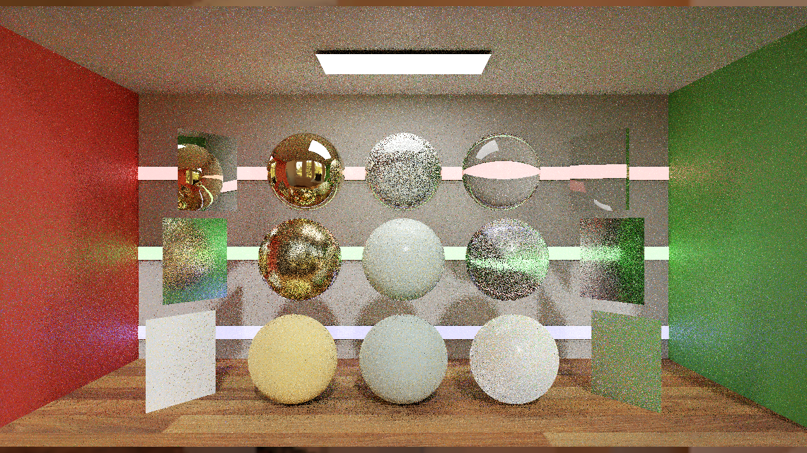
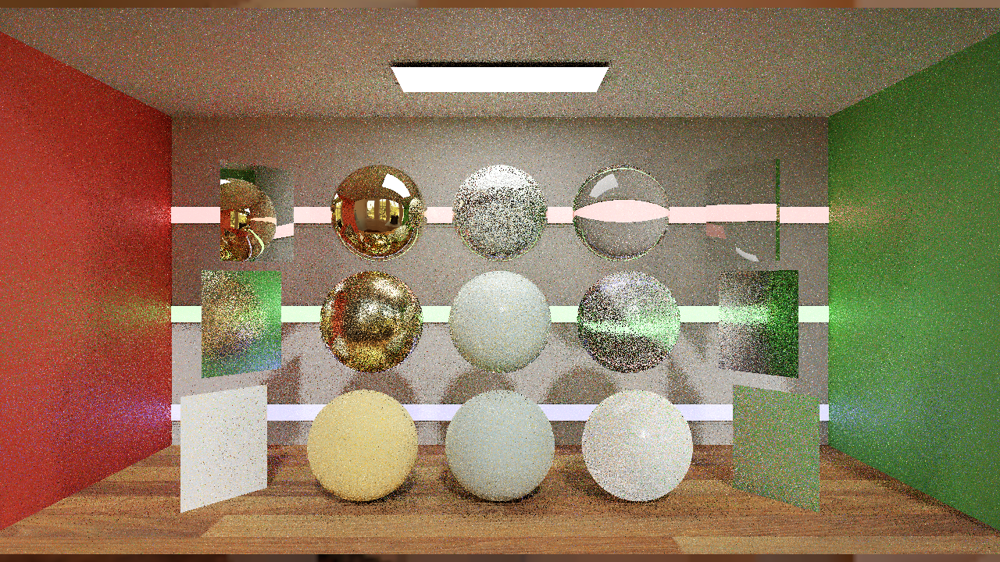
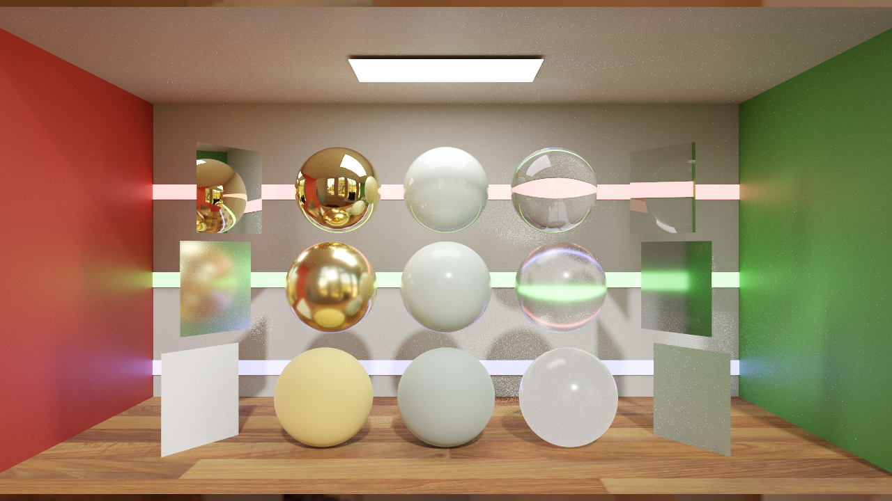
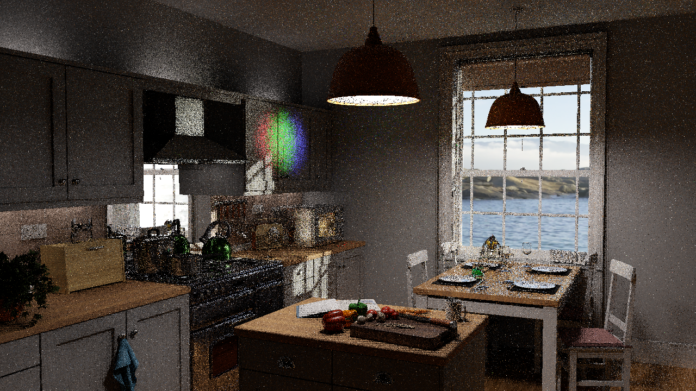
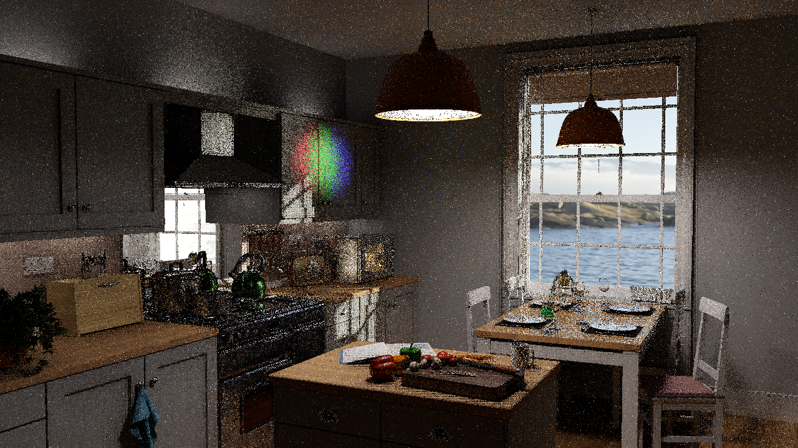
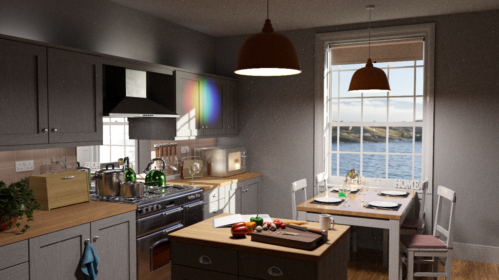

# First B1 comparison: RTXPT1.9 and RTXDI3.1 migration

Measured locally on2026-10-28. This is an initial two-scene comparison of a limited dependency/API migration. It does not reproduce the Wyman papers or demonstrate a new ReSTIR PT pipeline.

## Summary and lessons learned

B1 updates RTXPT's existing DI/GI integration to the RTXDI3.1 runtime. The active DI/GI algorithms remain equivalent under the scoped source audit; new PT++/CGNS capabilities in the reference SDK are not activated. Convergence's five matched process pairs show effectively unchanged GPU active time, with the observed difference well inside across-run variation. Kitchen and display-quality results are measured below. Across-run variation and display-sampling variation remain material; no general quality/performance improvement is established by this migration.

The important measurement lesson was to verify that the renderer continues drawing when unfocused. Upstream static scenes keep scene time at zero, and an active bounded capture can keep rendering without writing PNGs. A completed launch or a partial `perfLog` alone was insufficient. Separately, B0 repeat-image variation was larger than the first B0/B1 image difference; direct image inequality alone cannot identify an integration regression.

## Immutable source and implementation scope

| Version | Root source | Active runtime | Original assets |
|---|---|---|---|
| B0 / RTXPT1.9 | `303b408ab81790a5051abd7573830b7a4112eb8e`, tag `rtxpt-1.9-baseline` | RTXDI3.0 `a14e079c727ed8c4fd3173bd2aea8244c9d9f6d6` | `a56be4ed65029d2733fd02f00f4027ffd541eda8` |
| B1 | `7010bb4cda80788eb13cd9ee6143eb2f52a5b6ee` | RTXDI3.1 `f12037fa8e97ebc08e9e3edfd2de528ed1772a4b` | Same pin |

B1 changes the `External/Rtxdi` gitlink and14 API-name replacements in `Rtxpt/RTXDI/RtxdiPass.cpp`, `RtxdiResources.cpp`, `Rtxpt/SampleUI.cpp` and `AdvancedSampleUI.cpp`. No renderer shader files changed. The scoped audit compared17 active DI/GI files after removing comments/whitespace and explicitly enumerated local-identifier renames. This supports the limited migration interpretation; it is not a correctness or performance proof. Shared Gaussian RNG changed from three to two random draws, but no active RTXPT DI/GI use was found in the inspected path.

B1 does not add a ReSTIR PT application bridge, a PT reservoir lifecycle, a compatible-neighbor pass, reciprocal pairing, replay compaction, guiding, splatting, geometry LoD reuse or BDPT. Those remain separately gated B2+ candidates. The SDK source at `External/RTXDI-SDK` is reference-only.

## Hardware, build and measurement contract

Both versions built successfully in Release with CMake4.1.3, VS2022/MSVC19.44.35222 and the same pinned dependencies. The first B1 parallel build exceeded host commit/pagefile capacity; reducing build concurrency completed successfully. That setup failure is retained separately from accepted rendering runs.

Hardware was NVIDIA GeForce RTX4090 (24564MiB reported), driver617.42, AMD Ryzen7 5800X3D (8cores/16logical),32GB RAM, Windows10 Home10.0.19045. Clocks were observed, not locked. Background GPU applications were present. Whole-device allocation readings include them and cannot establish renderer-exclusive VRAM cost.

The isolated comparison uses original Convergence and Kitchen scenes at1280×720 output and verified internal resolution, static original camera/scene state,1spp, DI+GI on, NEE on/type2, SHaRC off, AA/denoiser off, subsampling off, firefly/post filters off, fixed exposure0/2 respectively. Frame generation is off in the chosen AA0 configuration. This is not the default reconstructed product preset.

Each scene has five process repetitions per version in balanced pair order: B0/B1, B1/B0, B0/B1, B1/B0, B0/B1. Each run has45s wall warmup and15s PresentMon2.6.0 capture. The frozen selection takes the last600 target-process/swapchain rows after dropping the final16. Validation requires zero PNG writes, at least616 valid target rows, actual1280×720 render dimensions, static scene time and enough internal frames to complete the capture guard's warmup.

The guard uses existing active `captureSequence` to keep `ShouldRenderUnfocused` true. The original static scene keeps time at0, so the requested20s capture never writes; the wrapper deliberately terminates its owned renderer after measurement. Do not use this protocol unchanged with animated scenes. `partial-perf.csv` validates state/coverage and is not the headline complete-frame timing.

PresentMon `GPUBusy` is target-process GPU engine active duration, not exclusive DI/GI time, display latency or a complete GPU critical-path profiler trace. CPU frame cadence and `GPUTime` are separate metrics. Observed presentation was DXGI, composed flip, SyncInterval0. The source CSV has no FrameType column; its absence is recorded rather than inferred from it. The representative table reports the median of five run medians. The paired-index bootstrap95% interval uses10000 seeded resamples of five process pairs; correlated per-frame observations are not treated as independent repetitions. The interval is exploratory with only five pairs.

## Initial timing results

| Scene | B0 GPU active ms | B1 GPU active ms | B1 change | Exploratory95% change interval | Interpretation |
|---|---:|---:|---:|---:|---|
| Convergence | 4.4584 | 4.4530 | −0.121% | [−5.775%,+4.968%] | No demonstrated speedup or slowdown |
| Kitchen | 5.3398 | 5.3591 | +0.363% | [-6.893%,+3.318%] | No demonstrated speedup or slowdown |

Secondary timings and whole-device allocation:

| Scene | Version | CPU cadence median ms | GPUTime median ms | Median of GPU active p95s ms | Device memory median MiB (whole GPU) |
|---|---|---:|---:|---:|---:|
| Convergence | B0 | 4.5091 | 4.4621 | 4.9848 | 12800 |
| Convergence | B1 | 4.5559 | 4.4582 | 5.0401 | 12791 |
| Kitchen | B0 | 5.4340 | 5.3444 | 6.6096 | 12303 |
| Kitchen | B1 | 5.4196 | 5.3636 | 5.9579 | 12222 |

Whole-GPU memory includes background applications and is not evidence of a version-specific allocation saving. CPU cadence, GPU busy intervals and display composition remain distinct.

Full run medians, tails, CPU cadence, GPU time and device-wide resource conditions belong to the machine-readable evidence accompanying this report. A GPU active-time ratio is not an equal-quality speedup. No fixed-error or equal-time tuning sweep was performed in this first comparison.

## Display image quality

The capture path exports tonemapped encoded sRGB PNGs. Initial tools evaluate display RGB MSE/PSNR, display-luma SMAPE100 and official LDR-FLIP1.7 at67pixels/degree. These are display-space diagnostics, not HDR-FLIP, linear radiometric RelMSE or an unbiasedness test. High-spp B0 reference captures retain their exact source/settings/hashes; reference mode can differ from real-time mode, and a finite reference is not assumed noise-free.

Five process captures per version/scene were scored against a B0 4096spp reference.

| Scene | Version | Median LDR-FLIP (range) ↓ | Median display MSE ↓ | Median PSNR dB ↑ | Median display SMAPE100 ↓ |
|---|---|---:|---:|---:|---:|
| Convergence | B0 | 0.24355 (0.24295–0.24381) | 0.018572 | 17.311 | 8.9718 |
| Convergence | B1 | 0.24338 (0.24309–0.24384) | 0.018515 | 17.325 | 8.9724 |
| Kitchen | B0 | 0.35210 (0.35175–0.35265) | 0.032208 | 14.920 | 30.1674 |
| Kitchen | B1 | 0.35226 (0.35177–0.35261) | 0.032269 | 14.912 | 30.1520 |

The 2048spp versus4096spp reference LDR-FLIP check was Convergence 0.02761; Kitchen 0.04723. This finite-reference discrepancy is retained as an uncertainty diagnostic, not a convergence proof. Similar ranges are descriptive; no formal independent-seed equivalence test is claimed.

A first Convergence B0/B1 diagnostic gave display MSE0.0113024, while B0 versus another B0 process gave0.0128540. This motivates repeated captures and reference scoring; it does not itself establish equal quality. No general CLI seed selector was verified, so repeated processes are not claimed to be independent Monte Carlo seeds. Temporal metrics, regional disocclusion tests and HDR export remain future work under [Quality metrics](QUALITY_METRICS.md).

## Exclusions and limits

Preserved setup diagnostics include a failed launch with unsuitable working directory, a static-scene sequence that never reached capture time, unfocused no-capture runs that stopped drawing, the interrupted partial timing run, a sandbox-denied profiler retry, and a retry with reported ETW loss from an orphaned task trace. The orphaned trace was stopped; accepted runs report no ETW event loss (absence of a warning is not independent proof of a lossless trace). They are excluded from version summaries by explicit completeness/state rules. A first-use clipped-exposure screenshot is diagnostic only. Accepted runs are not silently selected for favorable values.

This first comparison covers two original static scenes, one GPU, one isolated raw-display preset and a migration-only B1. It does not establish scene-wide performance, temporal quality, cache/reconstruction behavior, renderer-exclusive VRAM, independent-seed confidence or paper-algorithm gains. Next: preserve B1, choose a consequential B2 integration/optimization from profiling, add verified linear-HDR/seed controls and animated tests before stronger estimator or quality claims.

## Inspect the evidence

[Raw timing traces, per-run manifests, quality scores and checksums](https://github.com/BasixMaster/RTXPT_Next/tree/main/Benchmarks/results/2026-10-28-b1) are retained alongside the frozen protocol and portable capture/analysis tools. Images below show repeat1 without selecting for a favorable score. Generated scene captures retain the upstream assets’ applicable terms; see the pinned Assets repository.

### Convergence captures

| RTXPT1.9 / B0 | B1 | B0 reference4096spp |
|---|---|---|
|  |  |  |

### Kitchen captures

| RTXPT1.9 / B0 | B1 | B0 reference4096spp |
|---|---|---|
|  |  |  |

## Later frame-cap audit —2026-10-28

A subsequent read-only RTSS SDK audit found a current global232-FPS cap inherited by `Rtxpt.exe`, with no application-specific profile. This discovery describes the later audit time; no retained RTSS snapshot proves the state during the original B0/B1 runs. Their cap coverage is therefore **historical_unverified**. Preserve the numeric observations as exploratory migration measurements, not verified uncapped performance or maximum-throughput claims. SyncInterval0 did not rule out this external limiter. Future runs require explicit renderer controls, verified NVIDIA driver settings, an RTSS per-application zero-limit override/readback where needed, and restoration evidence. The frozen timing/capture files and their hashes remain unchanged.

The user then disabled the limiter in a user-owned RTXPT application profile. A fresh read-only audit verifies application SDK cap0 and the installed profile's frame/frametime/scanline settings0 while global232 remains unchanged. Future runs preserve that profile and use read-only boundary verification; no RTSS restoration is required or performed. This later correction does not retroactively establish the original runs' cap state.
