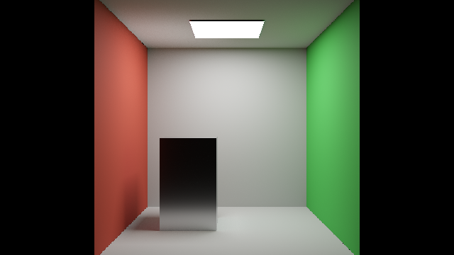
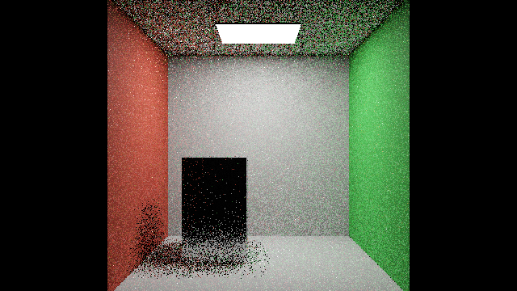
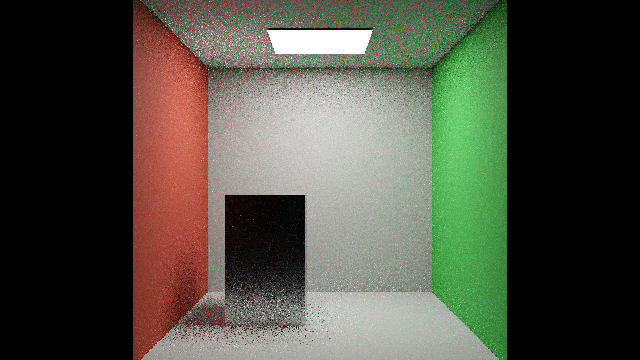

# B2 ReSTIR PT integration and B3 PT++ status

Updated2026-10-28. **B2 is in progress with scoped static opaque GPU quality/timing results; B3 footprint/initial-only roulette activation is in progress on a separate development branch. Neither has a promoted B2/B3 source tag.** See the [current B2 report](B2_RESULTS.md); older sections retain superseded diagnostic checkpoints. The [B1 report](B1_RESULTS.md) remains available locally and on GitHub; its frozen evidence is unchanged.

## Version steps and lighting ownership

| Version | Implementation meaning | Evidence state |

|---|---|---|

| B0 / RTXPT1.9 | Original renderer and scenes, including optional ReSTIR DI/GI | Preserved source tag; initial two-scene measurements |

| B1 | RTXDI3.1 API/runtime migration for existing DI/GI | Built and measured; no ReSTIR PT path |

| B2 | Integrate ReSTIR PT generation, path replay, temporal/spatial reservoirs and shading into RTXPT | In progress; runtime/source presence is not activation |

| B3 | Activate applicable PT++ controls and implement missing paper mechanisms | In progress; see [B3 implementation and ablations](B3_IMPLEMENTATION.md) |

Ordinary path tracing is the underlying transport engine. ReSTIR DI samples direct illumination; ReSTIR GI and ReSTIR PT are different approaches to indirect/path reuse. Keep the existing **ordinary PT + DI + GI** configuration as a control. A new **DI + ReSTIR PT** mode assigns direct lighting to DI and indirect lighting to PT. Making all three methods available does not mean adding overlapping GI and PT estimates together. A GI+PT combined estimator needs a documented partition or valid MIS before it is a supported mode. The eventual unified PT++ reservoir can own both direct and indirect contributions, so separate DI must also be partitioned or weighted correctly.

The staged dependency is: **B0 → B1 → B2 bridge/passes → B2 validation → B3 feature ablations → B3 combined validation**. Retain comparisons to every earlier version. A library update alone cannot supply the renderer-specific callbacks or contribution partition.

## B2 implementation gates

| Gate | State | Acceptance evidence needed |

|---|---|---|

| PT host context/resources and dispatch schedule | In progress | Real PT resources, initial/temporal/spatial/final passes, correct indices/barriers and resize/reset behavior |

| RTXPT application bridge and replay | In progress | Material/light/BSDF/PDF semantics, path-state/RNG replay and valid shift maps using RTXPT scenes |

| Mode selection and lighting ownership | Pending validation | Actual mode exposed in CLI/UI and manifest; unsupported overlaps rejected |

| Shader and renderer build | Pending | Successful relevant shader compilation and Release build, with full failure diagnostics preserved |

| Runtime correctness and quality | Pending | Finite outputs, no double count, history/reset cases, reference checks and raw/reconstructed scope labels |

| Uncapped benchmark controls | In progress | Renderer override exercised; effective settings and driver/external-cap coverage retained |

| B2 versus B0/B1 comparison | Pending | New immutable source identity and matched uncapped timing/quality/memory protocol |

These are acceptance gates, not completion percentages. An interface, resource allocation, synthetic test or research note cannot stand in for an executing estimator. Update each state only from actual evidence.

The initial prototype is restricted to opaque diagnostic transport. Nested-glass replay needs medium-state ownership that is not yet preserved in the PT bridge. The default finite diffuse-bounce budget also cannot be assumed preserved when a reused path's prefix changes, because the donor reservoir does not encode that budget. Use explicitly matched non-binding diffuse caps for diagnostic comparisons until the estimator/state contract is extended; do not label that experiment the default RTXPT20/2-bounce product configuration. These are genuine correctness gates, so no B2 release or default-mode promotion is claimed.

Current source gates require NEE on, raw AA0, denoiser0, pinhole aperture0, total bounce cap1–32 and a diffuse cap at least the total cap. PT selection disables SHaRC, subsampling and PSR and uses one plane. Every loaded material must be opaque or alpha-tested: enabled specular transmission or positive diffuse transmission rejects the scene explicitly. Original Convergence has six transmissive materials, so it is not an eligible prototype benchmark. A separately owned opaque diagnostic scene must retain its own source/configuration identity outside the unchanged Assets submodule.

New diagnostic CLI controls are `--maxBounces`, `--maxDiffuseBounces` and `--restirPTMode`:0 initial-only,1 temporal,2 spatial,3 both. These additions are not present in the original B0/B1 binaries. Passing the new switches to those binaries is not a valid way to claim matched baseline controls. Any alternate validation control must be separately identified and compared at genuinely matching transport settings.

## B3 PT++ feature inventory

RTXDI3.1 already implements a subset of PT++. B2's use of that runtime means some code/layout is inherited; B3 must not count inherited packed reservoirs or forced NEE reconnection as newly invented speedups. Fixed-threshold/footprint, history and roulette configuration must be recorded explicitly. Consult the [reference audit](PTPP_AUDIT.md) for source locators.

| Mechanism | Reference3.1 evidence | B2/B3 treatment |

|---|---|---|

| Footprint and inverse-footprint reconnection | Present | B2 can select the reference baseline policy; B3 activation/ablation must be explicit |

|64-byte packed reservoirs | Present | Inherited layout; include actual allocation, not a new B3 claim |

| Forced NEE reconnection | Present | Inherited runtime behavior; verify RTXPT light identity/PDF mapping |

| Initial-only roulette | Present, optional | Record initial/replay policy; activate only after parity checks |

| Duplication-aware history reduction | Present, configurable and biased | Separate quality/performance mode from correctness/reference controls |

| Reciprocal spatial pairing | Absent in audited path | New B3 implementation plus reciprocal-pair accounting tests |

| Unified direct/indirect reservoirs | Absent in audited Full Sample path | New B3 estimator partition; prove no overlap with separate DI/GI |

| Explicit replay compaction | Absent in audited active schedule | New B3 bounded queues, dispatch/barrier/overflow tests and total cost |

| All-candidate vector-weight shading | Absent in audited path | New B3 RGB estimator/normalization and finite-domain oracle |

| Exact paper dual-motion-vector disocclusion handling | Not verified in audited path | Derive and validate; PSR/zero-motion fallback is not a substitute claim |

| Complete micro-optimization equivalence | Not established | Record individual verified changes; no blanket paper-equivalence claim |

CGNS is a separate paper and an optional neighbor-selection policy supplied by3.1. It does not automatically compose with reciprocal pairing. Unsupported combinations remain disabled until their selection probabilities and weighting are validated.

## Frame-cap contract for future measurements

The source has several independent controls: `EnableVsync`, `FPSLimiter`, Streamline/Reflex `ReflexCappedFps` and frame generation. `FPSLimiter` both limits wall-clock rendering and changes update timestep; `captureSequence`'s simulated FPS controls scene chronology and must not be confused with a throughput cap. The new benchmark override is intended to force VSync off, FPSLimiter0, Reflex cap0/Reflex off, frame generation off and rendering while unfocused. Effective runtime values must be logged and checked; passing a flag is not verification.

NVIDIA driver settings can add foreground/background frame caps or force VSync. An external overlay/limiter may also intervene. Audit the exact executable profile and inherited global settings; if a temporary per-application override is used, retain prior values and restore them after the owned run. Do not silently change global desktop settings. An unavailable query is **unknown**, not proof that caps are off. Do not label a run fully uncapped while required coverage is unknown. Observed PresentMon SyncInterval0 is useful evidence of application presentation, but does not prove every driver/external limiter is disabled.

A later RTSS audit on2026-10-28 found a current232-FPS global limit inherited by `Rtxpt.exe`. This is a real external-cap finding, but it does not prove the historical B1 run-time setting. The installed official RTSS SDK sample requires administrator execution. A non-elevated prototype scope wrote a VirtualStore-only application profile; its zero readback was not accepted as proof that the live elevated RTSS hooks were uncapped. That temporary profile was restored to verified original absence and inherited/global232, with the global file unchanged. New scope code rejects non-administrator mutation and requires an installed-profile readback rather than a VirtualStore-only override. Actual Windows UAC approval/elevated execution is needed before a valid RTSS override test; sandbox escalation alone does not grant it. Instrumentation probes with external cap coverage unresolved remain excluded from uncapped performance claims.

The user subsequently disabled the limit in the **RTXPT application profile**. Fresh read-only verification now finds an installed `Rtxpt.exe` profile with effective SDK cap0 and physical frame/frametime/scanline limits0, overriding the unchanged global232 setting; no VirtualStore application profile is present. This user-owned profile is preserved. No automatic RTSS override or restore is performed. Administrator permission is not needed for this read-only verification path. Future timed runs can collect fresh SDK/physical-profile audits before launch, immediately before measurement and after measurement, bound to the executable/helper/SDK identities and selected profile hash. The authority is recorded as user confirmation plus SDK readback plus physical profile. These checks establish the known RTSS settings at those boundaries; they do not establish a universally limiter-free system.

B0/B1 remain immutable. Their existing runs have observed SyncInterval0 and default source limits, but lack a comprehensive driver/external-cap audit. A new harness facility cannot be retrospectively attributed to those old binaries. Any rerun must declare exactly how each control was disabled/verified without changing the preserved source identity.

## Summary and lessons learned

The requested B2/B3 split separates renderer integration from later algorithm activation and extensions. The critical correctness issue is contribution ownership, not the number of enabled toggles. The critical measurement issue is actual uncapped execution, not a simulated capture rate or an inverse GPU duration advertised as FPS. Current evidence establishes B1 compatibility and initial measurements; B2/B3 gains remain unknown until their real pipelines execute and pass the scoped gates.

## Changelog

-2026-10-28: Adopted user-selected B2 ReSTIR PT / B3 PT++ identities, recorded inherited3.1 mechanisms, mode ownership and future uncapped benchmark requirements. No B2/B3 result is claimed.

-2026-10-28: Recorded the later RTSS232-FPS finding, restored benchmark-only profile, administrator/VirtualStore gate and historical B1 cap uncertainty.

-2026-10-28: User disabled the RTXPT application-profile cap; added read-only effective0/global232 verification and preserved the user-owned profile.

## Implementation source and current validation

B2 uses NVIDIA RTXDI-Library 3.1, pinned at `f12037fa8e97ebc08e9e3edfd2de528ed1772a4b`, through a project-owned RTXPT application bridge. It is not a port of [DQLin/ReSTIR_PT](https://github.com/DQLin/ReSTIR_PT), the Falcor 4.4 implementation accompanying the SIGGRAPH 2022 GRIS paper. The runtime already contains some PT++ mechanisms, so B2 is not an exact 2022 reproduction. B3 must measure additional activations and extensions against this declared B2 configuration.

The two isolated `benchmark-controls-v1` control builds now compile in Release. Each changes exactly five host files and preserves all 164 shader source hashes. All 500 recorded original B0 artifacts and 483 original B1 artifacts remain unchanged. These control builds are separately named and have not yet completed matched GPU comparison runs.

The user configured the installed RTSS `Rtxpt.exe` application profile to 0 FPS. Read-only SDK and physical-profile checks agree; the global profile remains 232 FPS. Preserve the user's application profile. Fresh application, driver and external-limiter evidence is required for measured runs; this does not establish historical cap state.

A raw-output integration issue was identified: the AA0 output copy precedes the native no-denoiser layer merge, while DI/PT final shaders can add directly into OutputColor. B2 now initializes raw native radiance before DI/PT final contributions and skips the later overwrite for this restricted PT path. This change requires renewed GPU validation. Earlier diagnostic images must not establish final B2 quality claims. Original B0/B1 sources and evidence remain unchanged.

Optional `--captureLinearHDR` capture is being wired to store RGB PFM plus format/nonfinite metadata, using OutputColor in raw realtime mode and AccumulatedRadiance in reference mode. Successful CPU writer fixtures do not establish GPU readback correctness. HDR captures are validation work, not timed throughput samples.

### Earlier raw HDR diagnostic, before capture warm-up correction

The updated primary-ownership path and raw merge completed GPU captures in initial-only, temporal-only, spatial-only and combined reuse modes. Each 640×360 RGB image contains 230400 finite pixels with no NaN/Inf. Realtime readback is RGBA16F; the 4096-sample accumulated reference is RGBA32F. The PFM writer preserves stored values without tone mapping or exposure correction. Native continuation and PT now consume the same exported eligibility bit; unsupported primaries retain native continuation. Transmission remains globally gated pending dedicated tests.

| PT mode | Linear RGB MSE | CGNS-style luminance SMAPE ×100 | MAPE RGB / luminance denominator | Project RelMSE |

|---|---:|---:|---:|---:|

| Initial only | 0.188302 | 16.2155 | 0.359267 | 3.10904 |

| Temporal only | 0.188423 | 16.2193 | 0.359347 | 3.10829 |

| Spatial only | 0.179701 | 15.2780 | 0.341168 | 2.74707 |

| Temporal + spatial | 0.179843 | 15.2727 | 0.341392 | 2.74711 |

These are single diagnostic images against a finite-sample reference, not independent-trial improvements or a bias result. Temporal-only being close to initial-only requires history-use investigation; a successful dispatch does not prove useful history. HDR-FLIP and reference uncertainty were not measured at that early checkpoint; later matched-reference results supersede it. Formula/channel/stabilization definitions are in [quality metrics](QUALITY_METRICS.md). All five HDR captures, source-format metadata, PNG previews, metric JSON and byte hashes are retained under `Benchmarks/development/2026-10-28-b2-hdr-diagnostic`.

Release compilation passed after these changes. The benchmark tool suite passes 68 tests, including independent PFM endian/orientation/scale and analytically known metric fixtures. B2 remains a development prototype.

### First cap-verified timing pilot, 2026-10-28

One fresh process per configuration, in B0→B1→B2 order, completed 45 seconds wall-clock warm-up and 15 seconds PresentMon capture. The preregistered selection is the last 600 process/swapchain frames after dropping the final 16. Same owned opaque scene, 640×360, 1 spp, total/diffuse bounce caps 3/3, AA0, denoiser0, cache0. B0/B1 use DI+GI; B2 uses DI+PT with GI disabled. These are different indirect estimators and B2 includes the documented raw merge correction.

| Configuration | Median CPU frame cadence, ms | Median process GPU busy, ms |
|---|---:|---:|
| RTXPT1.9 + benchmark-controls-v1 | 1.48865 | 1.43195 |
| B1 + benchmark-controls-v1 | 1.55880 | 1.46115 |
| B2 development prototype | 1.79205 | 1.75795 |

B2 is slower in this pilot. This is not a statistically established performance difference: there is one process per version, no run-level confidence interval, and fixed run order. A GPU-busy interval is not display FPS or isolated PT-pass cost. This low-resolution scene does not establish performance on the original scene suite. The raw-HDR diagnostic above does not provide a matched B0/B1 HDR quality comparison.

Every accepted run passed effective application cap logging, NVIDIA foreground/background cap0 and forced-off VSync readback, observed SyncInterval0, no reported ETW loss, pre/post source/executable/shader-cache identity, and read-only RTSS boundary audits. RTSS selected the user's installed Rtxpt.exe profile0 over global232; it was never modified. Each temporary exact-executable NVIDIA profile was restored and verified. Other possible external limiters remain outside this known coverage.

An earlier B0 attempt was rejected because the verifier did not recognize the control adapter's distinct effective-settings receipt. It remains excluded; a regression test and fresh v2 runs supplied the accepted evidence. Timing CSV, summaries, public-safe manifests, frozen artifact hashes and restoration receipts are in `Benchmarks/development/2026-10-28-b2-uncapped-pilot`. Original private workspace roots in exported manifests are replaced with `[WORKSPACE]`; original-byte manifest hashes are retained separately.

### Temporal history diagnosis and corrected captures

Packed 64-byte reservoir readback confirmed that the earlier screenshot warm-up cleared PT history on every warm-up frame, including the captured frame: the temporal-only output had M=1 and age=0 throughout. The cause was CaptureScriptManager's per-frame ResetAccumulation flag, which is also a PT history invalidation signal. For active ReSTIR PT, capture warm-up now resets realtime caches once at the start and then allows history to converge; reference and legacy DI/GI capture behavior is preserved. General scene/material/mode invalidation remains active.

New initial, temporal, spatial and combined captures passed with finite HDR output. Temporal-only now has 117591 valid reservoirs with positive age and mean M=8.845; combined output has 118872 with positive age and mean M=14.900. These post-frame snapshots demonstrate stored history participation, not unbiased weighting or a quality guarantee.

| PT mode after correction | Linear RGB MSE | CGNS-style luminance SMAPE ×100 | MAPE RGB / luminance denominator | Project RelMSE |
|---|---:|---:|---:|---:|
| Initial only | 0.188060 | 16.1791 | 0.358352 | 3.10572 |
| Temporal only | 0.088666 | 10.8977 | 0.270062 | 0.620126 |
| Spatial only | 0.179835 | 15.2701 | 0.341140 | 2.74648 |
| Temporal + spatial | 0.084881 | 10.5938 | 0.258321 | 0.401247 |

Use this corrected table for the current screenshot diagnostic. It remains one image per mode against the earlier finite 4096-sample RGBA32F native reference; native reference integration and scene settings are unchanged. It does not establish independent-seed significance or estimator bias. Captures, metric JSON, reservoir summary statistics/ABI metadata and binary hashes are retained under `Benchmarks/development/2026-10-28-b2-history-fixed`. The large reservoir binaries remain in the local workbench. All 536 non-PDB runtime bundle files, renderer source patch and new source files are preserved locally for the current diagnostic checkpoint (executable SHA256 `fab46cf72b416b0797a9b39079c5eb68a280a19d161e9f4603f286cd78b0b11f`).

The timing pilot uses a capture-sequence guard but measures only after 45 seconds wall-clock warm-up, long after its 64-frame reset phase. Its known cap/identity evidence remains intact; it is still an exploratory one-process comparison of the earlier executable. That earlier B2 executable was fingerprinted before/after timing but was not retained before subsequent diagnostic builds; a fully retained repeatable B2 performance checkpoint remains pending. Do not substitute the current diagnostic executable hash for the pilot's recorded hash.

The tool suite passes 68 tests. The reservoir inspector independently checks tiled addressing and the pinned half-precision M/age layout. Raw reservoir capture is diagnostic-only, synchronizes the GPU, and must never be enabled in throughput timing runs.

## Matched-reference failure retained for diagnosis

The earlier raw-HDR tables used a reference with default `AccumulationAA=true`, while realtime AA0 used pixel-center camera rays. They remain methodology diagnostics, not matched camera-domain estimator-accuracy evidence. A new explicit `--referencePixelCenter true` switch disables reference subpixel integration. First-frame `SAMPLING_CONTRACT` logs verify actual seed, mode and pixel-jitter scale. General frame/history indices are unchanged by the new scramble seed.

The validation build adds default-zero `--samplingSeed`, scrambling native camera/BSDF/STF/RTXDI sampling and PT runtime RNG inputs. Seed0 retains the source's original stream construction; whole-renderer bit-exact replay is not established: same-seed separate processes differ. The controlled trials therefore record both distinct seeds and repeated-seed process variation. Packed PT reservoir export is now a separate opt-in `--capturePTReservoirs true` diagnostic, rather than a cost hidden in every HDR capture.

Eight seed trials (0,1,2,3,5,11,23,47), each initial-only and combined reuse, completed against a matched pixel-center native reference. The reference uses8192spp/seed101; separate4096spp/seed101 and8192spp/seed103 checks quantify finite-reference discrepancy. All captures use640×360,1spp realtime, total/diffuse caps3/3, AA0, denoiser0, cache0, fixed exposure0 and no firefly/post filters.

| Diagnostic | Initial only | Temporal + spatial |
|---|---:|---:|
| Median linear RGB MSE, eight seeds |0.109511|0.024737|
| Median official HDR-FLIP |0.232799|0.192335|
| Mean signed whole-frame luminance difference relative to reference |+16.27%|+15.24%|

**This pre-repair checkpoint failed the mean-radiance check.** Lower error after reuse is not sufficient when a persistent brightness discrepancy remains. A direct-only cap1 probe is already bright before PT indirect can contribute; native-vs-DI isolation is in progress. A separate source audit found a light-vertex bounce-budget mismatch that predicts missing, rather than excess, PT suffix light and needs its own correction/test.

Official flip-evaluator1.7 runs locally on stored linear RGB. PPD67 and ACES are explicit project choices, not recovered paper settings. Reference-only calibration selects exposure range[-3.2584834,+4.6571465] and8exposures; the same settings apply to every test. Reference4096 vs8192 RGB MSE is3.69138e-6; the separate8192-seed comparison is7.09672e-6. These finite checks do not prove convergence or unbiasedness.

DI-only raw captures also require the native layer merge before DI additions; the prior late merge overwrote those additions in OutputColor. B2 now uses the explicit raw merge order for realtime AA0 with denoising off, preserving original B0/B1 controls. New `--restirDIMode` and native `--neeMIS` validation overrides isolate initial, temporal and spatial DI against native exact-MIS lighting. PT-only light preparation now includes the configured ReGIR proposal even with primary DI off. These repairs require renewed GPU checks and remain development changes.

## Light-list, path-budget and DI reuse corrections

The matched-reference failure led to a local-light isolation experiment. A deterministic 8×8-per-triangle quadrature using the same reconstructed DI surface produced mean RGB [0.302392,0.301655,0.281082], close to native direct-reference [0.303280,0.302282,0.282504]. Thus the large excess was not explained by a different material model or duplicated native direct lighting. Component readback showed only primary emitter radiance before DI.

The concrete cause was in `PrepareLightsPass`: an allocated environment-map resource was treated as a registered scene light. With no scene environment record, subtracting one from zero infinite lights underflowed; the environment index wrapped into the local triangle list. The correction counts actual records and appends a real synthetic global-environment record when a baked map has no corresponding scene light. This preserves native baked sun/override illumination rather than inferring a light solely from resource allocation. Extra capacity and previous-frame mappings are tracked; skipped primitive records are pruned from temporal mapping.

A first registered-record repair reduced direct-only initial DI mean radiance to within approximately0.3–0.4% of the reference across uniform/power/ReGIR proposals, with and without BRDF candidates. These are diagnostic captures, not a convergence claim. The subsequent synthetic-record build and supported-light variants require their own verification.

Two additional contracts were repaired: geometry-hit light indices now include the current light-buffer region offset, while the power-PDF callback subtracts that offset before indexing its local texture and normalizes by actual texture area. Neither light loading nor temporal translation adds another offset. Native bounce limit B permits the terminal emitter after B scattering surfaces, whereas RTXDI PT counts the light vertex in its path length. Initial and replay PT limits therefore use B+1; this correction is measured separately from the light-list repair.

DI reuse has two additional validation controls. The inherited boiling filter intentionally removes high-weight samples. In pinned runtime `f12037f`, raytraced spatial resampling caches a neighbor before the naïve-sample discount rejects its contribution, but the later normalization pass still counts its mass. B2 now defaults the naïve-neighbor discount off to avoid that normalization defect. `--strictDIValidation true` also disables DI boiling and explicitly keeps the discount off while retaining raytraced bias correction; it does not modify the child runtime or promise unbiased GI. The capture wrapper verifies the effective first-frame receipt. Old default-filter captures remain an explicit ablation.

The corrected release checkpoint is retained locally with source patch and604 non-PDB bundle files (executable SHA256 `662d30e9cc7a18456a98fc0f8c109ffebbd36712d8ea8e6dedafcd9381db6f67`). A30-capture bounce/seed sweep is in progress, followed by strict-DI and distant-light checks. No B2 tag or equal-quality performance claim is issued. Seventy-three benchmark-tool tests pass, including rejected missing scene paths and effective seed/camera/DI receipts.

### Summary and lessons learned

Successful pass dispatch and lower per-image error did not establish transport correctness. Matching pixel integration exposed a real mean-lighting error; component captures and deterministic quadrature then isolated its source. Keep environment records, absolute/local light-index domains, light-vertex budgets and deliberate rejection filters explicit in each result identity. Original B0/B1 evidence remains preserved; the corrected B2 renderer needs fresh quality and timing evidence.

### Corrected 30-capture sweep and strict-DI ablation

Thirty captures completed on the retained corrected checkpoint. The fixed bounce sweep covers native limits1–4, PT-only and DI+PT, initial-only and combined reuse. At limit1, PT adds no indirect term. At limits2–4, initial PT-only whole-frame luminance differs from its matched native reference by approximately−0.48% to−0.51%; DI+PT initial differences are approximately−0.25% to−0.36%. This removes the earlier large brightness error and aligns the path-length domain; it is not proof of an unbiased estimator.

| Eight-seed cap3 diagnostic | Median linear RGB MSE | Median HDR-FLIP | Mean signed luminance difference |
|---|---:|---:|---:|
| Pre-repair initial |0.109511|0.232799|+16.27%|
| Pre-repair reuse |0.024737|0.192335|+15.24%|
| Corrected initial, inherited DI rejection settings |0.042697|0.167899|−0.351%|
| Corrected reuse, inherited DI rejection settings |0.005698|0.132292|−2.939%|
| Corrected initial, strict DI |0.042721|0.167812|−0.349%|
| Corrected reuse, strict DI |0.005637|0.125119|−2.126%|

These are development diagnostics with the same8192spp pixel-center reference and fixed HDR-FLIP settings. The intervals across eight seeds are exploratory; they do not include every source of reference/process uncertainty. Reuse still has a measurable negative mean difference, so a lower MSE/FLIP is not an equal-quality performance result or a B2 promotion.

Strict-DI spatial-only direct lighting now closely tracks initial-only output, confirming the skipped-neighbor normalization problem's practical effect. Temporal reuse retains a smaller deficit. PT-only reused output also darkens with longer paths independently of DI. A replay-only diagnostic is being added to isolate cached view-dependent radiance at mid-path reconnection; its result is pending. A separate producer defect was found in miss export: zero was written to the packed validity word even though bit1 must mark an empty surface. The miss-bit repair needs its own post-build regression; PT already has a separate frame/ownership guard.

Owned procedural-sky and directional-only variants were added alongside the original scene. Initial DI direct-light mean differences are approximately−0.25% and−0.23% respectively versus their matched8192spp native references. The directional-only scene exercises synthetic baked-environment registration without a scene EnvironmentLight. These single captures establish scoped lighting smoke checks, not full original-scene/material/motion coverage. PT cap3 sky/sun captures are finite smoke checks and are not compared to cap1 references.

The earlier uncapped timing pilot on the no-environment room predates this light-list repair. Retain its raw timings and cap receipts as historical execution evidence, but do not interpret it as a comparison of corrected lighting or substitute a new executable under those hashes. Fresh accepted B2 timing remains pending transport validation.

### Inspectable images and evidence

Fixed exposure0, same camera and640×360 output. The realtime images use1spp; the reference uses8192spp. These PNGs are display previews; the metrics above use stored linear PFM radiance. Click a picture to inspect it and press Escape to close.

| Native reference | Strict DI+PT initial, seed0 | Strict DI+PT reuse, seed0 |
|---|---|---|
|  |  |  |

Raw PFM/PNG, effective-setting receipts, public-safe capture manifests, metric JSON, source patches and hashes are retained in `Benchmarks/development/2026-10-28-b2-seeded-validation`, `2026-10-28-b2-corrected-budget`, and `2026-10-28-b2-strict-DI-validation`. In capture IDs, bN means bounce cap N, not a promoted B-version. Exact corrected and strict runtime bundles are retained locally. The strict checkpoint's source patch was reconstructed by removing documented subsequent diagnostic edits because a build-time source snapshot was missed; its exact executable/shader bundle is retained, and no bit-exact rebuild claim is made. The subsequent replay checkpoint snapshots source before compilation.

## Latest partition and reconnection checkpoint

See [B2 results](B2_RESULTS.md) for the current comparison. Later GPU tests confirmed that generic allowed-lobe masks disabled opaque mid-path reconnection; the guard now tests actual BSDF lobes. Census proves active mid-path connections. The replay-only ablation therefore did not explain the earlier deficit; it exposed missing activation. Native primary direct NEE also needed MIS1 under the same PT owner predicate because native continuation, including the primary BSDF light-hit counterpart, had been removed. Unsupported/native-owned paths retain their original MIS.

The current strict static DI preset additionally disables permutation sampling: under current-TLAS visibility approximation, evaluating a permuted neighbor's normalization from the current receiver produced a measurable static deficit. Fixed PT ordinary/boosted neighbor counts isolate the sample-dependent disocclusion boost. Age rejection remains an explicit independent ablation and had little effect in this seed0/11 test. The inactive raw PT neighbor-selection buffer remains allocated, but classic B2 does not define the macro enabling its loads; it is not an active CGNS prepass.

The packed miss validity repair passed subsequent native/DI/PT captures. Seventy-six benchmark-tool tests pass. B2's current raw quality and matched timing use the settings and hashes in the current report; older intermediate tables are not final B2 claims.
