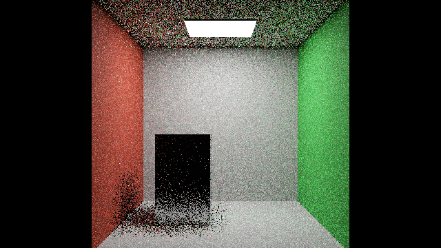

# B2 static opaque validation and first comparison

The corrected B2 development build now executes ReSTIR PT with active mid-path reconnection and passes the scoped static opaque transport checks below. **B2 is not promoted:** original material/medium coverage, motion, reconstruction, binding diffuse limits and wider scene tests remain pending. B3 PT++ extensions remain planned.

## First retained timing and quality comparison

RTX4090,640×360, owned opaque room,1spp, total/diffuse limits3/3, cache0, AA0, denoiser0, exposure0 and post/firefly filters off. Each timing configuration has three fresh processes,45s warm-up and15s PresentMon capture. Selection is the last600 target-process/swapchain frames after dropping16 tail frames. The table reports the median of process medians.

| Configuration | Lighting used | Process GPU busy, ms | CPU frame cadence, ms | Median LDR-FLIP | Encoded-sRGB RGB MSE |
|---|---|---:|---:|---:|---:|
| RTXPT1.9 + benchmark-controls-v1 | Native path tracing; DI/GI off |0.803|0.850|0.11679|0.013370|
| B1 + benchmark-controls-v1 | Native path tracing; DI/GI off |0.806|0.912|0.11674|0.013359|
| Corrected B2 development | DI + ReSTIR PT; GI off |1.519|1.600|0.06668|0.003171|

B2 costs approximately89% more process GPU-busy time per frame than the native controls in this small scene and has lower observed display-image error after history warm-up. This is **not** a time-to-equal-quality speedup, a general performance conclusion or a promoted B2 release. GPU-busy duration is not complete-frame GPU latency or display FPS. The three B2 run medians span1.502–1.595ms; three repetitions remain exploratory under the project protocol.

This new control track uses native path tracing. It does not exercise B1's migrated DI/GI passes; the earlier [B1 DI+GI report](B1_RESULTS.md) remains a separate experiment. Native controls retain upstream realtime approximate light/BSDF MIS. B2 uses its documented DI/PT contribution partition. Both are evaluated against the same finite pixel-center native reference. This is a comparison of configured renderers with different sampling estimators.

Common display metrics use three legacy process captures per control and eight explicitly seeded B2 captures, official flip-evaluator1.7, LDR mode and PPD67. Legacy captures have no explicit independent-seed control, so no paired-seed or statistical quality-significance claim is made. Original B0/B1 and controls-v1 do not export linear HDR; the raw-HDR results below apply to B2 only.

## B2 raw-HDR checks

The reference is8192spp, seed101, pixel-center integration. Separate4096spp and8192spp/seed103 checks retain finite-reference discrepancy. Realtime captures use seeds0,1,2,3,5,11,23,47 and64-frame history warm-up. HDR-FLIP uses PPD67, ACES and the frozen reference-only exposure interval[-3.2584834,+4.6571465] with8exposures. Inputs are stored linear RGB PFM, with no per-candidate brightness normalization.

| B2 strict static preset | Median linear RGB MSE | Median HDR-FLIP | Mean signed full-frame luminance difference |
|---|---:|---:|---:|
| Initial sampling only |0.042691|0.168010|−0.356%|
| Temporal + spatial reuse |0.004251|0.103416|−0.350%|

Reuse no longer introduces the earlier large mean-lighting discrepancy in this tested domain. The remaining approximately0.35% difference is reported, not normalized away. These checks do not prove unbiasedness or reference convergence. Same-seed separate processes are not guaranteed bit-exact.

The strict static configuration disables DI boiling rejection, naïve-neighbor discount and permutation sampling, retains raytraced DI bias correction, disables PT age rejection while retaining history mass cap8, and fixes ordinary/boosted PT spatial counts to1/1. Duplication reduction, CGNS, spatial heuristic mode, decorrelation, replacement and PT boiling remain off. These validation settings are explicit controls; they are not all interactive defaults.

## Repairs verified on the GPU

- Registered actual environment records and a real synthetic baked-environment record when needed. The prior map-resource test underflowed the infinite-light count and aliased an emissive triangle. Procedural-sky and directional-only smoke checks also completed.
- Aligned absolute light IDs with local power-PDF texture indexing and corrected PT's light-vertex-inclusive limit to native B+1.
- Repaired raw-output merge ordering, capture history reset behavior and packed miss validity.
- Tested actual BSDF lobes when deciding reconnection eligibility. Reservoir census now proves mid-path reconnections; the previous allowed-lobe test silently disabled them on generic opaque secondary surfaces.
- Restored primary native NEE's full direct term when PT ownership removes its BSDF emitter-hit counterpart. At limit1, PT-only mean difference is+0.030% versus+0.038% for the native realtime control, against the finite reference.
- Used fixed PT neighbor counts to isolate sample-dependent disocclusion boosting. Spatial-only mean differences at cap3 are+0.008% for fixed1/1 and−0.094% for fixed8/8 in the seed0 diagnostic. Age rejection had negligible effect in that small ablation; no general causal claim follows.

All three modes remain separately selectable: DI, GI and PT. GI and PT own alternative indirect estimates here; adding both together without a valid partition remains unsupported.

## Inspect the captures

Representative native trial1 and B2 seed0, fixed exposure0. The reference uses8192spp; realtime images use1spp. Metrics use the full retained capture sets. Click an image to enlarge it; Escape closes the preview.

| Native reference | RTXPT1.9 native control | Corrected B2 reuse |
|---|---|---|
|  |  |  |

## Cap, identity and failure receipts

All nine accepted timing processes passed app cap controls, foreground/background NVIDIA cap0 and forced-off VSync, observed SyncInterval0, read-only RTSS audits before launch/start/end, no reported ETW loss, no image writes, and pre/post source/executable/shader identity checks. Every temporary exact-executable NVIDIA profile was restored and verified. The user's installed Rtxpt.exe profile0 continues to override global232 and was never changed. Other possible external limiters remain outside this known coverage.

The final B2 executable SHA256 is `ba069160ebb1ae90a30a55bce00df353c8a0b88d1a5a6588725071a646f54cec`. The604-file runtime bundle and build-time source snapshot are retained locally, including a separate cache snapshot matching accepted timings. B0/B1 original refs and artifacts remain preserved. The controls-v1 binaries remain separately identified host-control adapters with unchanged renderer shaders.

One initial B2 timing attempt failed strict identity because shader-cache files changed; it is excluded and retained as cache warm-up. One legacy quality capture exited with STATUS_STACK_OVERFLOW; its replacement captures and all accepted timings completed. An unsupported new MIS option was also rejected on the legacy build; successful legacy commands omit it. No cause or reliability conclusion is inferred from those isolated failures.

Public-safe PFM/PNG, metric JSON, raw timing CSVs, effective-setting receipts, source patch, frozen hashes and restoration receipts are in `Benchmarks/development/2026-10-28-b2-static-opaque`. Large reservoir binaries and private recovery/telemetry files remain local. Earlier failed lighting checkpoints are retained separately and must not be substituted for this build.

## Summary and lessons learned

Ownership, light-list indexing and actual feature activation mattered more than enabling another toggle. Matching pixel integration and raw radiance exposed errors hidden by single display images; component captures, deterministic quadrature and reservoir census isolated them. B2 now has a reproducible static opaque quality/timing checkpoint. It improves the observed steady-state image quality at greater per-frame cost in this one scene. Wider materials, original scenes, motion, temporal metrics, reconstruction and renderer-exclusive memory/whole-frame GPU measurements remain required before promotion.

Documentation change2026-10-28: added the corrected B2 comparison, explicit estimator settings, measured quality/timing scope and retained failure evidence.
