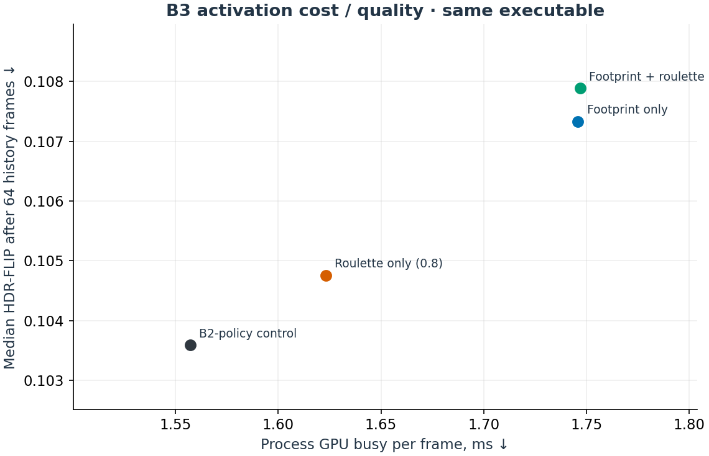
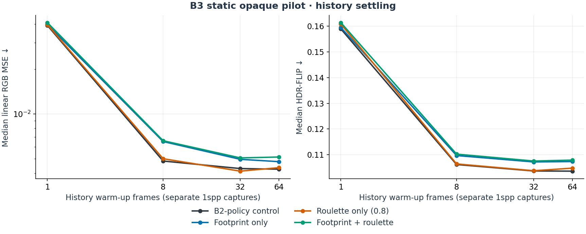
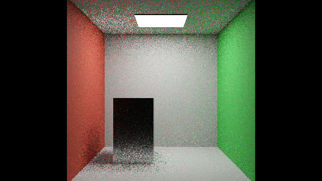
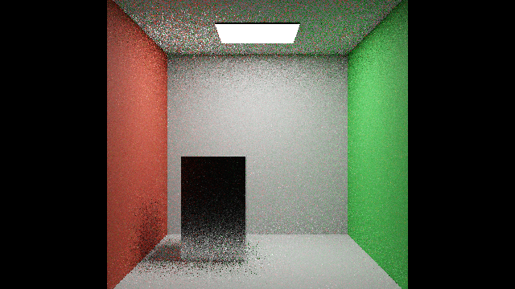

# B7 limited-feature ablation: retained legacy B3 results

> **LEGACY NUMBERING — preserved evidence.** The pilot below (`a7428c8`, retained `b3/ptpp-activation` branch/data labels) ran **DI3.1 + ReSTIR PT, GI off**. Under [canonical B0–B10](VERSION_MAPPING.md), it is **B7 plus limited footprint/initial-only-roulette ablations**, **not B9**, which requires B8's validated GI-sharing foundation. Old-B2 means the B7 control; old-B1 native-only means B3. All row values, images, source refs and raw data IDs remain unchanged. Old-B4 remaining-work references below now point to canonical **B10** scope via the retained [plan filename](B4_IMPLEMENTATION.md).

Canonical B0 remains original-default RTXPT1.9, not the raw native-control override in the common display table. The native PT + DI3.0/3.1 B1/B4 benchmark gap remains explicit; old-B1's 0.806 ms native-only timing did not exercise DI. Original-scene transmission/medium and binding diffuse-budget gates remain unresolved; renumbering does not create B8/B9/B10 measurements.

Measured 28–29 October 2026 (Europe/Zurich). **B3's two activations increased both cost and image error in this controlled opaque-room pilot.** The combined setting costs 12.18% more process GPU-busy time and has 4.15% higher HDR-FLIP than its same-executable B2-policy control. No optimized combined default or general speedup is established. The default remains fixed-threshold reconnection with roulette off.

B3 contains footprint/inverse-footprint reconnection and initial-generation-only roulette. The user assigned the remaining PT++ mechanisms to **B4**. Packed 64-byte reservoirs and forced NEE reconnection were inherited by B2; replay compaction, paired spatial reuse and unified direct/indirect reservoirs are not part of these B3 measurements. See [the implementation map](B3_IMPLEMENTATION.md) and [B4 gates](B4_IMPLEMENTATION.md).

## Isolated activation comparison

All rows use **RTXPT + ReSTIR DI + ReSTIR PT; GI off**, at 640×360, 1spp, 3 total / 3 diffuse bounces, AA/denoiser/cache/subsampling off, pinhole, exposure 0 and post/firefly filters off. Strict DI validation, PT age rejection off with history mass cap 8, and fixed spatial/boost counts 1/1 match the B2 static contract.

| Configuration and active algorithm | GPU busy/frame, ms ↓ | HDR-FLIP ↓ | Linear RGB MSE ↓ | Mean signed Y difference |
|---|---:|---:|---:|---:|
| B3 B2-policy control · DI + PT | 1.55720 | 0.103590 | 0.004256 | -0.373% |
| B3 footprint · DI + PT | 1.74590 | 0.107333 | 0.004782 | -0.508% |
| B3 roulette (0.8) · DI + PT | 1.62310 | 0.104757 | 0.004357 | -0.416% |
| B3 footprint + roulette · DI + PT | 1.74685 | 0.107887 | 0.005135 | -0.520% |

Quality uses seeds 0, 11 and 47 after 64 history warm-up frames; timing uses three fresh processes/configuration. These are exploratory repetitions. Native finite 8192spp pixel-center reference and the reference-only HDR-FLIP parameters are unchanged from B2: official flip-evaluator 1.7, PPD 67, ACES, exposure −3.2584834 to +4.6571465, eight exposures. No candidate brightness normalization is applied. Signed mean differences are reported, not interpreted as proof of bias or unbiasedness.

The figure shows the measured same-executable tradeoff after history warm-up. GPU busy is target-process engine active duration, not complete-frame GPU latency or display FPS. A cost/error scatter is not a time-to-equal-quality sweep.

## History settling and initial sampling

Sixty predeclared captures cover four settings, three seeds, reuse with history warm-up lengths 1, 8, 32 and 64, plus initial-only captures. Every image and packed diagnostic snapshot passed finite-state checks. History warm-up length is not accumulated spp: each point is a separate 1spp snapshot with the requested history, without frame averaging.

The curves show three-seed medians, not a confidence interval or a reference-convergence proof. DI and PT history evolve together. Original scenes, moving disocclusions, reconstructed output, and equal-time/quality convergence remain pending.

Initial-only DI/PT sampling (both reuse modes 0):

| Configuration and active algorithm | HDR-FLIP ↓ | Linear RGB MSE ↓ | Mean signed Y difference |
|---|---:|---:|---:|
| B3 B2-policy control · DI + PT | 0.167917 | 0.040367 | -0.379% |
| B3 footprint · DI + PT | 0.167976 | 0.040360 | -0.407% |
| B3 roulette (0.8) · DI + PT | 0.170157 | 0.041802 | -0.396% |
| B3 footprint + roulette · DI + PT | 0.170081 | 0.041755 | -0.362% |

## B0 through B3: common display track

These rows share the finite 8192spp native reference PNG, fixed exposure 0 and LDR-FLIP at PPD 67. They compare configured renderers with different estimators. B0/B1 controls retain upstream approximate native NEE MIS; B2/B3 use their explicit DI/PT partition.

| Version / preset | Actual algorithm | GPU busy/frame, ms ↓ | LDR-FLIP ↓ |
|---|---|---:|---:|
| B0 + benchmark-controls-v1 | Native RTXPT; DI/GI off | 0.803 | 0.11679 |
| B1 + benchmark-controls-v1 | Native RTXPT; DI/GI off | 0.806 | 0.11674 |
| Preserved B2 static checkpoint | DI + ReSTIR PT; GI off | 1.519 | 0.06668 |
| B3 B2-policy control | DI + ReSTIR PT; GI off | 1.557 | 0.06684 |
| B3 footprint | DI + ReSTIR PT; GI off | 1.746 | 0.06898 |
| B3 roulette (0.8) | DI + ReSTIR PT; GI off | 1.623 | 0.06760 |
| B3 footprint + roulette | DI + ReSTIR PT; GI off | 1.747 | 0.06908 |

B0/B1 use three legacy processes without explicit independent seed control; B2 uses eight explicit seeds; B3 uses three. B0/B1 do not export HDR. Earlier B0/B1/B2 timings were collected in a separate episode; the four B3 ablations are the contemporaneous comparison. The B3 B2-policy control includes the new executable's bindings and inactive diagnostic branch, so it is not relabelled as the immutable B2 binary. No version-wide significance or equal-quality speedup is claimed.

## Mandatory original-scene coverage

| Scene and matched contract | B0/B1 | B2 | B3 | B4 |
|---|---|---|---|---|
| Original Convergence: convergence-test.scene.json, 1280×720, exposure 0, 14/2 bounces | Historical DI + GI results; external cap coverage unverified | Unsupported transmission and binding diffuse cap | Same unsupported foundation gates | Pending implementation and foundation validation |
| Original Kitchen: kitchen-with-test-stuff.scene.json, 1280×720, exposure 2, 14/2 bounces | Historical DI + GI results; external cap coverage unverified | Unsupported glass/transmission/BLEND and binding diffuse cap | Same unsupported foundation gates | Pending implementation and foundation validation |
| Owned opaque room: 640×360, exposure 0, 3/3 bounces | Native controls measured | DI + PT measured | Four DI + PT settings measured here | Pending |

No opaque edits count as either original-scene result. Exact scene hashes and active algorithm labels are in [the variant overview](ALGORITHM_VARIANTS.md) and `Benchmarks/comparison-matrix.json`. The [historical B1 report](B1_RESULTS.md) remains separate; it cannot be pooled with cap-verified throughput.

## Timing and activation receipts

Each accepted timing process has 45s warm-up and 15s PresentMon capture; the predeclared selection is the last 600 target-process/swapchain rows after dropping 16 tail frames. Order rotates across three blocks. All 12 accepted runs passed app/NVIDIA/RTSS cap checks, observed SyncInterval 0, no reported ETW loss, no PNG writes and pre/post source/executable/shader-cache identity. Every temporary NVIDIA profile was restored and verified, including the excluded trace attempt. RTSS was read-only: the user's Rtxpt.exe profile 0 remains unchanged over global 232. Other external limiters remain unknown.

| Configuration and active algorithm | CPU cadence, ms | GPUTime, ms | Median selected-window GPU-busy p95, ms |
|---|---:|---:|---:|
| B3 B2-policy control · DI + PT | 1.64385 | 1.56220 | 2.03283 |
| B3 footprint · DI + PT | 1.78530 | 1.75080 | 2.12061 |
| B3 roulette (0.8) · DI + PT | 1.66540 | 1.62890 | 2.19656 |
| B3 footprint + roulette · DI + PT | 1.78695 | 1.75135 | 2.19454 |

The measured executable is `983fa394077d5cf6ca10cc6a60aa783eed1f6b07c9a0f5159b20dedd5b8f233f`. Its complete non-PDB bundle, cache and pre-build source patch are retained separately. The diagnostic seed-0 frame recorded 166,511 roulette tests, 33,381 terminations, 133,130 survivals and zero replay roulette tests in both roulette settings. Control/footprint-only frames recorded zero roulette tests. All four configurations have nonzero mid-path reconnection census. Diagnostic writes/readbacks were off during timing; the compiled diagnostic branch remains part of this executable.

One quality startup coincided with NVML failure, a commitment-limit error and Windows compositor fatal memory exhaustion. Its exact replacement passed; no renderer causation was established. One timing attempt produced no PresentMon CSV despite renderer activity and was rejected; its exact replacement passed. Both failures remain retained separately. Added inter-process spacing is outside the selected timing windows. No applications, RTSS settings or global driver settings were changed to recover.

## Inspect the captures

Seed 0 is shown consistently, without selecting a favorable image. Full metrics use all declared trials. Click a picture to enlarge; Escape closes the shared preview.

| B2-policy control · DI + PT | Footprint · DI + PT |
|---|---|
|  |  |
| **Roulette 0.8 · DI + PT** | **Footprint + roulette · DI + PT** |
|  |  |

Public-safe raw PFM/PNG, metrics, effective receipts, timing CSVs, restoration receipts and hashes are retained in `Benchmarks/development/2026-10-28-b3-activation`. Large packed binaries, executable bundles, private recovery files and resource/cost telemetry remain local. The native reference is the same hash retained with B2; failed earlier ReSTIR candidates are not comparison controls.

## Summary and lessons learned

Activating supplied PT++ controls did not improve this small opaque scene: footprint and roulette increased observed error and cost, so the B2 policy remains the default. The paper's large scheduling/unification improvements have not yet been implemented and its four-scene baseline is different. B3 now has explicit activation proof, complementary quality metrics, history curves and repeated cap-verified cost. B4 will address the remaining estimator/scheduling work and preserve the unresolved original-scene gates.

## Changes

- 2026-10-29: Finalized the scoped B3 pilot and assigned remaining PT++ work to B4. No general B3 release or complete-paper equivalence is claimed.
