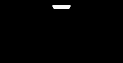
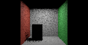
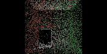
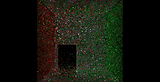
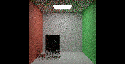
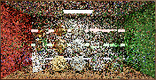
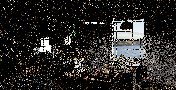
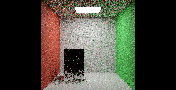

# B8–B10 staged implementation: contribution split and PT++ gates

The user deferred the brightness investigation and requested B8 through B10 next. No brightness correction, normalization, material change or reference adjustment is included here.

## Implemented and exercised

| Stage | Executed algorithm | Evidence and remaining scope |
|---|---|---|
| B8 development, stage0 | DI initial sampling + GI-short initial sampling + ReSTIR PT-long initial sampling + native fallback | GPU cap1/2/3/4 checks and 64-frame room sequence completed. GI reuse is off. |
| B8 development, stage1 | Same split, with DI/PT temporal and spatial reuse | Separate temporal, spatial and combined eight-frame room checks; positive-weight PT paths have light-inclusive length≥4. GI reuse is off. |
| B9 limited development ablation, stage2 | Stage1 + footprint reconnection + initial-only roulette, survival0.8 | Executed with DI/PT combined reuse. 13,243 initial roulette tests, **zero replay roulette tests** in the captured frame. GI reuse is off, so this does not establish complete canonical B9. |
| B10 preparation | Exact paired-MIS/vector-weight oracle, reciprocal pairing-texture construction and replay-queue model | Four new CPU tests pass. These mechanisms are **not yet dispatched by the renderer**. |

This is a working combined contribution foundation, not acceptance of complete B8/B9/B10. General secondary-material GI reuse, independent component-mean references, motion/reset stress tests, extended quality/convergence comparisons and accepted uncapped timing remain required. The original material/camera identities are retained.

## Contribution ownership

The development split uses eligible first opaque, continuous-reflection surfaces with unit native prefix throughput and empty medium state. Mixed delta/continuous primaries retain native fallback. For this strict initial implementation, primary DI uses the same eligible domain; the remaining primaries retain their native direct and indirect estimates.

- Visible emission/environment remains native.
- DI owns eligible primary direct lighting, including secondary-emitter/direct-environment counterparts.
- GI-short collects only the two-scattering indirect term. The secondary surface's own emission belongs to the preceding direct term. Its NEE and terminal BSDF-emission/environment counterpart retain their complementary MIS weights.
- PT-long streams only paths with at least three scattering events, corresponding to light-inclusive length4 or greater. It still advances the shorter prefixes and preserves empty initial draws.

GI-short evaluates its secondary BSDF at the original outgoing direction. This permits initial sampling without pretending that unchanged stored RGB can be reused at a different outgoing direction. The application bypasses GI temporal/spatial reuse and its approximate final blend in these development modes. The [full partition design](B8_PARTITION_DESIGN.md) still governs a correct general GI reuse implementation.

The native GI endpoint is now stored **after** rejection of false nested interfaces. Such interfaces cannot consume the secondary-surface export. The PT history contract includes changes to the GI/PT partition. No submodule is modified.

## Same-frame GPU checks

Optional captures retain native radiance and cumulative output after DI, GI-short and PT-long. Component differences therefore come from the same rendered frame. Captures are diagnostic work, outside performance measurement.

| Native bounce cap | GI-short | PT-long | Finite stages and completed-sum equality |
|---|---|---|---|
| 1 | Exactly zero | Exactly zero | Passed |
| 2 | Nonzero | Exactly zero | Passed |
| 3 | Nonzero | Nonzero | Passed |
| 4 | Nonzero | Nonzero | Passed |

Separate stage1 room captures exercised PT temporal-only, spatial-only and combined DI/PT reuse. Stored positive-weight paths respected the length4 lower bound and had finite weights/targets. Empty reservoirs can retain positive sample mass and length0; treating every positive-M reservoir as a selected radiating path would be an incorrect diagnostic.

The two original scenes also produced finite component captures under their original14/2 total/diffuse budgets with the existing explicit full-prefix replay guard. These are low-resolution development checks, not original-resolution scene acceptance. The first Convergence image was initially rejected by a verifier that assumed GI must always be off; its original manifest remains intact alongside an offline revalidation requiring the explicit disjoint-partition receipt. Kitchen passed the corrected verifier directly.

## Preliminary room images and quality

All images below have actual resolution **176×90**: the renderer adjusted the requested160-pixel width. They are integration illustrations, not substitutes for the required640×360 room and1280×720 original-scene comparisons.

| Native | DI | GI-short | PT-long | Sum |
|---|---|---|---|---|
|  |  |  |  |  |

Component illustrations use one fixed Reinhard/sRGB transform; raw PFM captures remain the evidence. There is no per-image brightness fit.

| Original Convergence development capture | Original Kitchen development capture | Limited PT++ room development capture |
|---|---|---|
|  |  |  |

The static room's initial-only runs each captured64 frames against a native2048-spp reference, with matched cap3/3 and raw output. This single low-resolution sequence is a preliminary check, without independent process/seed replication:

| Initial-only configuration | Mean individual-frame linear RGB MSE | MSE of64-frame mean |
|---|---:|---:|
| B7-style DI + full indirect ReSTIR PT | 0.0417633 | 0.000645112 |
| B8 development DI + GI-short + PT-long | 0.0374452 | 0.000508865 |

Do not infer a general quality gain, unbiasedness, full convergence or speedup from this cohort. HDR/display FLIP, larger reference/replicate studies, equal-time comparisons and moving-scene tests remain pending. No new GPU-busy/FPS comparison is accepted here. App receipts show vsync/limiter/reflex cap/frame generation off; driver/RTSS auditing remains part of actual timed cohorts.

## Capture-clock repair

The first sequence stalled because the static scene's animation clock stayed at zero. Recording now advances an independent fixed capture timeline, including when an animated scene loops. The stopped attempt is excluded. Both subsequent64-frame sequences completed. Single-frame behavior and renderer estimator defaults are unchanged.

## B10 prerequisites and next implementation

The new exact finite-domain oracle checks pair-MIS at both destinations with nonuniform measures/proposals, unequal source counts and nontrivial bijections. Its vector RGB sum equals the conditional mean of scalar reservoir selection. The two directed Jacobians belong to different sampled paths and are not assumed to be reciprocals.

The pairing-texture constructor independently follows the [PT++ paper's section3](https://cwyman.org/papers/i3d26_ReSTIRPT++.pdf): duplicated link IDs, alternating offset2×2 shuffles and race-free link resolution on the CPU. Tests verify deterministic reciprocal non-self links. The replay-queue model preserves both cheap and replay work and rejects overflow rather than dropping estimator terms. These models do not demonstrate GPU dispatch, barriers, memory use or runtime gains.

Next: implement and validate secondary-radiance reevaluation for GI reuse, then GPU pair-owned shared shifts and vector shading, explicit replay queues, unified primary direct/indirect ownership, duplication-map production and dual-motion recovery. Each remains a separate controlled feature under the [B10 plan](B4_IMPLEMENTATION.md). Merely selecting more flags does not complete full PT++.

## Evidence and reproduction

[Sanitized staged evidence](../../Benchmarks/development/2026-10-29-b8-staged-partition/README.md) includes effective receipts, raw component captures, packed-reservoir snapshots, aggregate sequence metrics, executable/source identities and exclusions. The final renderer identity was frozen **after** these development cohorts; it is not represented as a pre-frozen identity for their earlier executable phases. Existing source/binary controls are preserved separately.

The bounded Release build passes. **202 Python tests pass**, including the exact partition, capture receipts, paired-MIS, vector-weight, pairing and queue checks. GPU support checks above are separate from those CPU tests.
