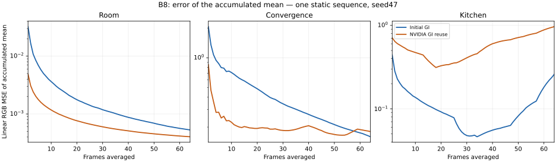

# B8–B10 staged implementation: contribution split and PT++ gates

**Current B10+ status:** your [B10–B16 roadmap and B10 sampling branches](ROADMAP.md) are maintained separately. The [latest B10 duplication comparison](B10_DUPLICATION_HISTORY.md) completes 18 quality sequences and 18 uncapped timings; full unification and dual motion remain pending. This chapter retains the B8 foundation and its staged history.

The user deferred the brightness investigation and requested B8 through B10 next. No brightness correction, normalization, material change or reference adjustment is included here.

## NVIDIA GI approximation: current implementation

The user selected NVIDIA's practical non-directional GI approximation for B8 on 2026-10-29. `--b8GIReuseMode 0|1|2|3` selects initial, temporal, spatial or temporal+spatial GI within the existing disjoint contribution split. Omission preserves the previous initial-only GI control exactly. The portable capture/timing tools expose `--b8-gi-reuse-mode`. This is an explicit development mode; the option alone is not canonical acceptance.

The initial-only control bypasses GI reservoir packing, filtering and final blending. The candidate includes those mechanisms as well as reuse, so this compares the complete GI approximation path rather than isolating temporal/spatial resampling alone.

The application now routes short-GI exports through the supplied RTXDI3.1 temporal/spatial reservoir passes and final visibility/blending. Secondary RGB remains non-directional. Existing application Jacobian rejection/clamping, Basic bias correction, boiling filtering and roughness-dependent final blending remain approximations; no exact glossy-reconnection or unbiasedness claim is made. No scene material or brightness correction is introduced.

GI history follows the PT partition/reset chronology: the first frame after a reset never reads GI history. None/spatial-only modes explicitly write the initial reservoir to slot0 rather than relying on a stale temporal-output index. Diagnostic captures include the final32-byte GI reservoir buffer, dimensions, frame, mode and tiled buffer indices. Stored M/age establish sample-history participation, not estimator correctness or a quality benefit.

Source guidance:

- [NVIDIA ReSTIR GI integration guide](https://github.com/NVIDIA-RTX/RTXDI/blob/main/Doc/RestirGI.md): initial-sample staging, non-directional secondary-radiance limitation and possible directional extensions.
- [Original GRIS/ReSTIR PT implementation](https://github.com/DQLin/ReSTIR_PT): hybrid shifts and general path-resampling foundation.
- [Conditional RIS paper](https://research.nvidia.com/labs/rtr/publication/kettunen2023conditional/) and [public prototype](https://github.com/NVlabs/conditional-restir-prototype): conditioning/weights for reused suffixes after unreused prefixes; these do not establish this project's exact triple-estimator integration.
- [PT++ §6.1](https://cwyman.org/papers/i3d26_ReSTIRPT++.pdf): unifies direct and indirect candidates in one PT reservoir. This is a separate B10 mechanism from retaining standalone DI/GI/PT passes.

**GPU validation completed:** eight177×91 room cases (legacy control, all four approximation modes, first-history frame and bounce caps1/2), plus six matched full-resolution snapshots (control/reuse for640×360 Room and1280×720 original Convergence/Kitchen). Raw same-frame component sums are finite/nonnegative and equal the completed output. GI-short and PT-long obey the tested bounce supports.

| Combined GI reuse snapshot,32 history frames | Positive-weight GI pixels | GI pixels with aged samples |
|---|---:|---:|
| Room640×360 |133,629|122,251|
| Convergence1280×720 |747,874|691,025|
| Kitchen1280×720 |772,579|727,850|

These counts show actual GI reservoir participation. They do not establish brightness agreement, quality improvement or unbiasedness. One Convergence capture rendered successfully but was excluded by a nested verifier that still assumed GI reuse off. A forwarding fix and regression test preceded a fresh passing capture; the excluded attempt remains recorded.

[Evidence summary](../../Benchmarks/development/2026-10-29-b8-nvidia-gi/summary.json). Six64-frame static quality sequences and18cap-verified timing processes are complete; results are below. The earlier results below retain their original initial-GI scope.

## Static64-frame quality: NVIDIA approximation versus initial GI

One sequence per scene/mode, seed47; identical source/executable, original materials/cameras, fixed exposure, raw1spp, no reconstruction, MIP0. Room640×360 cap4/4 uses the retained2048spp native reference; originals1280×720 cap14/2 use the retained4096spp MIP0 native references. The native references are finite estimates, not ground truth. DI/PT both use temporal+spatial reuse; PT uses one spatial neighbor. Scene animations are explicitly stopped.

| Scene / GI mode | Mean per-frame linear MSE ↓ | MSE of64-frame average ↓ | Frame64 HDR-FLIP ↓ | Frame64 LDR-FLIP ↓ | Mean raw Y difference |
|---|---:|---:|---:|---:|---:|
|room / Initial GI control|0.034602|0.000531|0.145792|0.089866|-0.307%|
|room / NVIDIA temporal+spatial GI|0.004731|0.000404|0.110711|0.077162|+0.065%|
|convergence / Initial GI control|1.513876|0.159663|0.381780|0.255432|-0.519%|
|convergence / NVIDIA temporal+spatial GI|1.507680|0.180113|0.315019|0.211882|-1.384%|
|kitchen / Initial GI control|1.035836|0.258452|0.520417|0.292854|-0.202%|
|kitchen / NVIDIA temporal+spatial GI|2.022504|0.965234|0.458518|0.272080|-3.415%|

**Mixed result:** Room improves in both frame error and error of the temporal average. Convergence has slightly lower mean frame MSE but higher mean-image MSE. Kitchen has lower representative FLIP but substantially higher linear frame/mean-image MSE and a more negative sample mean luminance difference with reused GI. Thus the approximation is operational, but these results do not justify promoting it as a universal quality improvement.

Frame64 FLIP is a single image; MSE columns summarize all64frames and their average. The retained curve includes every frame plus official FLIP at frames1/8/32/64. This is static chronological averaging, not equal-time convergence, moving-scene testing or independent-seed replication. Correlated reuse samples mean64frames are not64independent trials. Signed luminance differences are measurements, not brightness corrections or a proof of asymptotic bias. No global scale/exposure fitting is applied.

The Kitchen sample difference with active GI is separate from the earlier GI-off DI residual. NVIDIA documents non-directional secondary-radiance reuse and several bias controls; that guidance does not establish which mechanism causes each pixel error in this cohort. The brightness investigation remains deferred.

## Uncapped timing: complete18-process comparison

Three fresh process repeats per policy/scene, rotated order,30s warmup plus15s PresentMon2.6.0 recording. Same frozen renderer executable and699shader-cache files before/after every run; no image writes or reported trace loss. Application caps/VSync disabled, owned exact-executable NVIDIA limiter settings temporarily disabled, RTSS checked read-only, driver profile restored after every process. Unknown external limiters and background load remain limitations.

| Scene | GI initial GPU busy ms ↓ | GI reuse GPU busy ms ↓ | Change | Initial CPU cadence ms | Reuse CPU cadence ms |
|---|---:|---:|---:|---:|---:|
|opaque-room|1.7631|1.8811|+6.69%|1.8176|1.9167|
|convergence|10.3430|10.8529|+4.93%|10.2974|10.8039|
|kitchen|12.5822|13.3488|+6.09%|12.6082|13.3391|

Values are medians of per-process medians, using last600 Original/NotSet presentation rows and excluding the final16. GPU busy is per-process GPU engine time, not complete critical-path frame latency or renderer FPS. Three process repeats and their retained bootstrap intervals are exploratory; no equal-quality/equal-time speedup is established. The64-frame quality sequences are separate acquisitions from these no-image-write timing runs. Resident renderer-exclusive VRAM is not measured; diagnostic readback allocation is outside timed runs.

[Exact timing receipts and CSV evidence](../../Benchmarks/development/2026-10-29-b8-nvidia-gi/timing-evidence/README.md) · [Timing summary and run intervals](../../Benchmarks/development/2026-10-29-b8-nvidia-gi/timing-evidence/summary.json)

The convergence curves show error of chronological image averages from one sequence per mode/scene. They do not hold elapsed time fixed, establish independent sample counts or prove asymptotic bias.

## Summary and lessons learned: practical B8

NVIDIA GI reuse is now implemented and exercised alongside the disjoint DI/GI-short/PT-long split. Eight focused room gates, six full-resolution snapshots, six64-frame quality sequences and18uncapped timing processes complete this experimental checkpoint. The retained initial-only control remains selectable by omitting the new GI mode option.

Quality is scene- and metric-dependent: Room improves, while Kitchen has larger linear error and a more negative empirical luminance difference despite lower representative FLIP. Convergence is mixed between frame and mean-image error. Do not promote this as a universal quality improvement or compensate brightness with a scale factor. Exact outgoing-direction GI reevaluation, moving/disocclusion tests, independent seeds and equal-time/error comparisons remain separate research/acceptance work. Earlier B9/B10 ablations retain their original initial-GI scope until explicitly rerun with this new mode.

## Implemented and exercised

| Stage | Executed algorithm | Evidence and remaining scope |
|---|---|---|
| B8 development, stage0 | DI initial sampling + GI-short initial sampling + ReSTIR PT-long initial sampling + native fallback | GPU cap1/2/3/4 checks and 64-frame room sequence completed. GI reuse is off. |
| B8 development, stage1 | Same split, with DI/PT temporal and spatial reuse | Separate temporal, spatial and combined eight-frame room checks; positive-weight PT paths have light-inclusive length≥4. GI reuse is off. |
| B9 limited development ablation, stage2 | Stage1 + footprint reconnection + initial-only roulette, survival0.8 | Executed with DI/PT combined reuse. 13,243 initial roulette tests, **zero replay roulette tests** in the captured frame. GI reuse is off, so this does not establish complete canonical B9. |
| B10 development | Exact CPU prerequisites plus an adjacent reciprocal-pair/vector GPU pilot | See [the subsequent GPU pilot](B10_PAIRED_PILOT.md). Gaussian multi-pair reuse, replay queues and full PT++ remain pending. |

This is a working combined contribution foundation, not acceptance of complete B8/B9/B10. General secondary-material GI reuse, independent component-mean references, motion/reset stress tests, extended quality/convergence comparisons and accepted uncapped timing remain required. The original material/camera identities are retained.

## Contribution ownership

The development split uses eligible first opaque, continuous-reflection surfaces with unit native prefix throughput and empty medium state. Mixed delta/continuous primaries retain native fallback. For this strict initial implementation, primary DI uses the same eligible domain; the remaining primaries retain their native direct and indirect estimates.

- Visible emission/environment remains native.
- DI owns eligible primary direct lighting, including secondary-emitter/direct-environment counterparts.
- GI-short collects only the two-scattering indirect term. The secondary surface's own emission belongs to the preceding direct term. Its NEE and terminal BSDF-emission/environment counterpart retain their complementary MIS weights.
- PT-long streams only paths with at least three scattering events, corresponding to light-inclusive length4 or greater. It still advances the shorter prefixes and preserves empty initial draws.

GI-short evaluates its secondary BSDF at the original outgoing direction. This permits initial sampling without pretending that unchanged stored RGB can be reused at a different outgoing direction. The application bypasses GI temporal/spatial reuse and its approximate final blend in these development modes. The [full partition design](B8_PARTITION_DESIGN.md) still governs a correct general GI reuse implementation.

The native GI endpoint is now stored **after** rejection of false nested interfaces. Such interfaces cannot consume the secondary-surface export. The PT history contract includes changes to the GI/PT partition. No submodule is modified.

## Same-frame GPU checks

Optional captures retain native radiance and cumulative output after DI, GI-short and PT-long. Component differences therefore come from the same rendered frame. Captures are diagnostic work, outside performance measurement.

| Native bounce cap | GI-short | PT-long | Finite stages and completed-sum equality |
|---|---|---|---|
| 1 | Exactly zero | Exactly zero | Passed |
| 2 | Nonzero | Exactly zero | Passed |
| 3 | Nonzero | Nonzero | Passed |
| 4 | Nonzero | Nonzero | Passed |

Separate stage1 room captures exercised PT temporal-only, spatial-only and combined DI/PT reuse. Stored positive-weight paths respected the length4 lower bound and had finite weights/targets. Empty reservoirs can retain positive sample mass and length0; treating every positive-M reservoir as a selected radiating path would be an incorrect diagnostic.

The two original scenes also produced finite component captures under their original14/2 total/diffuse budgets with the existing explicit full-prefix replay guard. These are low-resolution development checks, not original-resolution scene acceptance. The first Convergence image was initially rejected by a verifier that assumed GI must always be off; its original manifest remains intact alongside an offline revalidation requiring the explicit disjoint-partition receipt. Kitchen passed the corrected verifier directly.

## Preliminary room images and quality

All images below have actual resolution **176×90**: the renderer adjusted the requested160-pixel width. They are integration illustrations, not substitutes for the required640×360 room and1280×720 original-scene comparisons.

| Native | DI | GI-short | PT-long | Sum |
|---|---|---|---|---|
|  |  |  |  |  |

Component illustrations use one fixed Reinhard/sRGB transform; raw PFM captures remain the evidence. There is no per-image brightness fit.

| Original Convergence development capture | Original Kitchen development capture | Limited PT++ room development capture |
|---|---|---|
|  |  |  |

The static room's initial-only runs each captured64 frames against a native2048-spp reference, with matched cap3/3 and raw output. This single low-resolution sequence is a preliminary check, without independent process/seed replication:

| Initial-only configuration | Mean frame linear RGB MSE | Mean frame HDR-FLIP | Mean frame display-FLIP | MSE of64-frame mean |
|---|---:|---:|---:|---:|
| B7-style DI + full indirect ReSTIR PT | 0.0417633 | 0.165987 | 0.092710 | 0.000645112 |
| B8 development DI + GI-short + PT-long | 0.0374452 | 0.161742 | 0.090879 | 0.000508865 |

Do not infer a general quality gain, unbiasedness, full convergence or speedup from this cohort. Official HDR/display FLIP was subsequently computed under fixed reference-derived settings; its per-frame hashes and evaluator identity are retained in the [B10 evidence supplement](../../Benchmarks/development/2026-10-29-b10-paired-vector-pilot/b8-supplemental-flip-quality.json). Larger reference/replicate studies, equal-time comparisons and moving-scene tests remain pending. The split also adds GI-short initial-sampling work, so this is not a matched-time or isolated sample-budget comparison. No new GPU-busy/FPS comparison is accepted here. App receipts show vsync/limiter/reflex cap/frame generation off; driver/RTSS auditing remains part of actual timed cohorts.

## Capture-clock repair

The first sequence stalled because the static scene's animation clock stayed at zero. Recording now advances an independent fixed capture timeline, including when an animated scene loops. The stopped attempt is excluded. Both subsequent64-frame sequences completed. Single-frame behavior and renderer estimator defaults are unchanged.

## B10 prerequisites and next implementation

The new exact finite-domain oracle checks pair-MIS at both destinations with nonuniform measures/proposals, unequal source counts and nontrivial bijections. Its vector RGB sum equals the conditional mean of scalar reservoir selection. The two directed Jacobians belong to different sampled paths and are not assumed to be reciprocals.

The pairing-texture constructor independently follows the [PT++ paper's section3](https://cwyman.org/papers/i3d26_ReSTIRPT++.pdf): duplicated link IDs, alternating offset2×2 shuffles and race-free link resolution on the CPU. Tests verify deterministic reciprocal non-self links. The replay-queue model preserves both cheap and replay work and rejects overflow rather than dropping estimator terms. These models alone demonstrate no GPU behavior. A subsequent [adjacent pair/vector GPU pilot](B10_PAIRED_PILOT.md) now supplies separately scoped dispatch/barrier evidence; the Gaussian texture path and replay queue remain unimplemented.

Next: implement and validate secondary-radiance reevaluation for GI reuse, broader Gaussian multi-pair GPU reuse beyond the current adjacent pair/vector pilot, explicit replay queues, unified primary direct/indirect ownership, duplication-map production and dual-motion recovery. Each remains a separate controlled feature under the [B10 plan](B4_IMPLEMENTATION.md). Merely selecting more flags does not complete full PT++.

## Evidence and reproduction

[Sanitized staged evidence](../../Benchmarks/development/2026-10-29-b8-staged-partition/README.md) includes effective receipts, raw component captures, packed-reservoir snapshots, aggregate sequence metrics, executable/source identities and exclusions. The final renderer identity was frozen **after** these development cohorts; it is not represented as a pre-frozen identity for their earlier executable phases. Existing source/binary controls are preserved separately.

The bounded Release build passes. **202 Python tests pass**, including the exact partition, capture receipts, paired-MIS, vector-weight, pairing and queue checks. GPU support checks above are separate from those CPU tests.
