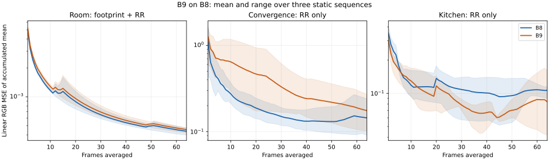

# B9 based on B8: limited PT++ comparison

B9 retains B8's NVIDIA non-directional GI temporal/spatial reuse, disjoint short-GI/long-PT split, original scenes and material/camera identities. Brightness fixes remain deferred. This is an experimental checkpoint, not a complete-paper or universal-quality claim.

## Active algorithm by scene

| Scene | B8 control | B9 candidate | Remaining limitation |
|---|---|---|---|
| Room640×360, cap4/4 | DI + GI-short reuse + ReSTIR PT-long; fixed reconnection, roulette off | Same B8 + footprint/inverse-footprint reconnection + initial-only roulette, survival0.8 | Opaque, nonbinding diffuse budget; broader transport acceptance remains pending |
| Original Convergence1280×720, cap14/2 | Same contribution split with full-prefix PT replay | Same B8 + initial-only roulette, survival0.8; full-prefix replay retained | Footprint mid-path reconnection unsupported; this is a partial B9 ablation |
| Original Kitchen1280×720, cap14/2 | Same contribution split with full-prefix PT replay | Same B8 + initial-only roulette, survival0.8; full-prefix replay retained | Footprint mid-path reconnection unsupported; this is a partial B9 ablation |

The original-scene guard still requires explicit full-prefix replay, fixed reconnection and the binding native diffuse budget. New development stage3 permits initial-only roulette exclusively with the B8 contribution partition and GI mode3. Stage2 retains footprint+roulette for the eligible Room configuration. Replay itself must never run roulette. No SDK submodule is edited.

[PT++ §§4 and6.2.4](https://cwyman.org/papers/i3d26_ReSTIRPT++.pdf) provide the footprint criteria and initial-only roulette scheme. The inherited application code draws roulette from the initial RNG, scales surviving throughput by inverse survival probability and records that probability for the sampling weight. Hybrid replay does not draw roulette. Diagnostic counters below exercise that separation; finite rendering alone does not establish unbiasedness.

Runtime packing and forced NEE reconnection are inherited RTXDI3.1 features, not new B9 gains. Remaining PT++ mechanisms belong to B10.

## Captured-frame GPU activation

| B9 scene | Initial roulette trials | Survivals | Terminations | Replay roulette trials |
|---|---:|---:|---:|---:|
| Room |210,338|168,151|42,187|0|
| Convergence |1,075,029|860,133|214,896|0|
| Kitchen |1,581,740|1,265,842|315,898|0|

These are the last captured frame, not accumulated counters over every warmup frame. GI history is active in all three snapshots. The cap1/cap2 Room cases retain the tested short-GI/long-PT support; empty transport is allowed to have no roulette trials.

## Verification and comparison scope

Release build and229benchmark-tool tests pass. All eight GPU diagnostic cases passed, including cap1/cap2 contribution support, finite same-frame sums, active GI history and zero captured-frame replay roulette trials. The Room snapshot has129,854stored mid-path PT reservoirs; original-scene snapshots have zero, as required by their full-prefix guard. The completed comparisons retain all three scenes, matched B8 controls, three sampling seeds47/1019/4093 with64static frames each, raw HDR and official HDR/LDR-FLIP, and separate repeated uncapped timing with cap/restoration receipts. Images are excluded from timing. Missing data remain pending rather than inferred.

A proposed bit-exact cross-process B8 regression gate failed before candidate execution. Native output matched exactly; differences first appeared in DI reuse. A repeat with the preserved B8 executable at its original location also differed from the historical capture. Full-image cross-process bit identity is therefore not established; the failed check is retained and is not called a B9 regression or a passed equivalence gate. Fresh matched controls and replicated quality are required and are provided below. A relocated-executable preflight failed before logging; the original-location repeat succeeded and the B9 executable was restored. No crash cause is asserted.

[Evidence status](../../Benchmarks/development/2026-10-30-b9-on-b8/summary.json) · [B8 measured foundation](B8_STAGED_IMPLEMENTATION.md) · [Canonical numbering](VERSION_MAPPING.md)

## Three-seed static quality comparison

Each row aggregates three fresh process captures with seeds47/1019/4093 and64chronological1spp frames per capture. Original materials/cameras, MIP0, fixed exposure, no reconstruction/cache/post/firefly filters and explicit stopped animations. Both versions use GI3 and DI/PT temporal+spatial reuse with one PT neighbor. Room640×360 cap4/4 uses the retained2048spp native reference; originals1280×720 cap14/2 use the retained4096spp MIP0 references. Reference hashes and reference-derived officialFLIP1.7 settings are fixed.

| Scene | Version | Mean frame RGB MSE ± SE ↓ | Frame64 HDR-FLIP median ↓ | Frame64 LDR-FLIP median ↓ |
|---|---|---:|---:|---:|
|opaque-room|B8|0.006225 ±0.000902|0.110516|0.076983|
|opaque-room|B9|0.006343 ±0.000900|0.111569|0.077476|
|convergence|B8|1.269916 ±0.149551|0.315774|0.211896|
|convergence|B9|1.440134 ±0.203356|0.319711|0.215269|
|kitchen|B8|0.745440 ±0.237990|0.459480|0.272643|
|kitchen|B9|0.797768 ±0.247025|0.464556|0.275362|

| Scene | Version | MSE of64-frame average ± SE ↓ | Mean raw luminance difference ± SE |
|---|---|---:|---:|
|opaque-room|B8|0.000436 ±0.000021|+0.055% ±0.028%|
|opaque-room|B9|0.000454 ±0.000018|+0.041% ±0.035%|
|convergence|B8|0.144587 ±0.048536|-1.545% ±0.056%|
|convergence|B9|0.175292 ±0.050493|-1.438% ±0.081%|
|kitchen|B8|0.106513 ±0.008284|-4.917% ±0.134%|
|kitchen|B9|0.083842 ±0.039001|-4.808% ±0.075%|

SE is sample standard error across the three per-seed process summaries. Reused frames are correlated;64frames are not64independent samples. FLIP columns describe frame64, while MSE columns describe all64frames and their temporal average. The finite native references are not ground truth. Signed luminance differences are measurements, not fitted corrections or a proof of asymptotic bias. No equal-time/error result or universal gain is established.

The curves average per-seed accumulated-mean MSE. Shading spans the minimum/maximum of the three sequences, not a confidence interval. Room tests footprint+roulette; the original scenes test roulette only. [Full quality inputs, frame hashes and statistics](../../Benchmarks/development/2026-10-30-b9-on-b8/quality.json). Timing is a separate no-image-write acquisition; results are below.

## Uncapped timing comparison

Eighteen fresh process runs, three rotated-order repeats per scene/version,30s warmup plus15s PresentMon2.6.0 capture. The last600 Original/NotSet presentation rows are selected and the final16 excluded. Frozen application source, executable and699shader-cache files were verified before/after every run. No image writes or reported trace loss; known app/NVIDIA/RTSS caps checked, SyncInterval0 observed and exact-executable NVIDIA profile restoration verified after every process. Unknown external limiters and background load remain limitations.

| Scene | B8 GPU busy ms ↓ | B9 GPU busy ms ↓ | Change | B8 CPU cadence ms | B9 CPU cadence ms |
|---|---:|---:|---:|---:|---:|
|opaque-room|1.9979|2.2281|+11.52%|1.9567|2.1827|
|convergence|10.9106|10.1379|-7.08%|10.9208|10.1384|
|kitchen|13.2793|12.2007|-8.12%|13.2720|12.1988|

GPU busy is target-process engine time, not a complete frame critical path, renderer FPS or isolated PT-pass time. These are medians of run medians; retained bootstrap intervals over three runs are exploratory. No equal-time/error or equal-quality speedup is established. Timed runs are separate from image-writing quality captures. Renderer-exclusive resident VRAM was not measured; no new GPU reservoir payload/layout was introduced by these host activation changes.

[Exact timing evidence](../../Benchmarks/development/2026-10-30-b9-on-b8/timing-evidence/comparison.json) · [Run-summary intervals](../../Benchmarks/development/2026-10-30-b9-on-b8/timing-summary.json)

## Seed-paired quality differences

The same explicit seed labels pair separate process summaries; they do not imply identical paths or bit-identical DI/GI histories. Differences are B9 minus B8. Sample SE uses three pairs, not individual correlated frames; it is exploratory small-sample uncertainty.

| Scene | Mean frame MSE difference ± paired SE |64-frame-average MSE difference ± paired SE |
|---|---:|---:|
|room|+0.000118 ±0.000017|+0.000018 ±0.000006|
|convergence|+0.170219 ±0.061952|+0.030705 ±0.011831|
|kitchen|+0.052328 ±0.177900|-0.022671 ±0.035464|

The Room point estimates show a small consistent error increase; Convergence has higher frame and accumulated-mean error. Kitchen has higher frame-error and lower accumulated-mean-error point estimates, with large paired uncertainty. None establishes a universal quality benefit. The brightness residual remains visible and deferred.

## Representative images

Fixed seed47, frame64; displayed images are not selected to match the median score. Click a picture to open it; Escape closes the shared viewer.

| Scene | Matched B8 | B9 candidate |
|---|---|---|
|room|||
|convergence|||
|kitchen|||

## Completed checkpoint and remaining gates

B9 now runs on B8 with GI reuse active. Eight diagnostic cases,18three-seed64-frame quality captures and18uncapped timing runs are complete. Room exercises footprint/inverse-footprint reconnection and initial-only roulette; original Convergence/Kitchen remain roulette-only full-prefix ablations because mid-path diffuse-budget/medium state is not yet carried. This completes the measured experimental checkpoint, not full original-scene footprint support or canonical promotion. Motion/reset stress and equal-time/error comparisons remain pending. No brightness compensation or scene-material substitution is applied.

## Summary and lessons learned

B9 now has an explicit original-scene roulette test path without removing the mid-path transport safeguard. The measured Room footprint+roulette combination is slower and has higher error; original-scene roulette-only runs reduce GPU busy while quality remains mixed. Successful finite rendering alone does not establish a quality gain or correct weighting. Independent-launch bit identity is not a validated oracle for the current reused-lighting pipeline; retain that limitation and compare matched replicated measurements.

## Changelog

- 2026-10-30: B9-on-B8 implementation and diagnostic phase started; scene-specific PT++ scope and repeatability limitation recorded.

- 2026-10-30: completed all-scene replicated quality and cap-verified timing; original-scene footprint and cross-process bitidentity remain unestablished.
