# B0–B16 and sampling-variant comparison overview

**Current implementation status:** The opt-in one-neighbor spatial replay queue now passes11captured-frame GPU oracles, including Convergence244654replays and Kitchen41032replays. Every packed-history word and vector-radiance bit matches its same-frame direct control. Native and direct-pair queue-disabled regressions pass. Queue performance, queue-only temporal-history sequences and full B10 acceptance remain pending. [Detailed queue checkpoint](B10_GAUSSIAN_PAIRING.md#replay-compaction--active-implementation-checkpoint).

All 20 registered variants appear below for each required scene. **The latest measured checkpoints now appear directly under B0 and B10 in these tables.** B10 Gaussian timing, Gaussian quality and replay-queue validation have separate rows because they are different acquisitions. **Not measured means unavailable, never zero.** B0 remains the unchanged RTXPT1.9 reference; its PT-only control is explicitly labelled as an override.

GPU busy is process GPU activity in milliseconds, not complete frame latency or an FPS estimate. Lower FLIP/MSE is better. Rows from different cohorts are descriptive: settings and sampling policies must be checked before computing a relative gain. Known app/NVIDIA/RTSS cap boundaries were verified for accepted current timing cohorts; unknown external limiters and background load remain limitations.

[Machine-readable overview](comparison-overview.json) · [Algorithm definitions and identities](VERSION_MAPPING.md) · [Benchmark protocol](BENCHMARK_VERSIONS.md)

## Latest B10 queue-history validation — partial development

Five static GPU cases compare272frames with actual queued output retained as history. Packed reservoir and RGB scheduling mismatches/overflow are zero; an injected early failure is rejected after a clean final frame. This is not full PT++, a quality improvement or a new timing result. B11 active CGNS remains pending. [Detailed evidence and remaining work](B10_QUEUE_HISTORY.md) · [B11 integration requirements](B11_INTEGRATION.md).

|Case|Resolution|Compared frames|Reservoir / RGB mismatches|Overflow|Diagnostic picture|
|---|---:|---:|---:|---:|---|
|room-adjacent64|177×91|64|0 / 0|0|<a href="assets/b10-history/room-adjacent64.png">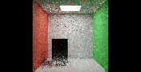</a>|
|room-gaussian64|177×91|64|0 / 0|0|<a href="assets/b10-history/room-gaussian64.png">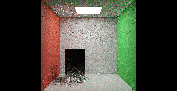</a>|
|room-thin16|176×1|16|0 / 0|0||
|convergence64|1280×720|64|0 / 0|0||
|kitchen64|1280×720|64|0 / 0|0|<a href="assets/b10-history/kitchen64.png">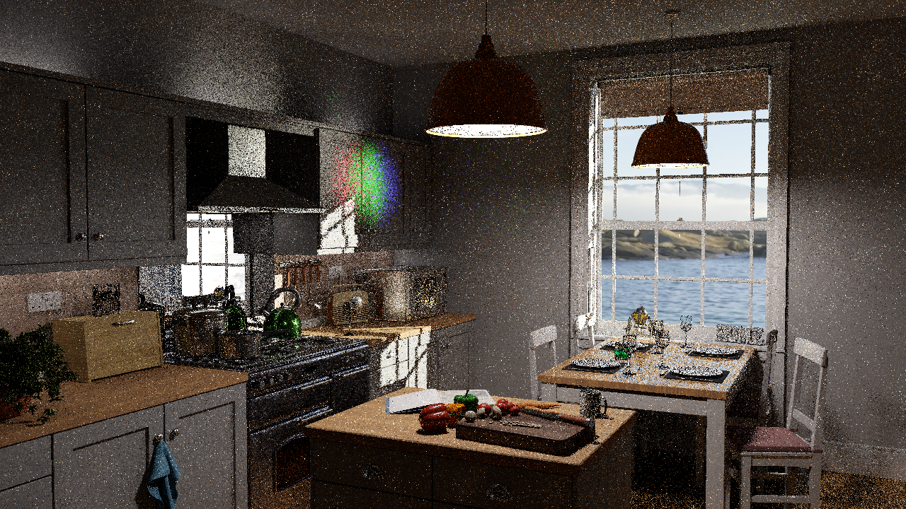</a>|

Pictures are final-frame scheduling diagnostics, not matched B10/B11 quality comparisons. Original-scene mid-path footprint and brightness investigation remain open. Driver-cap clearance is not asserted for these diagnostic captures.

## Controlled room — registered environment

Main canonical rows:640×360,1spp,3/3 bounce limits; opaque-room-registered-env.scene.json. B8 development pictures and new checkpoint rows explicitly use4/4; the queue snapshot is176x90. This is a distinct fixture from the legacy no-environment room. Native controls retain their DI/MIS policies; B6/B7 use their documented PT/strict-DI policies.

| Version | Algorithm | GPU busy ms ↓ | LDR-FLIP ↓ | HDR-FLIP ↓ | Picture | Evidence status |
|---|---|---:|---:|---:|---|---|
| **B0** | Unchanged RTXPT v1.9 reference: original defaults and dependencies | Unavailable | Unavailable | Unavailable | No eligible capture | [pending](VERSION_MAPPING.md) |
| **↳ B0 · PT-only control** | RTXPT1.9 native PT; ReSTIR DI/GI/PT off; native NEE on | 0.831 | 0.121162 | Unavailable | [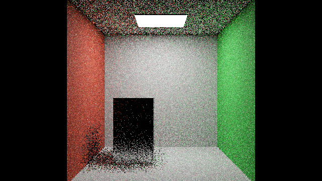](assets/native-pt-only/opaque-room.png) | [Measured override; original defaults preserved. Room4/4; originals14/2.](NATIVE_MATRIX_RESULTS.md) |
| **B1** | v1.9 native PT + ReSTIR DI3.0; GI off | 1.283 | 0.121484 | Unavailable |  | [measured](REGISTERED_ROOM_RESULTS.md) |
| **B2** | v1.9 native PT + ReSTIR DI3.0 + ReSTIR GI3.0 | 1.441 | 0.094603 | Unavailable | [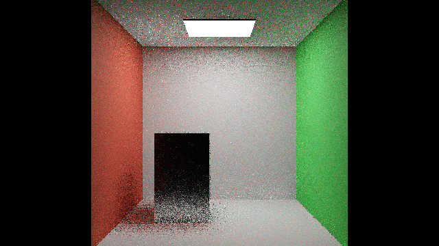](assets/native-matrix/opaque-room-B2.png) | [measured known caps verified](NATIVE_MATRIX_RESULTS.md) |
| **B3** | Native PT with RTXDI3.1 linked; DI/GI off | 0.805 | 0.116744 | Unavailable | [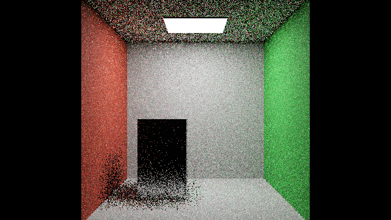](assets/native-matrix/opaque-room-B3.png) | [measured known caps verified](NATIVE_MATRIX_RESULTS.md) |
| **B4** | Native PT + ReSTIR DI3.1; GI off | 1.289 | 0.121719 | Unavailable | [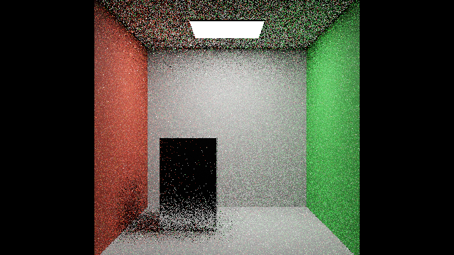](assets/registered-room/B4.png) | [measured](REGISTERED_ROOM_RESULTS.md) |
| **B5** | Native PT + ReSTIR DI3.1 + ReSTIR GI3.1 | 1.461 | 0.093961 | Unavailable | [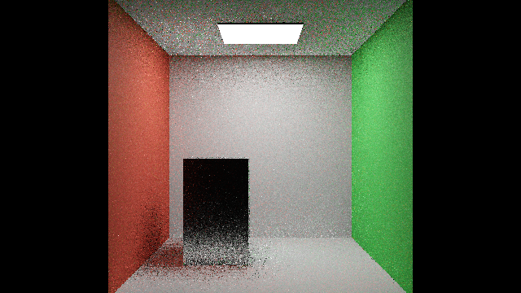](assets/native-matrix/opaque-room-B5.png) | [measured known caps verified](NATIVE_MATRIX_RESULTS.md) |
| **B6** | ReSTIR PT; DI/GI off | 1.419 | 0.073817 | 0.114122 |  | [measured](REGISTERED_ROOM_RESULTS.md) |
| **B7** | ReSTIR PT + ReSTIR DI3.1; GI off | 1.539 | 0.066837 | 0.103801 | [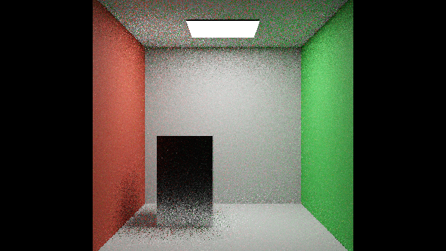](assets/registered-room/B7.png) | [measured](REGISTERED_ROOM_RESULTS.md) |
| **B8** | B8 development: DI + approximate GI-short reuse + PT-long | Unavailable | Unavailable | Unavailable |  | [development not accepted](B8_STAGED_IMPLEMENTATION.md) |
| **↳ B8 · GI initial control** | DI + GI-short initial + PT-long | 1.763 | 0.089866 | 0.145792 | [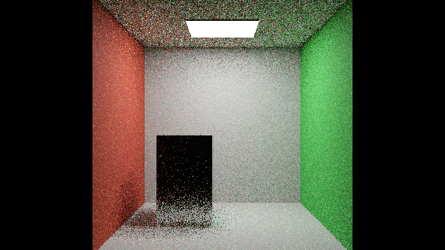](assets/b8-nvidia-gi/room-gi-1.png) | [64-frame static sequence, frame64 FLIP; 3 uncapped timing processes. Initial-only GI control. Cap4/4. Mixed quality; not canonical acceptance.](B8_STAGED_IMPLEMENTATION.md) |
| **↳ B8 · NVIDIA GI reuse** | DI + GI-short temporal/spatial approximation + PT-long | 1.881 | 0.077162 | 0.110711 |  | [64-frame static sequence, frame64 FLIP; 3 uncapped timing processes. Nondirectional GI approximation. Cap4/4. Mixed quality; not canonical acceptance.](B8_STAGED_IMPLEMENTATION.md) |
| **↳ B8 · matched B9 control** | GI3 + PT-long fixed, roulette off | 1.998 | 0.076983 | 0.110516 |  | [Three seeds ×64static frames; frame64 FLIP. Three uncapped timings. Room cap4/4. Development, no promotion.](B9_RESULTS.md) |
| **B9** | B9 on B8: GI reuse + footprint/roulette | Unavailable | Unavailable | Unavailable | [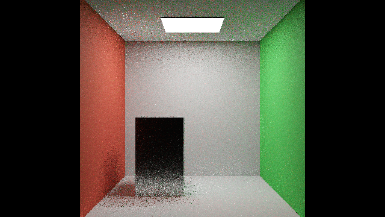](assets/b9-on-b8/room-B9.png) | [development not accepted](B9_RESULTS.md) |
| **↳ B9 · footprint + roulette** | GI3 + PT-long footprint/roulette | 2.228 | 0.077476 | 0.111569 |  | [Three seeds ×64static frames; frame64 FLIP. Three uncapped timings. Room cap4/4. Development, no promotion.](B9_RESULTS.md) |
| **B10** | B10 development: initial-GI split + Gaussian pair/vector pilot | Unavailable | Unavailable | Unavailable | [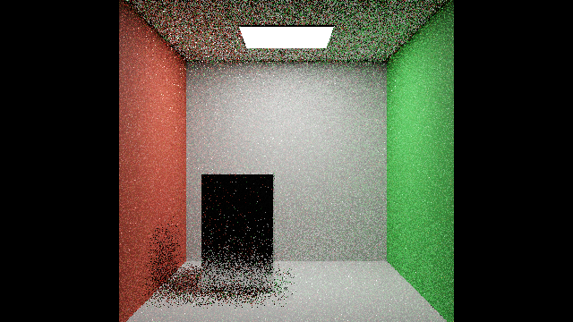](assets/b10-gaussian/room.png) | [development not accepted](B10_GAUSSIAN_PAIRING.md) |
| **↳ B10 · Gaussian timing** | DI initial + GI initial + paired/vector PT; one Gaussian neighbor | 1.591 | Unavailable | Unavailable | No images during timing | [3 timed processes; quality is a separate row. Room4/4; originals14/2.](B10_GAUSSIAN_PAIRING.md) |
| **↳ B10 · Gaussian quality** | One-neighbor paired/vector PT; GI initial only | Unavailable | 0.096257 | 0.159373 |  | [Quality-only cohort: 64-frame sequence, cap4/4.](B10_GAUSSIAN_PAIRING.md) |
| **↳ B10 · Replay queue** | One-neighbor spatial replay queue; DI/GI initial | Unavailable | Unavailable | Unavailable | [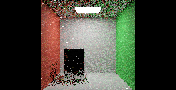](assets/b10-queue/opaque-room.png) | [Exact snapshot: 176x90, cap4/4, 0 replays,0 mismatches. Timing/quality scores pending.](B10_GAUSSIAN_PAIRING.md) |
| **B10.75** | B10 full PT++ at0.75average spp | Unavailable | Unavailable | Unavailable | No eligible capture | [pending](VERSION_MAPPING.md) |
| **B10.50** | B10 full PT++ at0.5average spp | Unavailable | Unavailable | Unavailable | No eligible capture | [pending](VERSION_MAPPING.md) |
| **B10.25** | B10 full PT++ at0.25average spp | Unavailable | Unavailable | Unavailable | No eligible capture | [pending](VERSION_MAPPING.md) |
| **B11** | B10 + Compatibility-Guided Neighbor Selection active | Unavailable | Unavailable | Unavailable | No eligible capture | [pending](VERSION_MAPPING.md) |
| **B12** | B11 + Stochastic Pairwise MIS | Unavailable | Unavailable | Unavailable | No eligible capture | [pending](VERSION_MAPPING.md) |
| **B13** | B12 + ReSTIR LoD | Unavailable | Unavailable | Unavailable | No eligible capture | [pending](VERSION_MAPPING.md) |
| **B14** | B13 + ReSTIR BDPT with LW version | Unavailable | Unavailable | Unavailable | No eligible capture | [pending](VERSION_MAPPING.md) |
| **B15** | B14 + ReSTIR PG | Unavailable | Unavailable | Unavailable | No eligible capture | [pending](VERSION_MAPPING.md) |
| **B16** | B15 + Multi-Layer Reservoir Splatting | Unavailable | Unavailable | Unavailable | No eligible capture | [pending](VERSION_MAPPING.md) |

Coverage and missing-data reasons

- **B0:** Unchanged original reference preserved. Separate raw-native control data exists; original-default benchmark is not replaced by it
- **B1:** Explicit separate zero-intensity registered environment fixture, same owned model/materials/camera; preserve prior no-env data separately. Three timing repeats; native3quality processes or modern3seed history sweep.
- **B2:** Fresh native-control cohort:3 quality processes and3 cap-verified timing processes; original shader estimator retained. Different acquisition cohort from B1/B4 and B6/B7.
- **B3:** Fresh native-control cohort:3 quality processes and3 cap-verified timing processes; original shader estimator retained. Different acquisition cohort from B1/B4 and B6/B7.
- **B4:** Explicit separate zero-intensity registered environment fixture, same owned model/materials/camera; preserve prior no-env data separately. Three timing repeats; native3quality processes or modern3seed history sweep.
- **B5:** Fresh native-control cohort:3 quality processes and3 cap-verified timing processes; original shader estimator retained. Different acquisition cohort from B1/B4 and B6/B7.
- **B6:** Explicit separate zero-intensity registered environment fixture, same owned model/materials/camera; preserve prior no-env data separately. Three timing repeats; native3quality processes or modern3seed history sweep.
- **B7:** Explicit separate zero-intensity registered environment fixture, same owned model/materials/camera; preserve prior no-env data separately. Three timing repeats; native3quality processes or modern3seed history sweep.
- **B8:** NVIDIA non-directional GI reuse: 640x360 cap4/4,64-frame static quality measured; mixed results. Scoped timing is shown separately when available; no canonical promotion.
- **B9:** Eight GPU diagnostics passed; 640x360 cap4/4 snapshot shown. Three-seed64-frame quality and uncapped timing in progress. Original-scene footprint remains unsupported; no promotion.
- **B10:** Gaussian single-neighbor pair/vector development executes at original1280x720 and room640x360. GI initial only; original-scene quality is one capture, room one64-frame sequence. Remaining mechanisms and accepted total timing pending. Image is 640x360 development coverage, not an accepted matched benchmark.
- **B10.75:** User-confirmed roadmap; activation/integration and matched quality/performance evidence pending. No measurements inferred.
- **B10.50:** User-confirmed roadmap; activation/integration and matched quality/performance evidence pending. No measurements inferred.
- **B10.25:** User-confirmed roadmap; activation/integration and matched quality/performance evidence pending. No measurements inferred.
- **B11:** User-confirmed roadmap; activation/integration and matched quality/performance evidence pending. No measurements inferred.
- **B12:** User-confirmed roadmap; activation/integration and matched quality/performance evidence pending. No measurements inferred.
- **B13:** User-confirmed roadmap; activation/integration and matched quality/performance evidence pending. No measurements inferred.
- **B14:** User-confirmed roadmap; activation/integration and matched quality/performance evidence pending. No measurements inferred.
- **B15:** User-confirmed roadmap; activation/integration and matched quality/performance evidence pending. No measurements inferred.
- **B16:** User-confirmed roadmap; activation/integration and matched quality/performance evidence pending. No measurements inferred.

## Original Convergence

1280×720,1spp,14/2 bounce limits, exposure0. Original materials and camera preserved.

| Version | Algorithm | GPU busy ms ↓ | LDR-FLIP ↓ | HDR-FLIP ↓ | Picture | Evidence status |
|---|---|---:|---:|---:|---|---|
| **B0** | Unchanged RTXPT v1.9 reference: original defaults and dependencies | Unavailable | Unavailable | Unavailable | No eligible capture | [pending](VERSION_MAPPING.md) |
| **↳ B0 · PT-only control** | RTXPT1.9 native PT; ReSTIR DI/GI/PT off; native NEE on | 2.517 | 0.372227 | Unavailable |  | [Measured override; original defaults preserved. Room4/4; originals14/2.](NATIVE_MATRIX_RESULTS.md) |
| **B1** | v1.9 native PT + ReSTIR DI3.0; GI off | 3.796 | 0.341609 | Unavailable |  | [measured](CANONICAL_NATIVE_DI_RESULTS.md) |
| **B2** | v1.9 native PT + ReSTIR DI3.0 + ReSTIR GI3.0 | 4.510 | 0.243459 | Unavailable |  | [measured known caps verified](NATIVE_MATRIX_RESULTS.md) |
| **B3** | Native PT with RTXDI3.1 linked; DI/GI off | 2.565 | 0.375281 | Unavailable | [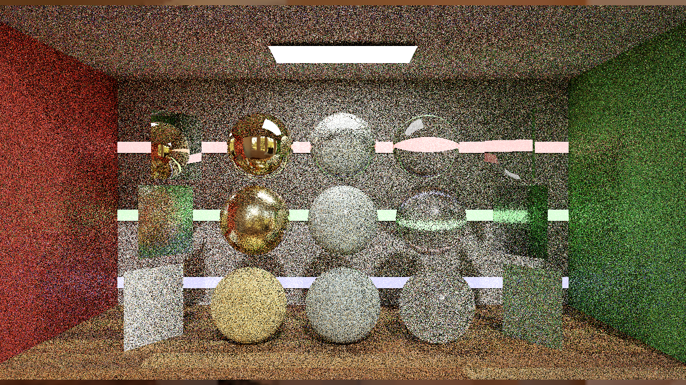](assets/native-matrix/convergence-B3.png) | [measured known caps verified](NATIVE_MATRIX_RESULTS.md) |
| **B4** | Native PT + ReSTIR DI3.1; GI off | 3.772 | 0.341623 | Unavailable | [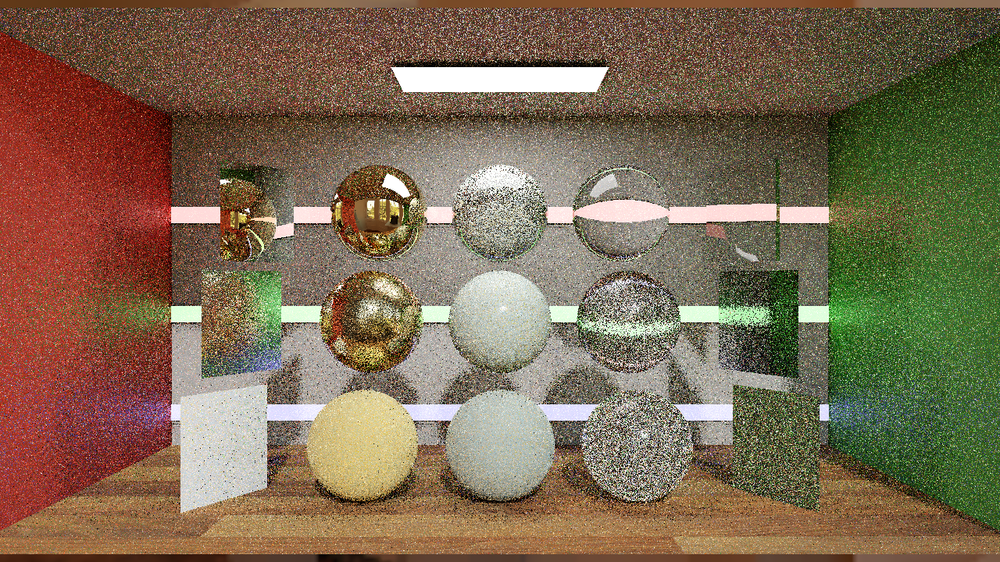](assets/canonical-native-di/convergence-B4.png) | [measured](CANONICAL_NATIVE_DI_RESULTS.md) |
| **B5** | Native PT + ReSTIR DI3.1 + ReSTIR GI3.1 | 4.545 | 0.243522 | Unavailable | [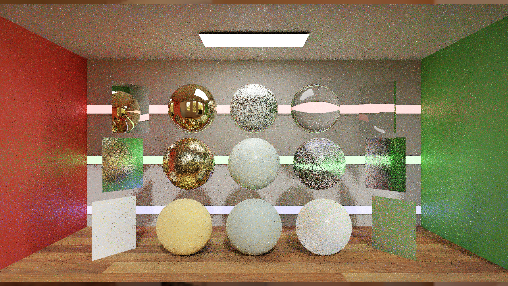](assets/native-matrix/convergence-B5.png) | [measured known caps verified](NATIVE_MATRIX_RESULTS.md) |
| **B6** | ReSTIR PT; DI/GI off | Unavailable | 0.300663 | 0.453476 | [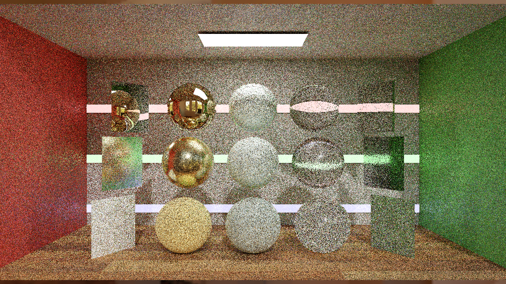](assets/finite-shift-guard/convergence-B6.png) | [Guarded quality measured; timing pending †](FINITE_SHIFT_GUARD.md) |
| **B7** | ReSTIR PT + ReSTIR DI3.1; GI off | Unavailable | 0.222129 | 0.333817 |  | [Guarded quality measured; timing pending †](FINITE_SHIFT_GUARD.md) |
| **B8** | B8 development: DI + approximate GI-short reuse + PT-long | Unavailable | Unavailable | Unavailable |  | [development not accepted](B8_STAGED_IMPLEMENTATION.md) |
| **↳ B8 · GI initial control** | DI + GI-short initial + PT-long | 10.343 | 0.255432 | 0.381780 | [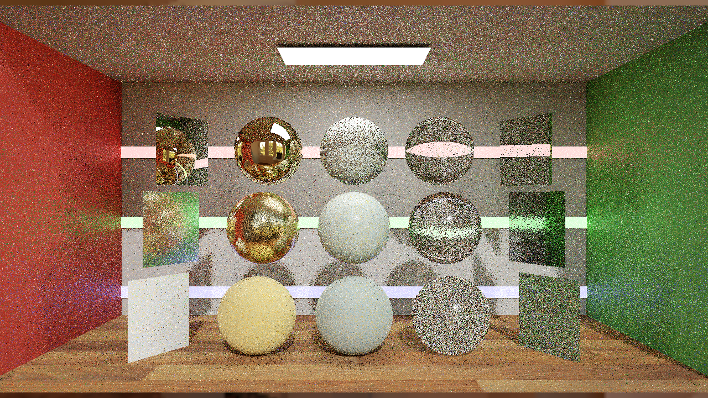](assets/b8-nvidia-gi/convergence-gi-1.png) | [64-frame static sequence, frame64 FLIP; 3 uncapped timing processes. Initial-only GI control. Cap14/2. Mixed quality; not canonical acceptance.](B8_STAGED_IMPLEMENTATION.md) |
| **↳ B8 · NVIDIA GI reuse** | DI + GI-short temporal/spatial approximation + PT-long | 10.853 | 0.211882 | 0.315019 |  | [64-frame static sequence, frame64 FLIP; 3 uncapped timing processes. Nondirectional GI approximation. Cap14/2. Mixed quality; not canonical acceptance.](B8_STAGED_IMPLEMENTATION.md) |
| **↳ B8 · matched B9 control** | GI3 + PT-long fixed, roulette off | 10.911 | 0.211896 | 0.315774 | [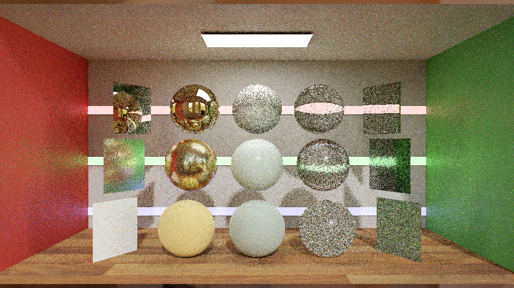](assets/b9-on-b8/convergence-B8.png) | [Three seeds ×64static frames; frame64 FLIP. Three uncapped timings. Original cap14/2; footprint unsupported. Development, no promotion.](B9_RESULTS.md) |
| **B9** | B9 on B8: GI reuse + full-prefix roulette-only ablation | Unavailable | Unavailable | Unavailable | [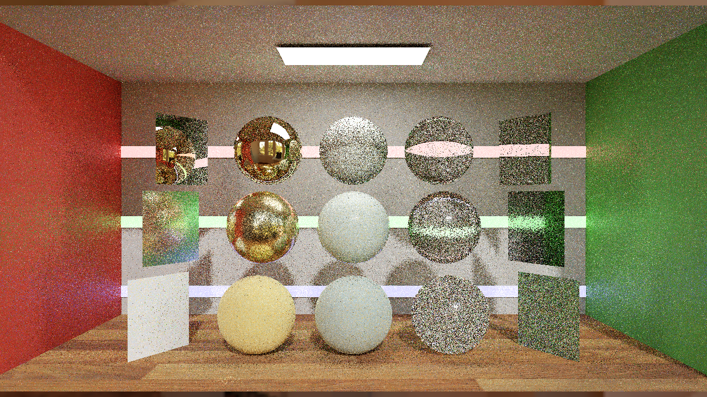](assets/b9-on-b8/convergence-B9.png) | [development not accepted](B9_RESULTS.md) |
| **↳ B9 · roulette only** | GI3 + PT-long full-prefix roulette-only | 10.138 | 0.215269 | 0.319711 |  | [Three seeds ×64static frames; frame64 FLIP. Three uncapped timings. Original cap14/2; footprint unsupported. Development, no promotion.](B9_RESULTS.md) |
| **B10** | B10 development: initial-GI split + Gaussian pair/vector pilot | Unavailable | Unavailable | Unavailable |  | [development not accepted](B10_GAUSSIAN_PAIRING.md) |
| **↳ B10 · Gaussian timing** | DI initial + GI initial + paired/vector PT; one Gaussian neighbor | 7.184 | Unavailable | Unavailable | No images during timing | [3 timed processes; quality is a separate row. Room4/4; originals14/2.](B10_GAUSSIAN_PAIRING.md) |
| **↳ B10 · Gaussian quality** | One-neighbor paired/vector PT; GI initial only | Unavailable | 0.351035 | 0.536508 |  | [Quality-only cohort: 1 image,8 warmup frames, cap14/2.](B10_GAUSSIAN_PAIRING.md) |
| **↳ B10 · Replay queue** | One-neighbor spatial replay queue; DI/GI initial | Unavailable | Unavailable | Unavailable |  | [Exact snapshot: 1280x720, cap14/2, 244654 replays,0 mismatches. Timing/quality scores pending.](B10_GAUSSIAN_PAIRING.md) |
| **B10.75** | B10 full PT++ at0.75average spp | Unavailable | Unavailable | Unavailable | No eligible capture | [pending](VERSION_MAPPING.md) |
| **B10.50** | B10 full PT++ at0.5average spp | Unavailable | Unavailable | Unavailable | No eligible capture | [pending](VERSION_MAPPING.md) |
| **B10.25** | B10 full PT++ at0.25average spp | Unavailable | Unavailable | Unavailable | No eligible capture | [pending](VERSION_MAPPING.md) |
| **B11** | B10 + Compatibility-Guided Neighbor Selection active | Unavailable | Unavailable | Unavailable | No eligible capture | [pending](VERSION_MAPPING.md) |
| **B12** | B11 + Stochastic Pairwise MIS | Unavailable | Unavailable | Unavailable | No eligible capture | [pending](VERSION_MAPPING.md) |
| **B13** | B12 + ReSTIR LoD | Unavailable | Unavailable | Unavailable | No eligible capture | [pending](VERSION_MAPPING.md) |
| **B14** | B13 + ReSTIR BDPT with LW version | Unavailable | Unavailable | Unavailable | No eligible capture | [pending](VERSION_MAPPING.md) |
| **B15** | B14 + ReSTIR PG | Unavailable | Unavailable | Unavailable | No eligible capture | [pending](VERSION_MAPPING.md) |
| **B16** | B15 + Multi-Layer Reservoir Splatting | Unavailable | Unavailable | Unavailable | No eligible capture | [pending](VERSION_MAPPING.md) |

Coverage and missing-data reasons

- **B0:** Unchanged original reference preserved. Separate raw-native control data exists; original-default benchmark is not replaced by it
- **B1:** Original scene/material/camera retained;3quality and3timing process repetitions/configuration
- **B2:** Fresh native-control cohort:3 quality processes and3 cap-verified timing processes; original shader estimator retained. Different acquisition cohort from B1/B4 and B6/B7.
- **B3:** Fresh native-control cohort:3 quality processes and3 cap-verified timing processes; original shader estimator retained. Different acquisition cohort from B1/B4 and B6/B7.
- **B4:** Original scene/material/camera retained;3quality and3timing process repetitions/configuration
- **B5:** Fresh native-control cohort:3 quality processes and3 cap-verified timing processes; original shader estimator retained. Different acquisition cohort from B1/B4 and B6/B7.
- **B6:** Five-seed1280x720 matched MIP0 quality; finite zero-Jacobian targets prevent invalid MIS propagation. Guarded replay-first transport; original scene/material/camera14/2. Throughput and general stability acceptance pending.
- **B7:** Five-seed1280x720 matched MIP0 quality; finite zero-Jacobian targets prevent invalid MIS propagation. Guarded replay-first transport; original scene/material/camera14/2. Throughput and general stability acceptance pending.
- **B8:** NVIDIA non-directional GI reuse: 1280x720 cap14/2,64-frame static quality measured; mixed results. Scoped timing is shown separately when available; no canonical promotion.
- **B9:** Eight GPU diagnostics passed; 1280x720 cap14/2 snapshot shown. Three-seed64-frame quality and uncapped timing in progress. Original-scene footprint remains unsupported; no promotion.
- **B10:** Gaussian single-neighbor pair/vector development executes at original1280x720 and room640x360. GI initial only; original-scene quality is one capture, room one64-frame sequence. Remaining mechanisms and accepted total timing pending. Image is 1280x720 development coverage, not an accepted matched benchmark.
- **B10.75:** User-confirmed roadmap; activation/integration and matched quality/performance evidence pending. No measurements inferred.
- **B10.50:** User-confirmed roadmap; activation/integration and matched quality/performance evidence pending. No measurements inferred.
- **B10.25:** User-confirmed roadmap; activation/integration and matched quality/performance evidence pending. No measurements inferred.
- **B11:** User-confirmed roadmap; activation/integration and matched quality/performance evidence pending. No measurements inferred.
- **B12:** User-confirmed roadmap; activation/integration and matched quality/performance evidence pending. No measurements inferred.
- **B13:** User-confirmed roadmap; activation/integration and matched quality/performance evidence pending. No measurements inferred.
- **B14:** User-confirmed roadmap; activation/integration and matched quality/performance evidence pending. No measurements inferred.
- **B15:** User-confirmed roadmap; activation/integration and matched quality/performance evidence pending. No measurements inferred.
- **B16:** User-confirmed roadmap; activation/integration and matched quality/performance evidence pending. No measurements inferred.

## Original Kitchen

1280×720,1spp,14/2 bounce limits, exposure2. Original materials and camera preserved.

| Version | Algorithm | GPU busy ms ↓ | LDR-FLIP ↓ | HDR-FLIP ↓ | Picture | Evidence status |
|---|---|---:|---:|---:|---|---|
| **B0** | Unchanged RTXPT v1.9 reference: original defaults and dependencies | Unavailable | Unavailable | Unavailable | No eligible capture | [pending](VERSION_MAPPING.md) |
| **↳ B0 · PT-only control** | RTXPT1.9 native PT; ReSTIR DI/GI/PT off; native NEE on | 3.243 | 0.376870 | Unavailable | [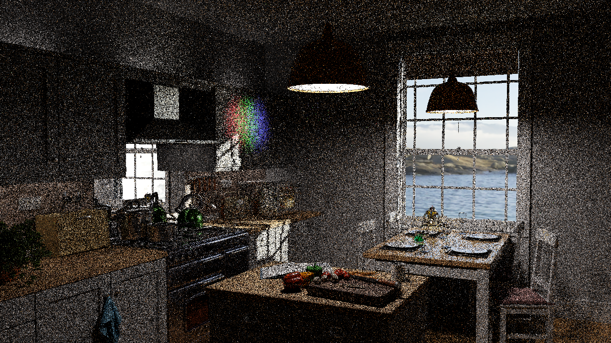](assets/native-pt-only/kitchen.png) | [Measured override; original defaults preserved. Room4/4; originals14/2.](NATIVE_MATRIX_RESULTS.md) |
| **B1** | v1.9 native PT + ReSTIR DI3.0; GI off | 4.455 | 0.386252 | Unavailable | [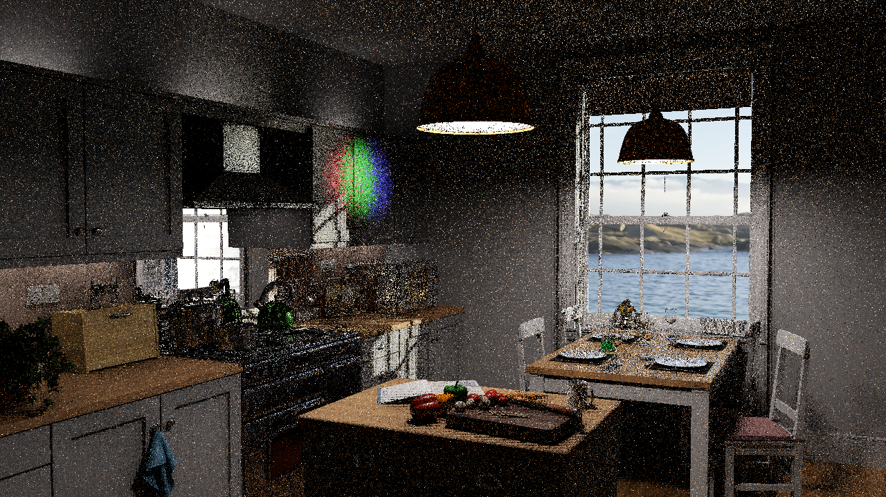](assets/canonical-native-di/kitchen-B1.png) | [measured](CANONICAL_NATIVE_DI_RESULTS.md) |
| **B2** | v1.9 native PT + ReSTIR DI3.0 + ReSTIR GI3.0 | 5.370 | 0.352840 | Unavailable | [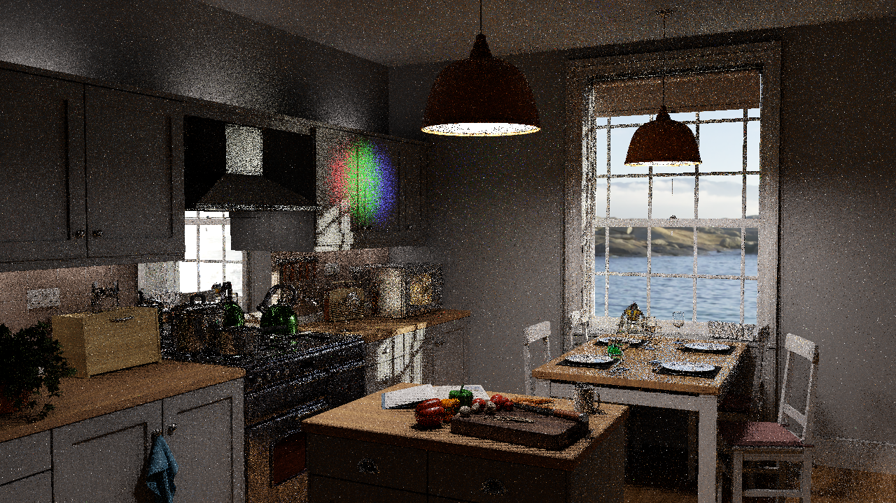](assets/native-matrix/kitchen-B2.png) | [measured known caps verified](NATIVE_MATRIX_RESULTS.md) |
| **B3** | Native PT with RTXDI3.1 linked; DI/GI off | 3.258 | 0.382364 | Unavailable | [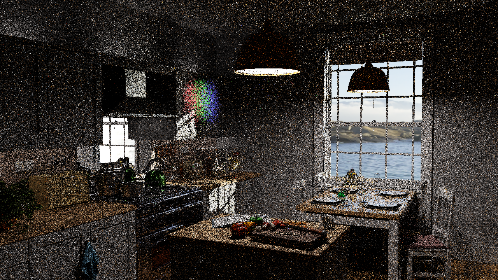](assets/native-matrix/kitchen-B3.png) | [measured known caps verified](NATIVE_MATRIX_RESULTS.md) |
| **B4** | Native PT + ReSTIR DI3.1; GI off | 4.446 | 0.386295 | Unavailable | [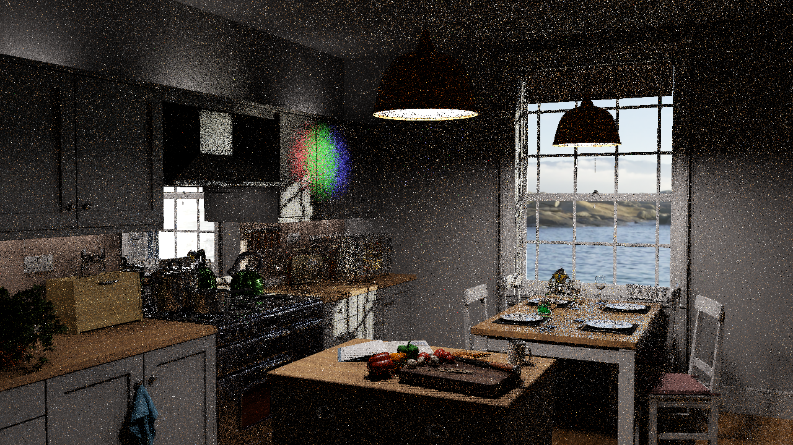](assets/canonical-native-di/kitchen-B4.png) | [measured](CANONICAL_NATIVE_DI_RESULTS.md) |
| **B5** | Native PT + ReSTIR DI3.1 + ReSTIR GI3.1 | 5.421 | 0.351458 | Unavailable |  | [measured known caps verified](NATIVE_MATRIX_RESULTS.md) |
| **B6** | ReSTIR PT; DI/GI off | Unavailable | 0.302520 | 0.546629 | [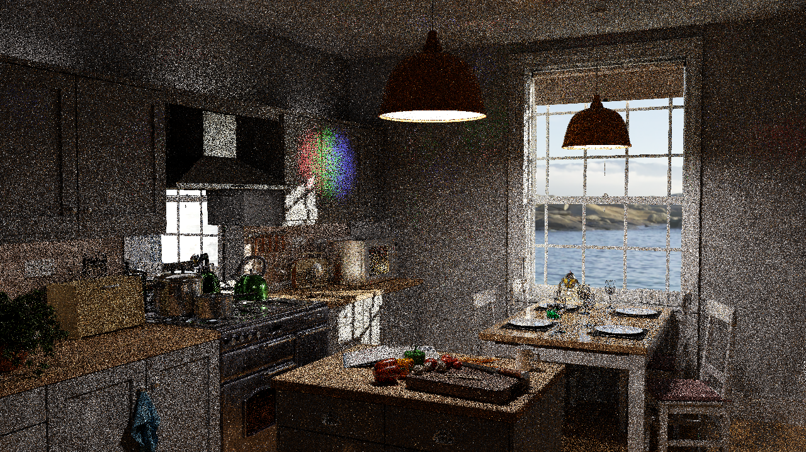](assets/finite-shift-guard/kitchen-B6.png) | [Guarded quality measured; timing pending †](FINITE_SHIFT_GUARD.md) |
| **B7** | ReSTIR PT + ReSTIR DI3.1; GI off | Unavailable | 0.249775 | 0.440491 | [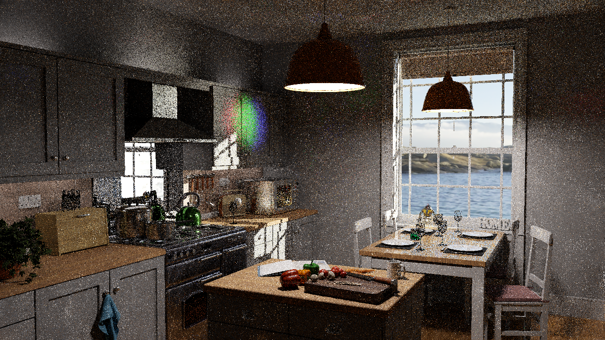](assets/finite-shift-guard/kitchen-B7.png) | [Guarded quality measured; timing pending †](FINITE_SHIFT_GUARD.md) |
| **B8** | B8 development: DI + approximate GI-short reuse + PT-long | Unavailable | Unavailable | Unavailable | [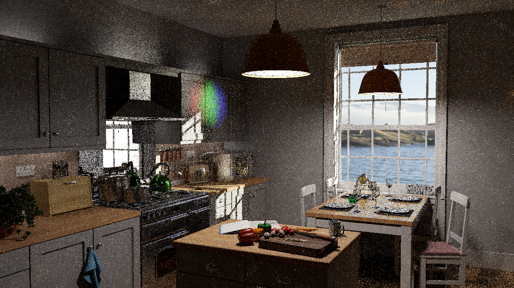](assets/b8-nvidia-gi/kitchen-gi3.png) | [development not accepted](B8_STAGED_IMPLEMENTATION.md) |
| **↳ B8 · GI initial control** | DI + GI-short initial + PT-long | 12.582 | 0.292854 | 0.520417 | [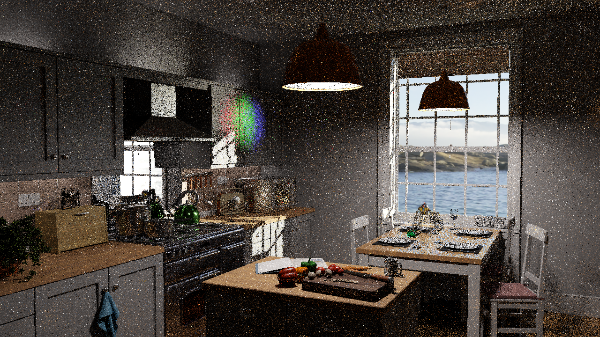](assets/b8-nvidia-gi/kitchen-gi-1.png) | [64-frame static sequence, frame64 FLIP; 3 uncapped timing processes. Initial-only GI control. Cap14/2. Mixed quality; not canonical acceptance.](B8_STAGED_IMPLEMENTATION.md) |
| **↳ B8 · NVIDIA GI reuse** | DI + GI-short temporal/spatial approximation + PT-long | 13.349 | 0.272080 | 0.458518 |  | [64-frame static sequence, frame64 FLIP; 3 uncapped timing processes. Nondirectional GI approximation. Cap14/2. Mixed quality; not canonical acceptance.](B8_STAGED_IMPLEMENTATION.md) |
| **↳ B8 · matched B9 control** | GI3 + PT-long fixed, roulette off | 13.279 | 0.272643 | 0.459480 | [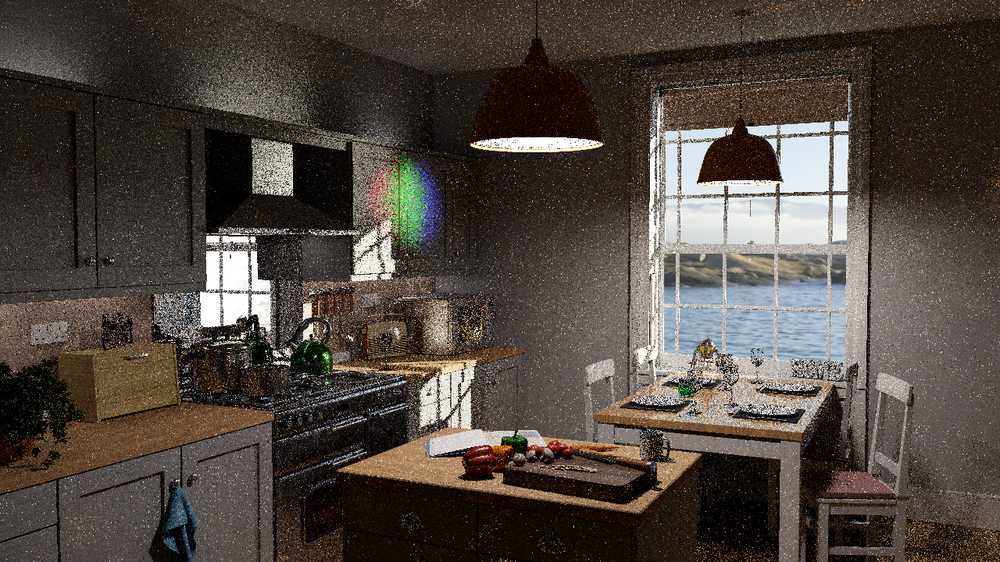](assets/b9-on-b8/kitchen-B8.png) | [Three seeds ×64static frames; frame64 FLIP. Three uncapped timings. Original cap14/2; footprint unsupported. Development, no promotion.](B9_RESULTS.md) |
| **B9** | B9 on B8: GI reuse + full-prefix roulette-only ablation | Unavailable | Unavailable | Unavailable | [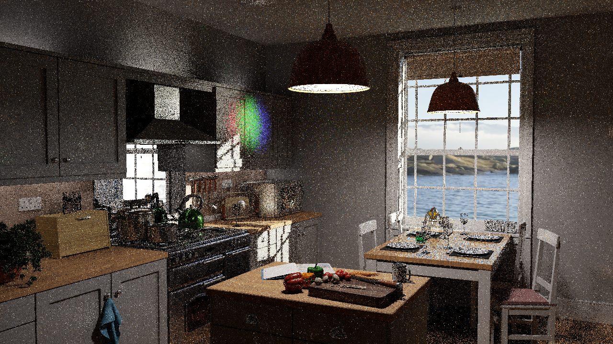](assets/b9-on-b8/kitchen-B9.png) | [development not accepted](B9_RESULTS.md) |
| **↳ B9 · roulette only** | GI3 + PT-long full-prefix roulette-only | 12.201 | 0.275362 | 0.464556 |  | [Three seeds ×64static frames; frame64 FLIP. Three uncapped timings. Original cap14/2; footprint unsupported. Development, no promotion.](B9_RESULTS.md) |
| **B10** | B10 development: initial-GI split + Gaussian pair/vector pilot | Unavailable | Unavailable | Unavailable | [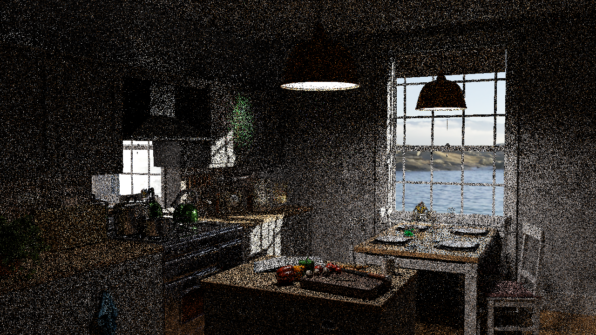](assets/b10-gaussian/kitchen.png) | [development not accepted](B10_GAUSSIAN_PAIRING.md) |
| **↳ B10 · Gaussian timing** | DI initial + GI initial + paired/vector PT; one Gaussian neighbor | 8.262 | Unavailable | Unavailable | No images during timing | [3 timed processes; quality is a separate row. Room4/4; originals14/2.](B10_GAUSSIAN_PAIRING.md) |
| **↳ B10 · Gaussian quality** | One-neighbor paired/vector PT; GI initial only | Unavailable | 0.406308 | 0.752397 |  | [Quality-only cohort: 1 image,8 warmup frames, cap14/2.](B10_GAUSSIAN_PAIRING.md) |
| **↳ B10 · Replay queue** | One-neighbor spatial replay queue; DI/GI initial | Unavailable | Unavailable | Unavailable | [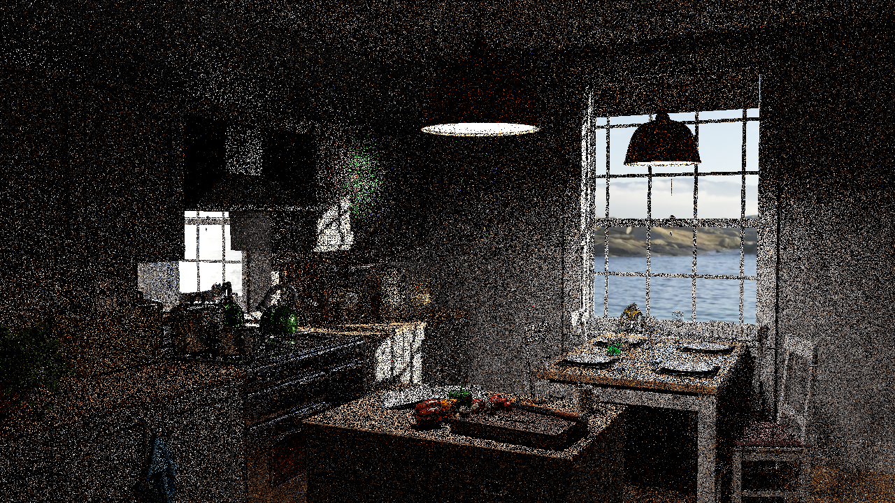](assets/b10-queue/kitchen.png) | [Exact snapshot: 1280x720, cap14/2, 41032 replays,0 mismatches. Timing/quality scores pending.](B10_GAUSSIAN_PAIRING.md) |
| **B10.75** | B10 full PT++ at0.75average spp | Unavailable | Unavailable | Unavailable | No eligible capture | [pending](VERSION_MAPPING.md) |
| **B10.50** | B10 full PT++ at0.5average spp | Unavailable | Unavailable | Unavailable | No eligible capture | [pending](VERSION_MAPPING.md) |
| **B10.25** | B10 full PT++ at0.25average spp | Unavailable | Unavailable | Unavailable | No eligible capture | [pending](VERSION_MAPPING.md) |
| **B11** | B10 + Compatibility-Guided Neighbor Selection active | Unavailable | Unavailable | Unavailable | No eligible capture | [pending](VERSION_MAPPING.md) |
| **B12** | B11 + Stochastic Pairwise MIS | Unavailable | Unavailable | Unavailable | No eligible capture | [pending](VERSION_MAPPING.md) |
| **B13** | B12 + ReSTIR LoD | Unavailable | Unavailable | Unavailable | No eligible capture | [pending](VERSION_MAPPING.md) |
| **B14** | B13 + ReSTIR BDPT with LW version | Unavailable | Unavailable | Unavailable | No eligible capture | [pending](VERSION_MAPPING.md) |
| **B15** | B14 + ReSTIR PG | Unavailable | Unavailable | Unavailable | No eligible capture | [pending](VERSION_MAPPING.md) |
| **B16** | B15 + Multi-Layer Reservoir Splatting | Unavailable | Unavailable | Unavailable | No eligible capture | [pending](VERSION_MAPPING.md) |

Coverage and missing-data reasons

- **B0:** Unchanged original reference preserved. Separate raw-native control data exists; original-default benchmark is not replaced by it
- **B1:** Original scene/material/camera retained;3quality and3timing process repetitions/configuration
- **B2:** Fresh native-control cohort:3 quality processes and3 cap-verified timing processes; original shader estimator retained. Different acquisition cohort from B1/B4 and B6/B7.
- **B3:** Fresh native-control cohort:3 quality processes and3 cap-verified timing processes; original shader estimator retained. Different acquisition cohort from B1/B4 and B6/B7.
- **B4:** Original scene/material/camera retained;3quality and3timing process repetitions/configuration
- **B5:** Fresh native-control cohort:3 quality processes and3 cap-verified timing processes; original shader estimator retained. Different acquisition cohort from B1/B4 and B6/B7.
- **B6:** Five-seed1280x720 matched MIP0 quality; finite zero-Jacobian targets prevent invalid MIS propagation. Guarded replay-first transport; original scene/material/camera14/2. Throughput and general stability acceptance pending.
- **B7:** Five-seed1280x720 matched MIP0 quality; finite zero-Jacobian targets prevent invalid MIS propagation. Guarded replay-first transport; original scene/material/camera14/2. Throughput and general stability acceptance pending.
- **B8:** NVIDIA non-directional GI reuse: 1280x720 cap14/2,64-frame static quality measured; mixed results. Scoped timing is shown separately when available; no canonical promotion.
- **B9:** Eight GPU diagnostics passed; 1280x720 cap14/2 snapshot shown. Three-seed64-frame quality and uncapped timing in progress. Original-scene footprint remains unsupported; no promotion.
- **B10:** Gaussian single-neighbor pair/vector development executes at original1280x720 and room640x360. GI initial only; original-scene quality is one capture, room one64-frame sequence. Remaining mechanisms and accepted total timing pending. Image is 1280x720 development coverage, not an accepted matched benchmark.
- **B10.75:** User-confirmed roadmap; activation/integration and matched quality/performance evidence pending. No measurements inferred.
- **B10.50:** User-confirmed roadmap; activation/integration and matched quality/performance evidence pending. No measurements inferred.
- **B10.25:** User-confirmed roadmap; activation/integration and matched quality/performance evidence pending. No measurements inferred.
- **B11:** User-confirmed roadmap; activation/integration and matched quality/performance evidence pending. No measurements inferred.
- **B12:** User-confirmed roadmap; activation/integration and matched quality/performance evidence pending. No measurements inferred.
- **B13:** User-confirmed roadmap; activation/integration and matched quality/performance evidence pending. No measurements inferred.
- **B14:** User-confirmed roadmap; activation/integration and matched quality/performance evidence pending. No measurements inferred.
- **B15:** User-confirmed roadmap; activation/integration and matched quality/performance evidence pending. No measurements inferred.
- **B16:** User-confirmed roadmap; activation/integration and matched quality/performance evidence pending. No measurements inferred.

† Original-scene B6/B7 quality uses five explicit seeds and new matched MIP0 references after the finite-MIS-target fix. This differs from retained native timing/quality cohorts; it is not a new throughput result or unrestricted scene acceptance. Native startup intermittency and the smaller DI-enabled residual remain. See the [scene-fix follow-up](FINITE_SHIFT_GUARD.md).

## Historical observations — different cohorts

These retained measurements remain useful context, but are excluded from the current tables’ numeric columns. Their settings, scene identity or cap evidence differ. Historical images are available through the linked reports; they are not substitutes for missing current captures.

| Canonical interpretation | Scene | GPU busy ms | LDR-FLIP | Scope and pictures |
|---|---|---:|---:|---|
| B2: native PT + DI/GI3.0 | Convergence | 4.4584 | 0.24355 | [Legacy migration cohort; caps unverified](B1_RESULTS.md) |
| B5: native PT + DI/GI3.1 | Convergence | 4.4530 | 0.24338 | [Legacy migration cohort; caps unverified](B1_RESULTS.md) |
| B2: native PT + DI/GI3.0 | Kitchen | 5.3398 | 0.35210 | [Legacy migration cohort; caps unverified](B1_RESULTS.md) |
| B5: native PT + DI/GI3.1 | Kitchen | 5.3591 | 0.35226 | [Legacy migration cohort; caps unverified](B1_RESULTS.md) |
| B0/raw-native-control, not original defaults | Legacy room, no registered environment | 0.803 | See report | [DI/GI off; different fixture](B2_RESULTS.md) |
| B3: native PT, DI/GI off | Legacy room, no registered environment | 0.806 | See report | [Different fixture](B2_RESULTS.md) |
| B7: ReSTIR PT + DI3.1 | Legacy room, no registered environment | 1.519 | See report | [Earlier checkpoint](B2_RESULTS.md) |

## Quality detail and convergence coverage

The JSON includes display MSE, available linear MSE and CPU cadence alongside each current result. [Registered-room history curves and finite-reference checks](REGISTERED_ROOM_RESULTS.md) cover B6/B7 at1,8,32,64 warm-up frames and three explicit seeds. These are separate1spp history-settling snapshots, not accumulated-spp convergence or time-to-equal-quality. Native captures use three process restarts without verified independent seeds. Original-scene native quality uses finite4096spp references; the room uses a separate finite8192spp native reference with discrepancy checks. HDR-FLIP is unavailable for native original-shader controls.

## B10 Gaussian development — separate quality cohorts

The room comparison uses one64-frame sequence per policy at640x360, cap4/4, one spatial neighbor and GI initial only. Original-scene rows are one1280x720 image each, original14/2 budgets, eight warm-up frames and spatial-only PT. These values do not replace or rank against the main accepted cohorts. [Full report and actual algorithm scope](B10_GAUSSIAN_PAIRING.md).

|Case|Resolution / frames|Linear RGB MSE ↓|HDR-FLIP ↓|Display-FLIP ↓|
|---|---|---:|---:|---:|
|adjacent-room64|640x360 / 64|0.0393616|0.160266|0.098267|
|gaussian-room64|640x360 / 64|0.0412007|0.159373|0.096257|
|gaussian-convergence|1280x720 / 1|2.95359|0.536508|0.351035|
|gaussian-kitchen|1280x720 / 1|0.899919|0.752397|0.406308|

Gaussian room MSE increases about4.7% while FLIP decreases slightly. This mixed result is not promoted. Pairing timings and spatial-queue snapshot checks are now shown in the scene tables above; full GI reuse, simultaneous multi-neighbor reuse, queue timing and full-history acceptance remain pending.

## Summary and lessons learned

The current registered-room comparison shows B7 costing19.4%more process GPU busy than B4 while lowering LDR-FLIP by45.1%. Original Convergence/Kitchen B1/B4 timing changes are below1%; they do not demonstrate a general speedup. B6/B7 now have corrected original-resolution five-seed quality evidence; native startup stability and new throughput remain pending. B8 now has NVIDIA GI temporal/spatial reuse with14scoped GPU checks; quality/timing are in progress. Earlier limited PT++ ablations retain their initial-only GI scope. Their176x90 illustrations are explicitly development-only; B10 now has Gaussian table GPU development with extended-resolution pictures; full GI reuse, remaining PT++ mechanisms and accepted extended measurements remain pending.

## Changes

- 2026-10-29: Added one generated overview with all33 version/scene rows, explicit missing coverage, representative images and retained historical cohort links.

## Material precision ablation — defaults unchanged

A separate matched five-seed experiment compares legacy material truncation with opt-in half-up rounding for B4/B7. These quality-only rows do not replace canonical results or supply throughput. Full settings, uncertainty and limitations: [precision follow-up](GBUFFER_PRECISION.md).

|Scene / variant|Legacy mean Y difference|Rounded mean Y difference|HDR-FLIP legacy → rounded ↓|Legacy / rounded seed0 pictures|
|---|---:|---:|---:|---|
|Convergence / B4|-0.370%|-0.270%|0.43186 → 0.43114| |
|Convergence / B7|-0.351%|-0.037%|0.33360 → 0.33293|<a href="assets/gbuffer-precision/convergence-B7-r0-s0.png">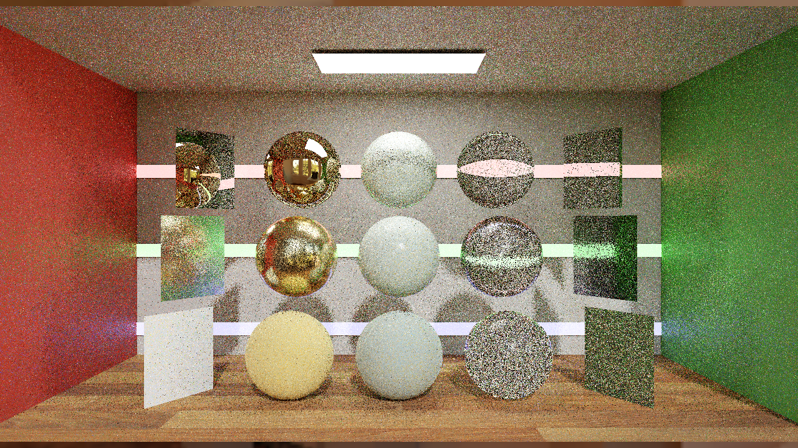</a> |
|Kitchen / B4|-0.833%|-0.936%|0.58597 → 0.58601| |
|Kitchen / B7|-1.062%|-1.114%|0.44106 → 0.44025| |

Signed Y uses raw linear HDR against the same finite reference, without brightness normalization. The full report includes sample standard errors, LDR-FLIP and all per-seed data. No general energy-preservation or unbiasedness claim.

## DI reuse isolation — renderer unchanged

A separate fixed-1spp five-seed study compares initial-only, temporal-only, spatial-only and combined DI within B4/B7. Material rounding remains off. These are quality-only ablations, not replacements for canonical timings. [Full settings, uncertainty, contrasts and pictures](DI_REUSE_ISOLATION.md).

|Scene / variant|DI initial Y difference|Temporal Y difference|Spatial Y difference|Combined Y difference|Seed0 initial / combined|
|---|---:|---:|---:|---:|---|
|Convergence / B4|-0.069%|-0.424%|-0.198%|-0.264%|<a href="assets/di-reuse-isolation/convergence-B4-di0-s0.png">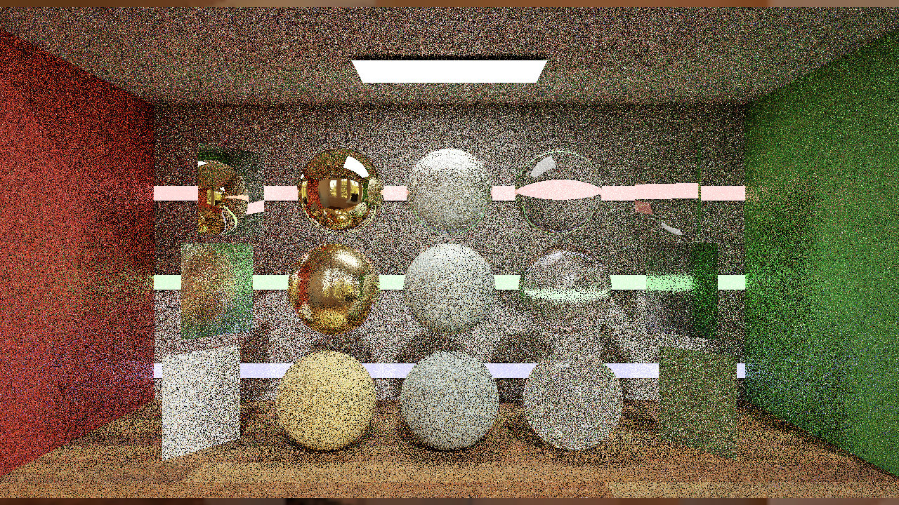</a> |
|Convergence / B7|-0.006%|-0.169%|-0.074%|-0.251%|<a href="assets/di-reuse-isolation/convergence-B7-di0-s0.png">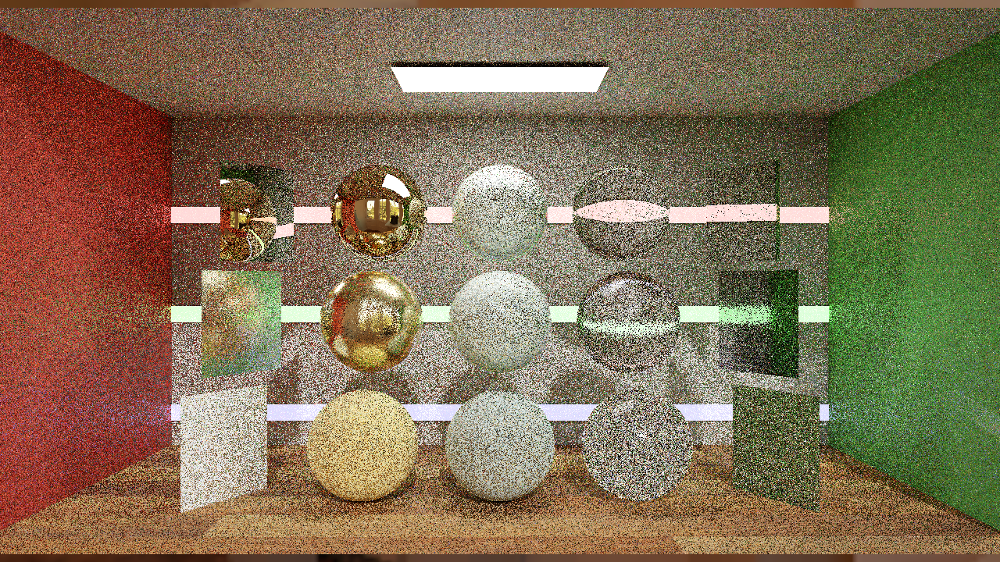</a> |
|Kitchen / B4|-1.159%|-0.719%|-0.930%|-0.745%|<a href="assets/di-reuse-isolation/kitchen-B4-di0-s0.png">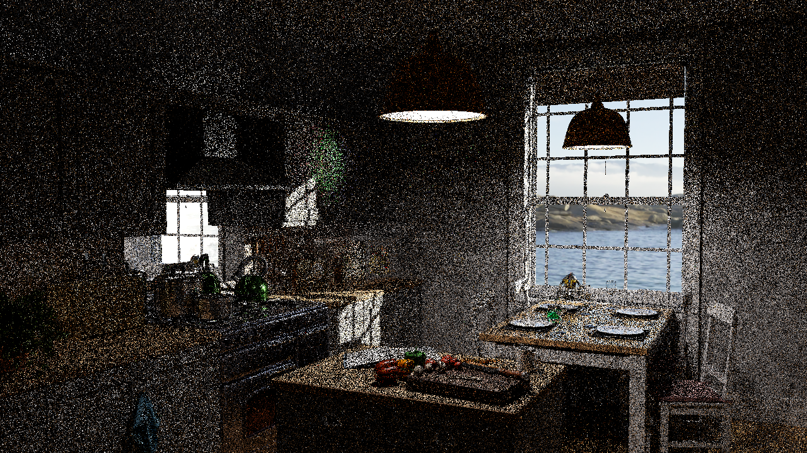</a> |
|Kitchen / B7|-1.004%|-1.249%|-1.370%|-1.220%|<a href="assets/di-reuse-isolation/kitchen-B7-di0-s0.png">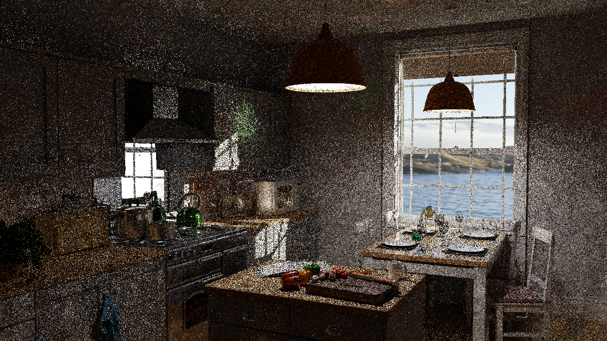</a> <a href="assets/di-reuse-isolation/kitchen-B7-di3-s0.png">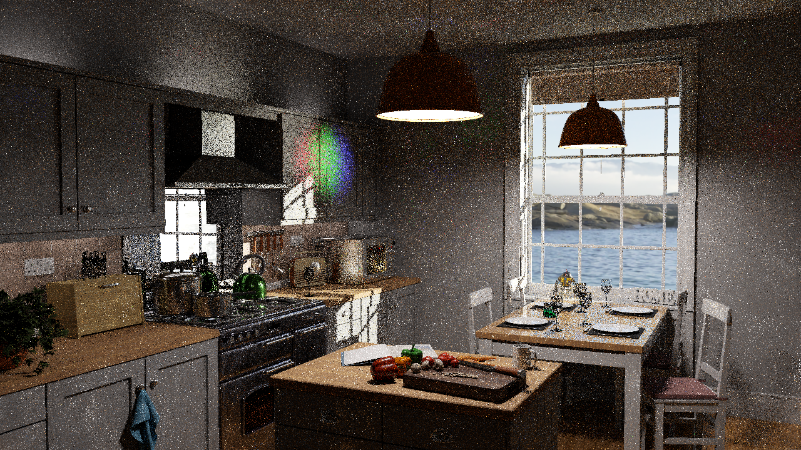</a>|

All four modes keep DI active. Mode0 disables temporal/spatial reuse, not initial RIS or final DI shading. Signed Y uses the same raw-HDR finite references; it is not brightness-normalized. Full HDR/LDR-FLIP results and sample standard errors are in the linked report.

## Prefix-throughput diagnostic — no quality gain claimed

A calibrated diagnostic found zero packed prefix pixels above one in eight physical snapshots. Omitted legacy default and preserve-above-one arrays were identical in the four observed pairs. This does not explain the sampled brightness discrepancy. The synthetic positive control is excluded from physical images and quality/performance claims. [Scope, calibration and pictures](PREFIX_THROUGHPUT.md).

|Scene / variant|Default max / above-one pixels|Preserve max / above-one pixels|Default / preserve pictures|
|---|---:|---:|---|
|Convergence / B4|1.0 / 0|1.0 / 0| <a href="assets/prefix-throughput/convergence-B4-preserve1-s0.png">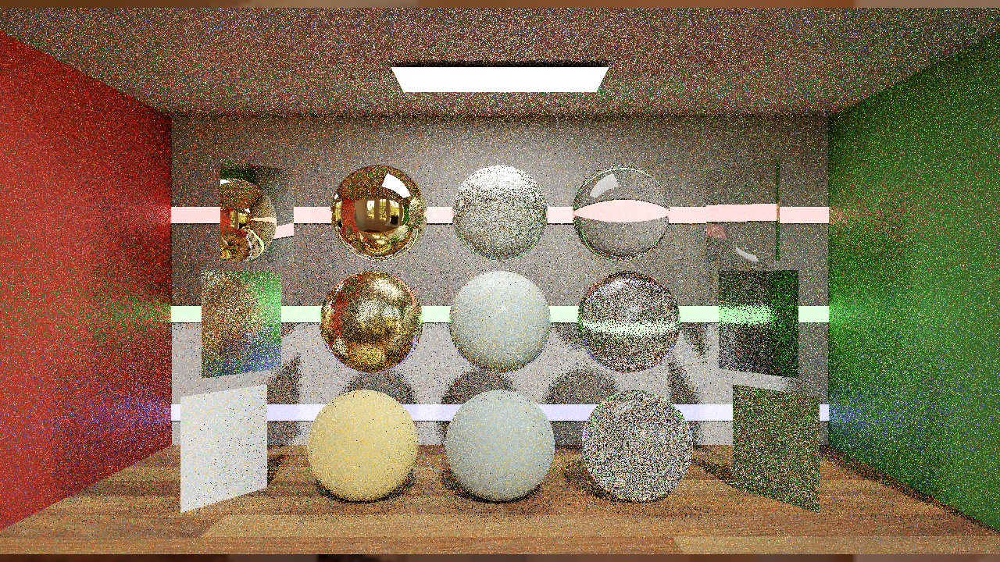</a>|
|Convergence / B7|1.0 / 0|1.0 / 0| <a href="assets/prefix-throughput/convergence-B7-preserve1-s0.png">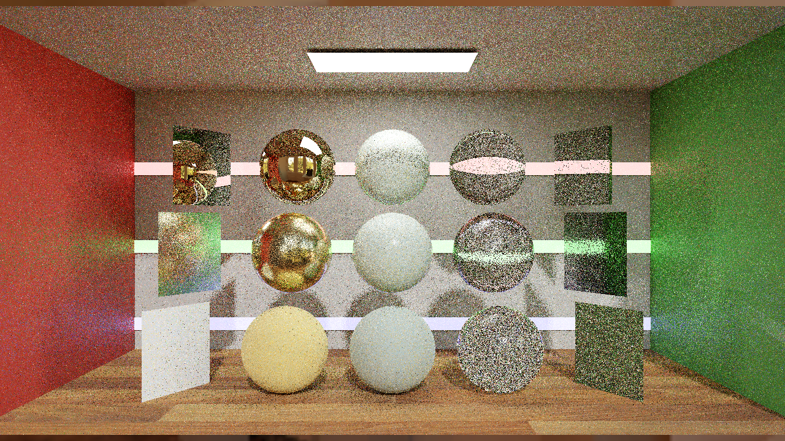</a>|
|Kitchen / B4|1.0 / 0|1.0 / 0| <a href="assets/prefix-throughput/kitchen-B4-preserve1-s0.png">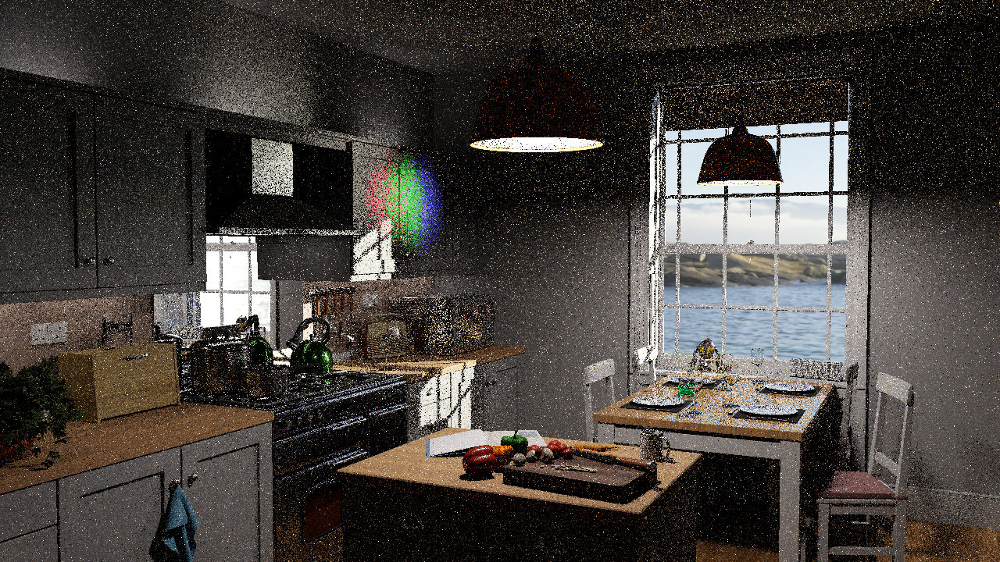</a>|
|Kitchen / B7|1.0 / 0|1.0 / 0| |

One seed and final-frame packed weights only; not a raw-float range proof, unbiasedness result or throughput benchmark. The legacy clamp remains default.

## Paired development timing — adjacent versus Gaussian

Three process repetitions per policy/scene,45s warmup plus30s capture, no image writes. Source/executable/682shader-cache identities stayed frozen; app/NVIDIA/RTSS cap checks and driver restoration passed. One spatial neighbor, DI initial and GI initial only; this is not full B10. GPU busy is process engine activity, not renderer FPS. Small differences remain exploratory. [Quality, images, uncertainty and full scope](B10_GAUSSIAN_PAIRING.md).

|Scene|Adjacent GPU busy ms|Gaussian GPU busy ms|Change|
|---|---:|---:|---:|
|opaque-room|1.5873|1.5915|+0.27%|
|convergence|7.2950|7.1838|-1.52%|
|kitchen|8.4429|8.2623|-2.14%|

## Fresh B0 PT-only override — separate from original defaults

Preserved RTXPT1.9/runtime3.0 with native PT and NEE; ReSTIR DI/GI/PT off. Three quality process restarts and three cap-verified timing runs per scene. Original scenes1280x720,14/2; room640x360,4/4, distinct from the earlier3/3 native-room cohort. Native MIS/filter policies remain unchanged. HDR metrics are unavailable because this preserved binary has no raw-HDR exporter. [Report and evidence](NATIVE_MATRIX_RESULTS.md).

|Scene|GPU busy ms|CPU cadence ms|Display-FLIP|Display MSE|Picture|
|---|---:|---:|---:|---:|---|
|opaque-room|0.8307|0.8743|0.121162|0.0139288||
|convergence|2.5172|2.4667|0.372227|0.0866742||
|kitchen|3.2427|3.2611|0.376870|0.0691566||
