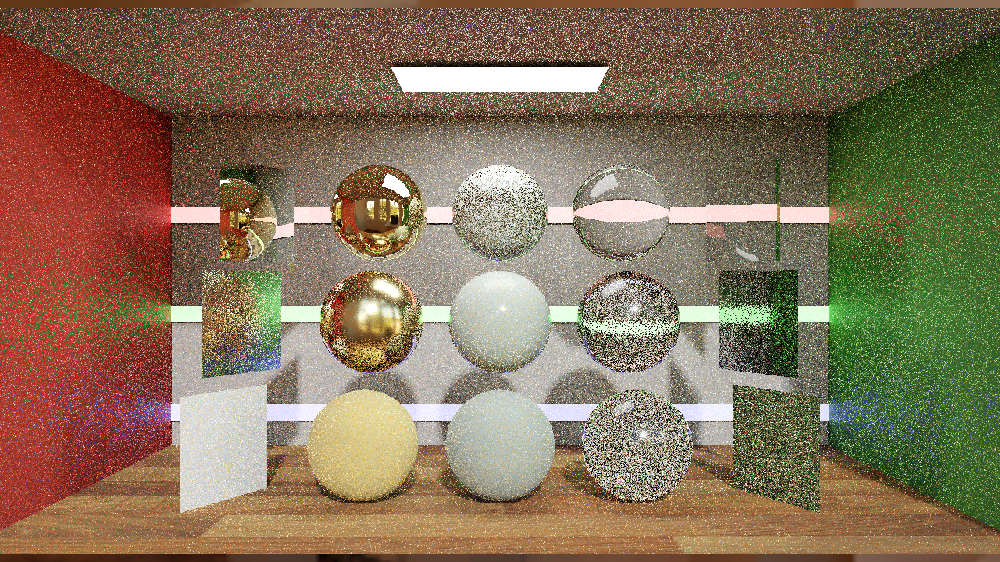
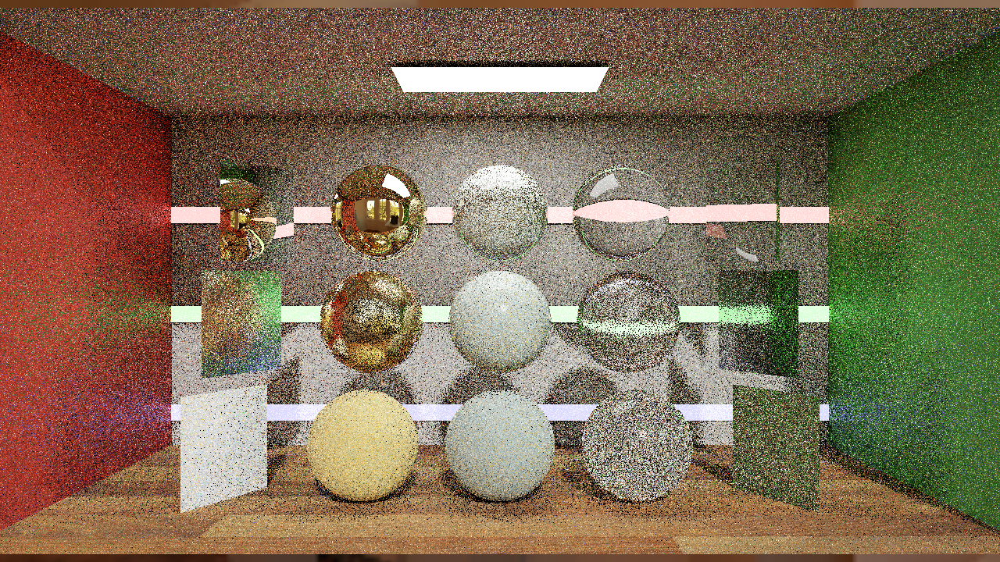
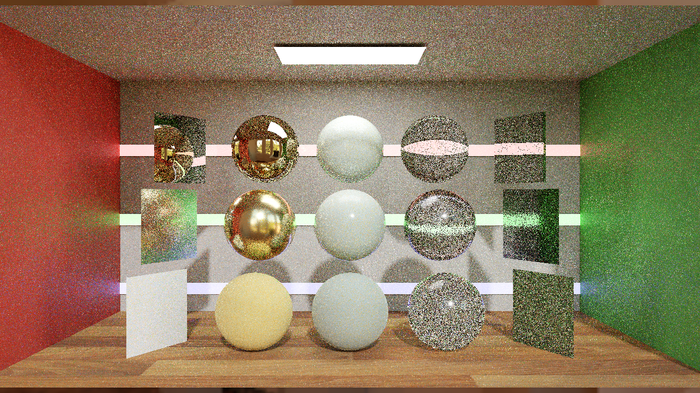
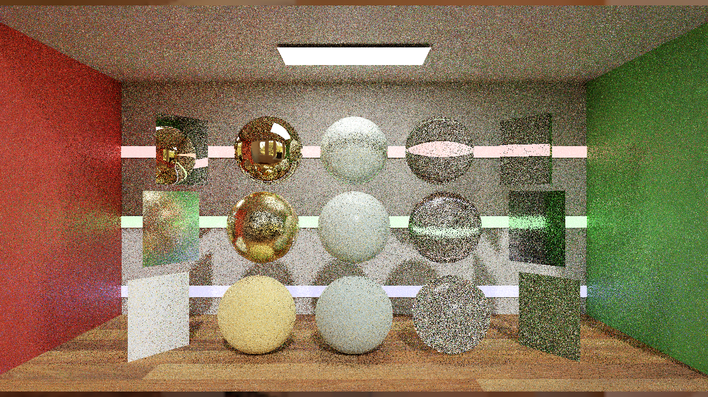
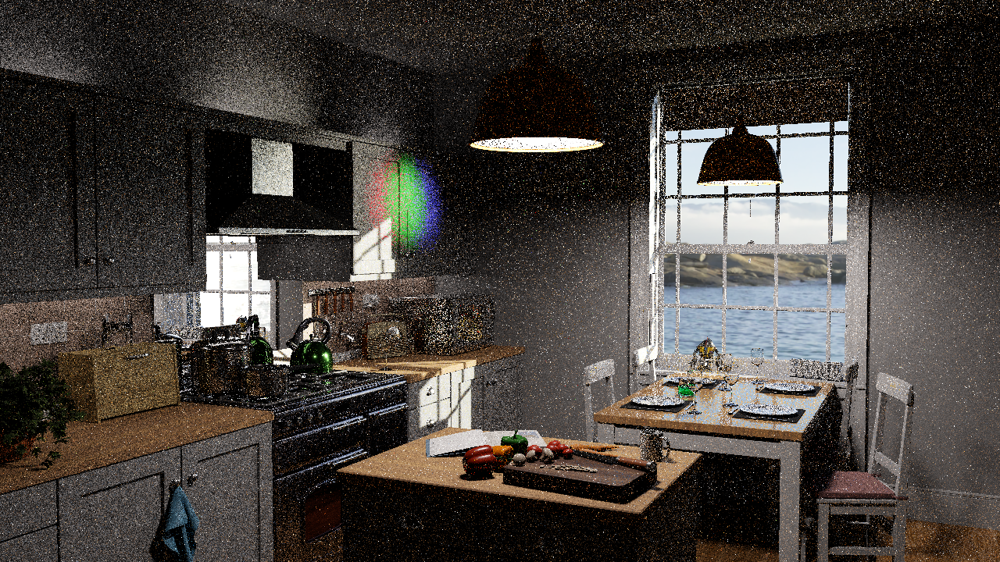
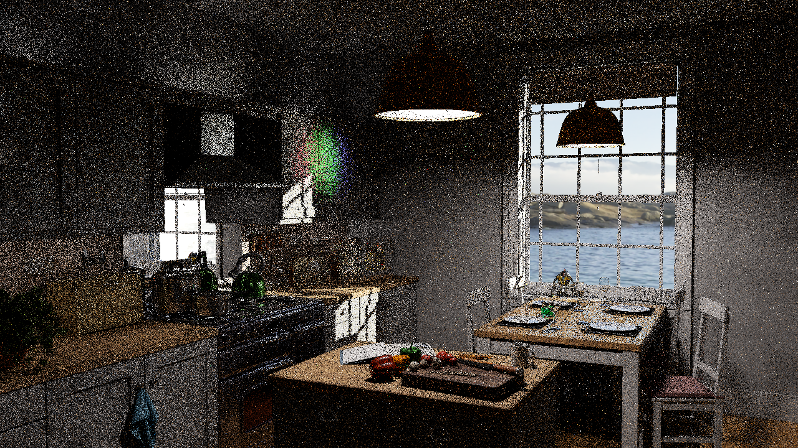
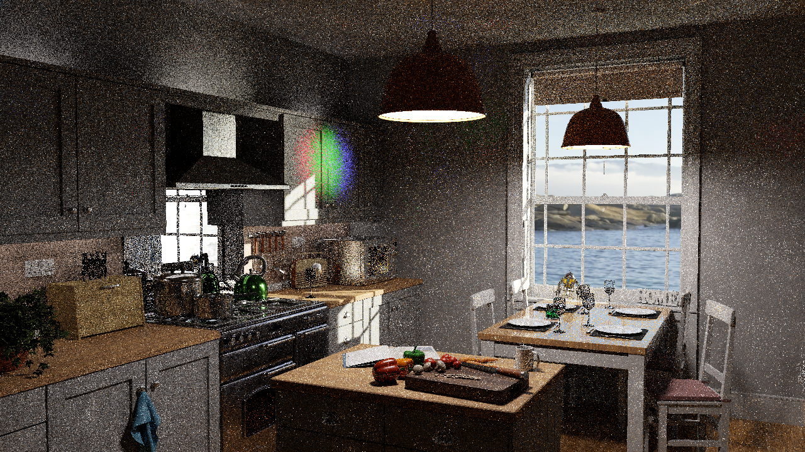
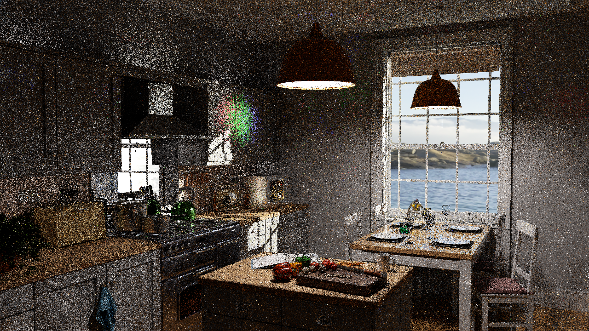

# DI reuse isolation: initial, temporal and spatial stages

**2026-10-29.** This study separates DI reuse choices within native PT + DI and guarded ReSTIR PT + DI. The renderer executable and shaders are unchanged from `cbe38e0`; material rounding remains off.

[Unified comparison](COMPARISON_OVERVIEW.md) · [Previous precision study](GBUFFER_PRECISION.md) · [Evidence index](https://github.com/BasixMaster/RTXPT_Next/blob/b3/ptpp-activation/Benchmarks/development/2026-10-29-di-reuse-isolation/index.json)

## Controlled experiment

Original Convergence and Kitchen cameras/materials, 1280×720, 14/2 total/diffuse bounce limits, 1 spp, 64 history frames. Five explicit seeds: 0, 11, 47, 1019, 4093. Environment MIP0, strict DI, legacy material packing, AA/reconstruction/cache/post/firefly filters off. All modes retain the same initial proposal settings and final visibility/shading.

Within B4 (native PT + DI 3.1), GI and ReSTIR PT are off. Within B7 (guarded ReSTIR PT + DI 3.1), GI is off and PT stays in temporal+spatial full-prefix replay mode with terminal-only reconnection, roulette off, age rejection off and ordinary/boosted spatial counts 1/1. Native primary policies differ between B4 and B7; only the within-variant DI-mode comparison isolates reuse.

DI modes 0/1/2/3 mean initial RIS only, temporal only, spatial only and temporal+spatial. Every mode still performs initial DI sampling and final shading. Mode 0 disables reuse, not DI. The harness now verifies actual DI activation and mode from the renderer's transport receipt, rather than relying solely on launch arguments.

The unchanged native 4096 spp MIP0 references and their independent-seed/reference-discrepancy checks come from the finite-shift study. This fixed-1spp terminal-frame experiment is not accumulated-spp convergence or a proof of unbiasedness. No image brightness normalization is applied.

## Raw-HDR and perceptual quality

Mean Y is signed average linear-HDR luminance difference relative to the finite reference. ± is sample standard error over five seeds. FLIP columns are medians; official evaluator 1.7, PPD67 and the same reference-derived HDR exposure parameters are retained.

|Scene|Variant|DI reuse mode|Mean Y difference ± SE|HDR-FLIP ↓|LDR-FLIP ↓|
|---|---|---|---:|---:|---:|
|Convergence|B4|Initial only|-0.069% ±0.495%|0.54745|0.35785|
|Convergence|B4|Temporal only|-0.424% ±0.380%|0.41664|0.28441|
|Convergence|B4|Spatial only|-0.198% ±0.419%|0.45913|0.30888|
|Convergence|B4|Temporal + spatial|-0.264% ±0.310%|0.43229|0.29485|
|Convergence|B7|Initial only|-0.006% ±0.236%|0.44921|0.29313|
|Convergence|B7|Temporal only|-0.169% ±0.215%|0.31524|0.20860|
|Convergence|B7|Spatial only|-0.074% ±0.210%|0.36330|0.23920|
|Convergence|B7|Temporal + spatial|-0.251% ±0.174%|0.33430|0.22220|
|Kitchen|B4|Initial only|-1.159% ±0.120%|0.74936|0.40702|
|Kitchen|B4|Temporal only|-0.719% ±0.218%|0.59263|0.32094|
|Kitchen|B4|Spatial only|-0.930% ±0.172%|0.67895|0.35908|
|Kitchen|B4|Temporal + spatial|-0.745% ±0.156%|0.58621|0.32505|
|Kitchen|B7|Initial only|-1.004% ±0.316%|0.60044|0.33292|
|Kitchen|B7|Temporal only|-1.249% ±0.208%|0.44901|0.24682|
|Kitchen|B7|Spatial only|-1.370% ±0.250%|0.53407|0.28724|
|Kitchen|B7|Temporal + spatial|-1.220% ±0.325%|0.44050|0.24948|

## Changes relative to initial-only DI

These are seed-paired differences between separate process captures. They do not assume identical sampled paths. Sample uncertainty describes these five runs, not a general unbiasedness result.

|Scene|Variant|DI mode|Mean Y change vs initial, percentage points ± SE|
|---|---|---|---:|
|Convergence|B4|Temporal only|-0.355 ±0.249|
|Convergence|B4|Spatial only|-0.129 ±0.100|
|Convergence|B4|Temporal + spatial|-0.195 ±0.295|
|Convergence|B7|Temporal only|-0.163 ±0.347|
|Convergence|B7|Spatial only|-0.067 ±0.193|
|Convergence|B7|Temporal + spatial|-0.245 ±0.338|
|Kitchen|B4|Temporal only|+0.440 ±0.117|
|Kitchen|B4|Spatial only|+0.229 ±0.217|
|Kitchen|B4|Temporal + spatial|+0.414 ±0.121|
|Kitchen|B7|Temporal only|-0.245 ±0.168|
|Kitchen|B7|Spatial only|-0.366 ±0.206|
|Kitchen|B7|Temporal + spatial|-0.216 ±0.231|

## Pictures

Representative seed0 images. Click to enlarge; Escape closes the shared preview.

|Scene / variant|Initial only|Temporal only|Spatial only|Temporal + spatial|
|---|---|---|---|---|
|Convergence / B4|||||
|Convergence / B7|||||
|Kitchen / B4|||||
|Kitchen / B7|||||

## Validation and boundaries

All 80 quality captures completed with effective reuse-setting receipts and frozen source/executable/shader checks before and after each run. All raw outputs were finite. The acquisition loop stops on the first failed launch and does not silently retry. One successful block does not resolve the previously observed intermittent native startup access violation.

Selected seed0 captures also save native radiance before resampling additions. Total minus this same-frame component is DI for B4, but includes both DI and PT for B7. It must not be described as an isolated DI contribution in B7. Components from separate processes are not added/subtracted as if they were the same path realization. The seed0 invariance check found bitwise equality across all modes only for native Kitchen B4; other scene/variant components varied, reinforcing this limitation.

The export includes all 80 PNG images, sanitized capture/metric/settings receipts, frozen artifact/harness hashes, two selected Kitchen B7 raw PFMs and orchestration/scoring scripts. Other raw files remain local. Exported scripts expect a workspace `work/` directory beside `outputs/RTXDI_Next`; select a fresh output name when reproducing.

The new harness contract has activation/mode mismatch, missing/invalid receipt, duplicate/conflict and inactive-mode tests. No renderer build or algorithm change was needed for this experiment.

## Matched timing attempt — excluded

A separate corrected-original B4/B7 timing sequence was started after quality scoring finished. Its first B4 attempt produced no PresentMon CSV or presentation rows, so the sequence stopped with zero accepted timing samples. App uncapped controls and the NVIDIA driver cap audit passed; the temporary NVIDIA profile was restored and verified. The renderer exit1 came from intentional harness termination, not a demonstrated renderer crash. The harness's final `failed_cap_verification` label reflects a missing CSV needed to inspect SyncInterval, not evidence that a cap was detected.

The attempted trace, driver/restoration receipts and exclusion reason are retained under the evidence index. Desktop/display and presentation-collection availability need confirmation before retrying. The absence of a presentation trace does not invalidate captured image quality and does not establish that either algorithm is faster or slower.

The failed collector log used a UTF-16 BOM. The harness previously decoded it as UTF-8, which could hide reported ETW-loss warnings. A BOM-aware decoder now supports UTF-16 and UTF-8, with seven new regression tests. A fresh audit of all 72 retained exported `presentmon.log` files found zero reported ETW-loss warnings after correct decoding. This audit does not cover unavailable private/original logs or prove the absence of unreported loss. The decoder fix does not explain the missing CSV.

## Summary and lessons learned

The Kitchen deficit already exists without DI reuse: native PT+DI (B4) is −1.159% ±0.120% SE and guarded PT+DI (B7) is −1.004% ±0.316% SE in initial-only mode. Temporal+spatial DI gives −0.745% ±0.156% and −1.220% ±0.325%, respectively. This rules out temporal/spatial reuse as the sole explanation of the observed discrepancy; it does not identify a unique cause or prove either estimator unbiased.

Relative to initial-only DI, combined reuse moves Kitchen B4 by +0.414 percentage points ±0.121 SE and Kitchen B7 by −0.216 points ±0.231 SE. The latter change is comparable to its observed sampling uncertainty. Avoid describing every negative difference as a new PT++ effect.

Reuse substantially reduces perceptual error relative to initial-only RIS. Temporal-only has the lowest median HDR-FLIP for Convergence in both variants; combined reuse has the lowest median HDR-FLIP for Kitchen. Temporal-only has slightly lower median LDR-FLIP in all four scene/variant cases. These static results do not select a universal default: motion, disocclusion, other scenes, sample cost and time-to-equal-error remain separate requirements. Defaults are unchanged.

Finite-reference checks are much smaller than the Kitchen residual: compared with the primary 4096-spp reference, the independent 4096-spp seed changes mean Y by −0.00684% in Convergence and +0.03792% in Kitchen. The 2048-spp references differ by −0.01208% and −0.01804%. These establish reference agreement at this scale, not ground truth.

The next diagnostic should inspect initial DI and its integration, including proposal/support consistency and GBuffer/prefix transport. Source inspection still finds `saturate(path.GetThp())` in the inherited dominant-surface throughput export. That clamp could discard valid weights above one, but this study did not capture the underlying throughput range and cannot establish that it explains these scenes. It remains an unimplemented candidate, not a claimed fix. Brightness compensation is not applied.

**These DI-mode captures provide no throughput measurement.** PNG/PFM writes and concurrent CPU quality analysis make these process elapsed times unsuitable as renderer performance numbers. Existing canonical measurements and timings remain unchanged; this is a separately identified DI-mode ablation. B8 sharing and B9/B10 PT++ remain pending.
