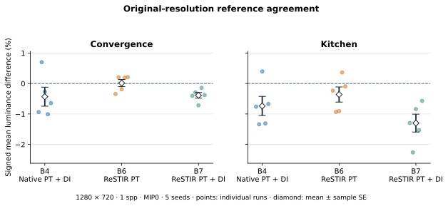
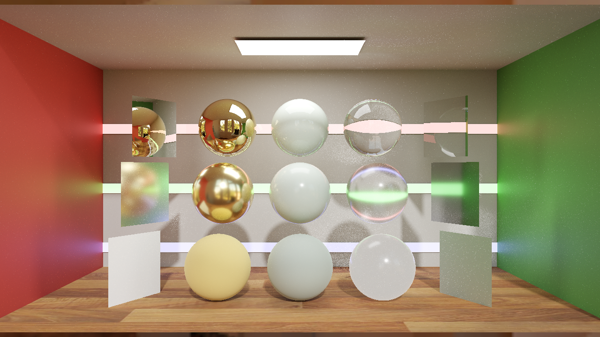
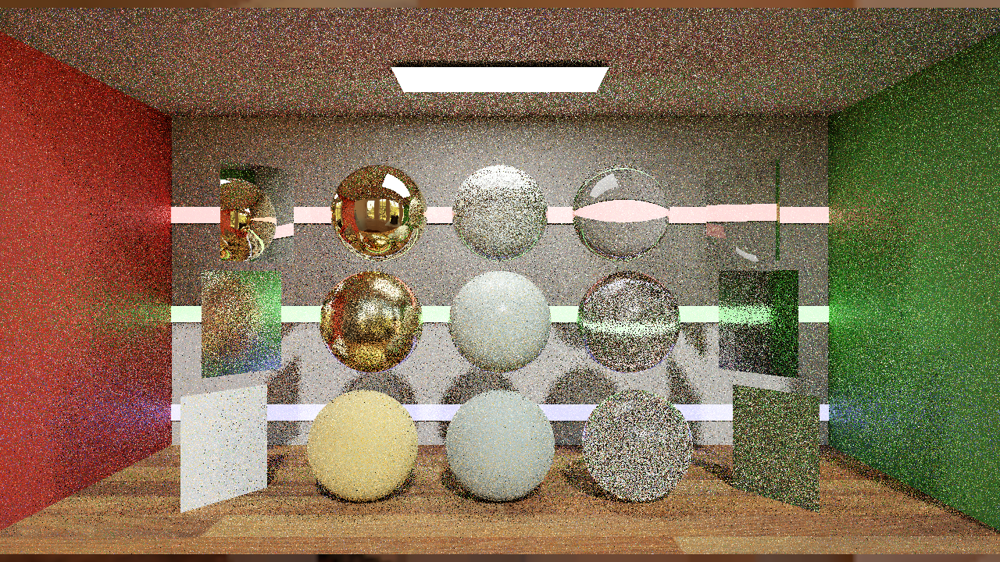
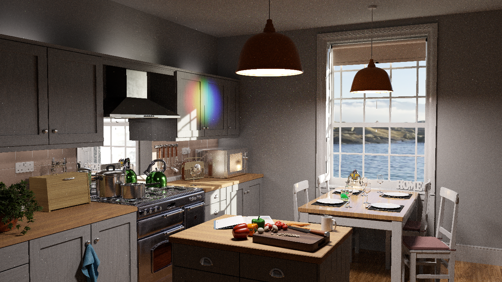
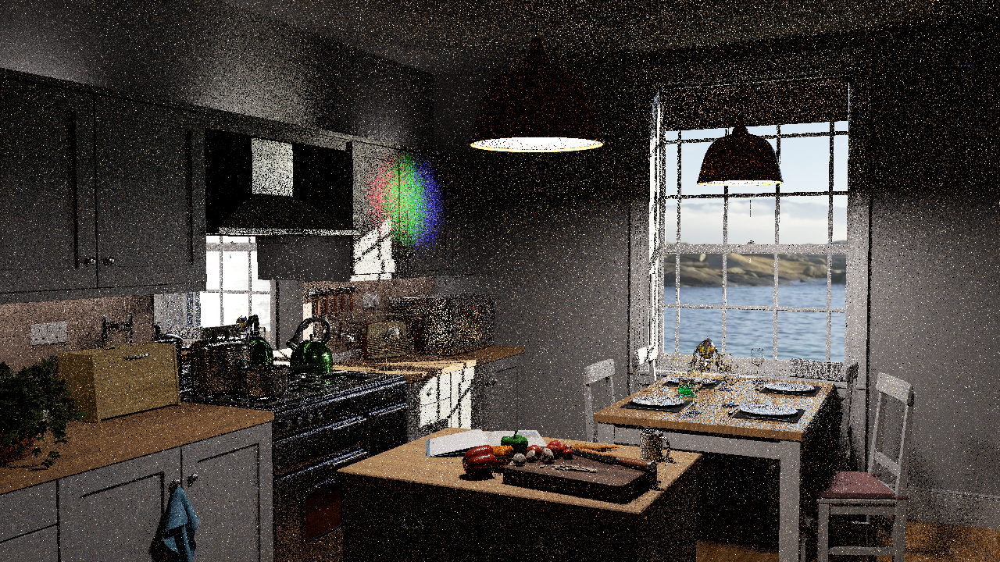

# Finite rejected-shift targets: ReSTIR PT scene fix

**2026-10-29: fixed an invalid-MIS propagation bug affecting the original Convergence and Kitchen scenes.** RTXDI could return a NaN target for a rejected zero-Jacobian shift. That NaN entered inverse-MIS normalization and erased valid contributions. The application adapter now returns a finite zero target for that rejected domain; nonzero-Jacobian targets, PDFs and normalization remain unchanged.

[Unified B0–B10 overview](COMPARISON_OVERVIEW.md) · [Evidence index and selected raw HDR](https://github.com/BasixMaster/RTXPT_Next/blob/b3/ptpp-activation/Benchmarks/development/2026-10-29-finite-shift-guard/index.json) · [Earlier guarded-scene work](PT_EXTENDED_SCENES.md)

## What was fixed

`HybridShiftGuard.hlsli` wraps the pinned RTXDI hybrid-shift function before temporal/spatial resampling. A terminal light can have a zero solid-angle PDF; the SDK explicitly returns Jacobian0 but may already have formed a0/0 target. IEEE floating-point arithmetic then gives `NaN * 0`, not a finite zero. Inverse-MIS sums can become NaN, and the final denominator check sets the resulting weight to0.

The fix canonicalizes only `jacobian == 0` to `targetFunction = 0`. It does not clamp positive contributions, brighten an image, change a PDF, or adjust reference images. Diagnostic counters distinguish raw SDK values from values returned to the resampling caller. The raw SDK calculation may still produce NaNs internally; they no longer leave this adapter for the observed rejected domain.

|320×180 last-frame diagnostic|Convergence|Kitchen|
|---|---:|---:|
|Before: returned nonfinite target/weight products|445|1918|
|After: returned nonfinite target/weight products|0|0|
|Classification: nonfinite target with nonzero Jacobian|0|0|

These are separate diagnostic launches. Corrected histories change which shifts are evaluated, so raw internal NaN counts are not a before/after performance metric. The first proposed remedy—rejecting empty prefixes earlier—did not remove the observed NaNs and was discarded. The final adapter delegates valid paths to the existing SDK function.

### Why a zero contribution must remain finite

A calculated example has one valid center candidate with target2 and RIS weight sum2, plus a rejected neighbor. Correct normalization keeps the center radiance2. A NaN neighbor term can instead turn the MIS sum into NaN and yield radiance0. Returning finite zero for the rejected shift restores the expected center result. This example explains the boundary condition; GPU counters and rendered images provide the implementation evidence.

## Original-resolution quality

Original Convergence and Kitchen materials/cameras,1280×720,1spp,14/2 total/diffuse limits,64history frames, five explicit seeds0/11/47/1019/4093. PT uses full-prefix replay with terminal-light reconnection, roulette off, age rejection off and ordinary/boosted spatial sample counts1/1. B6 has DI/GI off; B7 adds strict DI3.1 and keeps GI off. Native fallback retains primary domains outside PT ownership. No reconstruction, radiance cache, postprocessing or firefly filtering is applied.

|Scene|Variant|HDR-FLIP ↓|LDR-FLIP ↓|Mean luminance difference ± sample SE|
|---|---|---:|---:|---:|
|Convergence|B6|0.45348|0.30066|+0.014% ±0.117%|
|Convergence|B7|0.33382|0.22213|-0.387% ±0.094%|
|Kitchen|B6|0.54663|0.30252|-0.362% ±0.249%|
|Kitchen|B7|0.44049|0.24977|-1.301% ±0.294%|

FLIP values are medians across five seeds. HDR-FLIP1.7 uses PPD67 and ACES with exposure bounds derived only from the native reference. Mean luminance is measured on raw linear RGB. Sample SE describes these five runs; it is not an unbiasedness proof. All20original-resolution captures were finite. Seed0diagnostics showed positive-weight, aged, M>1 reservoirs, terminal-only reconnection, and zero returned nonfinite targets/weight products.



## Remaining DI-enabled difference

**Follow-up:** [Controlled GBuffer material precision test](GBUFFER_PRECISION.md) compares legacy truncation and opt-in rounding without changing canonical defaults. The original evidence below remains preserved.

A supplementary native PT+DI3.1 control uses the same dimensions, bounce limits, five seeds, strict DI, explicit MIP0 and references. It retains native primary replacement/plane policies, which differ from the PT integration; it is not a one-variable PT ablation.

|Scene|Native PT+DI control mean difference ± SE|Corrected PT+DI mean difference ± SE|
|---|---:|---:|
|Convergence|-0.433% ±0.312%|-0.387% ±0.094%|
|Kitchen|-0.738% ±0.315%|-1.301% ±0.294%|

The native DI control also has a deficit. Source inspection found a relevant inherited precision issue: `GBufferHelpers.hlsli::Encode_R11G11B10_FLOAT` truncates low mantissa bits, and its existing TODO warns about energy loss. This establishes a possible DI-side contribution, not a complete causal attribution of the residual. Packing precision was not changed in this fix; baseline source/policies and all earlier measurements remain preserved.

## Matched references and retained cohorts

Native environment diffuse filtering defaults to MIP2, while the ReSTIR environment sampler evaluates MIP0. New `--environmentDiffuseMip`/`--environment-diffuse-mip` controls and an effective-setting receipt permit an explicit MIP0 quality track for both reference and candidates. Omission preserves the existing default; the opaque regression recorded effective MIP2 without an override. B0 defaults and baseline pins are unchanged.

The reference suite uses2048spp,4096spp and an independent4096spp seed. The earlier reference images are retained as a separate cohort. In these scenes the new MIP0 reference changed mean luminance by only−0.004%/−0.032% relative to the retained reference: filtering does not explain the earlier multi-percent deficit. No historical metrics were overwritten or pooled into the new summaries.

The reduced-resolution study contains40successful images:30from the main block plus an explicit10image Kitchen follow-up after a failed native startup. The original-resolution block completed20images plus6references without a failed launch. Ten supplementary native-DI images completed separately. All formal captures have source/executable/cache checks before and after execution.

## Pictures

These are representative seed0frames. Click/tap a picture to open the shared preview; Escape or Close dismisses it.

|Scene|Native4096spp reference|Native PT+DI control|B6 ReSTIR PT|B7 ReSTIR PT+DI|
|---|---|---|---|---|
|Convergence|<a href="assets/finite-shift-guard/convergence-reference.png"></a>|<a href="assets/finite-shift-guard/convergence-B4.png"></a>|<a href="assets/finite-shift-guard/convergence-B6.png"></a>|<a href="assets/finite-shift-guard/convergence-B7.png"></a>|
|Kitchen|<a href="assets/finite-shift-guard/kitchen-reference.png"></a>|<a href="assets/finite-shift-guard/kitchen-B4.png"></a>|<a href="assets/finite-shift-guard/kitchen-B6.png"></a>|<a href="assets/finite-shift-guard/kitchen-B7.png"></a>|

## Stability, regression and performance scope

The ordinary opaque-room B6 regression remained pixel-identical to the preserved capture in both repeats. B7 varied between processes, as it did previously; no bitwise B7 pass is claimed. Both omitted environment-filter overrides retained effective MIP2.

Native startup stability is still unresolved. A passive source-level trace of an earlier failed process pointed to `LightsBaker::CreateRenderPasses` while collecting resource statistics. Null-resource diagnostics and noninteractive Windows error handling were added. A subsequent startup access violation still occurred before PT dispatch, so those changes are not presented as a complete startup fix. The failure, invalid debugger setup attempts, successful main-process reproduction and explicit follow-up block are retained in the evidence.

**No new throughput result is claimed.** Image captures write PNG/PFM/reservoir data and are excluded from timing. New performance comparisons require the existing known-cap protocol and matched settings. The current overview retains prior measured timings and leaves corrected original-scene PT timings unavailable. Fixed1spp history snapshots are not accumulated-spp convergence or time-to-equal-error measurements.

## Reproducing a guarded quality capture

Build this renderer revision and use a new output directory. For Kitchen B7, for example:

```text
python Benchmarks/tools/run_capture.py --exe bin/Rtxpt.exe --output capture-kitchen-b7 --scene kitchen-with-test-stuff.scene.json --mode dipt --exposure 2 --width 1280 --height 720 --max-bounces 14 --max-diffuse-bounces 2 --simple --app-uncapped --linear-hdr --nee-mis 0 --environment-diffuse-mip 0 --sampling-seed 0 --history-frames 64 --pt-mode 3 --di-mode 3 --strict-di-validation --pt-replay-only-validation --pt-extended-scene-validation --pt-disable-age-rejection-validation --pt-fixed-spatial-samples 1 --capture-pt-reservoirs
```

Use `--mode pt` for B6. The explicit extended-scene flag remains a guarded development contract; it is not unrestricted interactive scene support. Capture manifests record the exact reference/candidate commands and effective filtering. Selected full-resolution raw PFMs are included in the evidence export; other raw captures and full debugger logs remain local.

## Summary and lessons learned

A rejected path must contribute finite zero throughout MIS, including inverse normalization. Returning Jacobian0 was insufficient when the target was NaN. The adapter removes that failure without changing valid-path weights. Both original scenes now have full-resolution five-seed quality evidence; a smaller DI-enabled discrepancy and intermittent native startup failure remain explicit. Generic absorption/motion support, unrestricted mid-path reconnection for binding diffuse budgets, new throughput and B8/B9/B10 remain pending.

## Changes

- 2026-10-29: Added finite rejected-shift targets, raw/returned GPU diagnostics, matched filtering controls, source-level startup diagnosis, full-resolution quality and supplementary native-DI controls.
