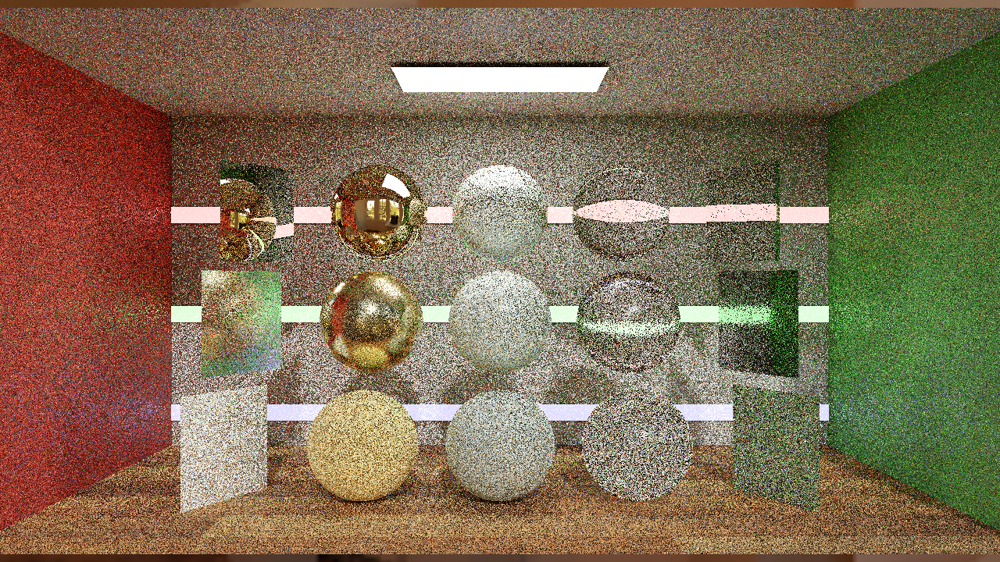
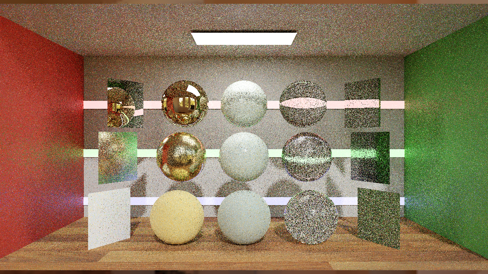
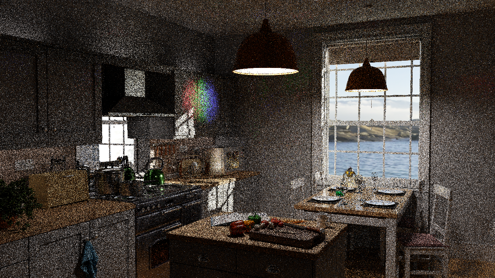
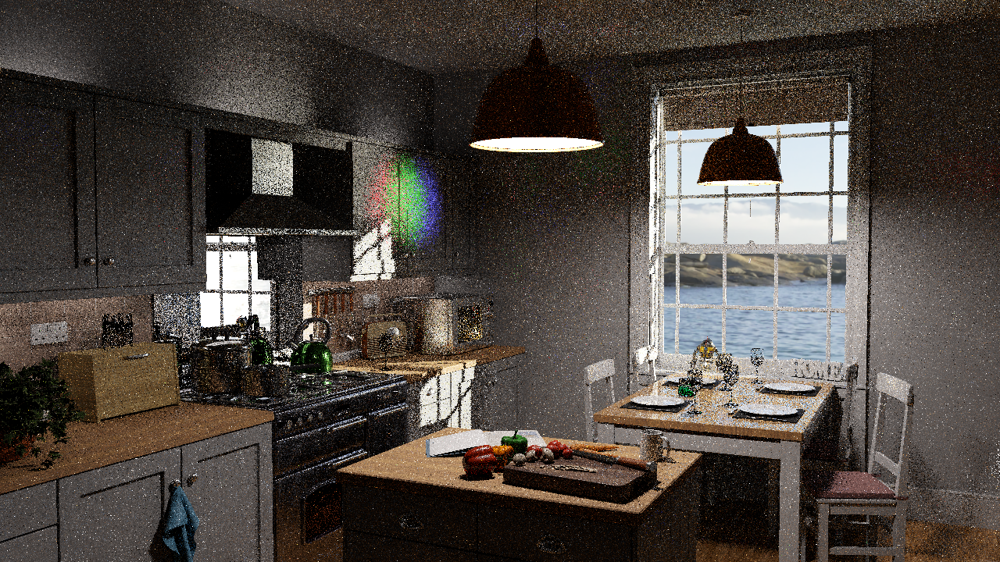

# ReSTIR PT on the original scenes: guarded development

**Historical development checkpoint; see the [finite-target follow-up](FINITE_SHIFT_GUARD.md) for the corrected source and five-seed original-resolution results.**

**2026-10-29: Convergence and Kitchen now render through the guarded replay-first path at their original1280×720 resolution, original materials/cameras and14/2 total/diffuse limits. Quality acceptance remains pending.** A reduced-resolution multi-seed study still shows a brightness deficit with combined reuse. This is a partial compatibility fix, not a completed general ReSTIR PT implementation or a measured speedup.

[B0–B10 comparison overview](COMPARISON_OVERVIEW.md) · [Sanitized evidence index](../../Benchmarks/development/2026-10-29-original-scene-pt-development/index.json)

## Confirmed changes

- Separate continuation-ray alpha testing from visibility-ray alpha testing. Continuation rays must see surfaces marked `ExcludeFromNEE`; that exclusion belongs to shadow rays.
- Preserve native selected-component BSDF weights in full-prefix PSS replay. Reproduce native diffuse classification, the0.25roughness boundary and alternating diffuse-transmission counter policy.
- Keep terminal emission after a scatter crosses the diffuse limit, but stop further NEE/scattering. Reject an over-budget replay prefix before `RecordPathIntersection` can evaluate its terminal connection.
- Restore discrete delta-environment contribution during hybrid replay. The pinned RTXDI callback excludes secondary-bounce environment light; this application assigns the discrete delta path to PT. The adapter uses the runtime’s replay reconnection length, preserving the DI/continuous-NEE partition.
- Invalidate history when the diffuse limit or extended-scene contract changes. Add a diagnostic-only same-pixel hybrid-shift check and transmission/medium/budget counters. The diagnostic dispatch is absent from throughput runs.
- Bound shader compilation to two jobs by default through `RTXPT_SHADER_COMPILE_JOBS`.

## What passed and what remains

| Gate | Evidence | Status |
|---|---|---|
| Build and effective-setting guards | Release build;160 benchmark-tool tests and6 independent diffuse-budget oracle tests | Passed; source/math tests do not replace GPU validation |
| Initial original-scene development | Four320×180 PT/DI+PT smokes, original materials and14/2limits; finite raw HDR, transmission and budget activity | Passed within this scope |
| Delta-path replay regression | Before:14/18 pure-replay failures in Convergence/Kitchen. Corrected320×180 seed0 probes:0/0 | Confirmed local contribution fix |
| All target identities | Corrected Convergence0/30377 failures; Kitchen2/6650 failures at the diagnostic tolerance | Kitchen NEE discrepancies remain; no full identity claim |
| Original-resolution rendering | Four1280×720 seed0/h64 captures: B6/B7 on both scenes; finite raw HDR, positive weights, M>1 and aged reservoirs; no mid-path reconnection | Passed as guarded development images |
| Quality acceptance | Three explicit seeds at320×180, independent native finite-reference checks | Pending: brightness deficit remains |
| Generic absorption/motion support | Initial scenes recorded0attenuated-medium segments; no motion acceptance suite | Not established |
| New throughput comparison | Image-writing development captures are excluded from timing | Pending correctness acceptance |

## Remaining quality discrepancy

These are **320×180 development results**, using the corrected48-byte primary-state candidate. They are not the1280×720 overview metrics. Each row uses three explicit seeds,1spp and64history frames, temporal+spatial reuse. B7 also enables DI reuse. HDR-FLIP1.7 uses PPD67 and ACES with exposure bounds derived only from the reference; no brightness normalization is applied. Signed luminance is relative to the finite native4096spp reference. Sample standard errors are exploratory estimates from three seeds, not a proof of unbiasedness.

| Scene | Variant | HDR-FLIP ↓ | LDR-FLIP ↓ | Signed mean luminance difference |
|---|---|---:|---:|---:|
| Convergence | B6 | 0.4670 | 0.3108 | -1.26% ±0.30% sample SE |
| Convergence | B7 | 0.3540 | 0.2329 | -2.08% ±0.13% sample SE |
| Kitchen | B6 | 0.6185 | 0.3597 | -4.66% ±1.46% sample SE |
| Kitchen | B7 | 0.5089 | 0.2921 | -4.41% ±0.78% sample SE |

The independent4096spp reference differs in mean luminance by+0.026% in Convergence and+0.017% in Kitchen; the2048spp discrepancies are+0.003% and−0.033%. Those small mean discrepancies do not explain the candidate’s deficit. Spatial/temporal ablations and all failed cohorts remain in the evidence. A same-pixel replay check is necessary but does not establish correct cross-pixel reuse or inverse-MIS normalization.

An exact-primary-surface experiment expanded native state from48 to176bytes and restored uncompressed primary normals/material data. Twenty-four captures did not remove the reuse deficit: combined Kitchen B6/B7 remained−4.66%/−4.98%. That experiment was rejected and the48-byte state restored. No extra memory cost or brightness compensation is retained.

## Original-resolution pictures

One seed per variant/scene,64history frames, raw output with AA/denoising/cache disabled. These show successful execution and scene content; they do not establish accepted quality, unbiasedness, or performance. Click a picture to inspect it; Escape closes the shared preview.

### Convergence · B6 development

### Convergence · B7 development

### Kitchen · B6 development

### Kitchen · B7 development

## Running the development path

The default released path retains its prior scene capability checks. Opt in explicitly through `--ptExtendedSceneValidation true` together with `--ptReplayOnlyValidation true`, fixed threshold1.0 and roulette off. The capture wrapper exposes `--pt-extended-scene-validation --pt-replay-only-validation`; it rejects a canonical acceptance label. Keep the actual algorithm/settings on every result. This does not activate arbitrary mid-path suffix reconnection, because the reservoir does not store a general diffuse-budget suffix history.

Native fallback retains primary domains outside PT ownership, including transmissive primaries. Transmission-scatter counters establish execution of some transmitted continuations; they do not prove full absorption or arbitrary layered-material support. The32-word diagnostic buffer includes aggregate self-replay checks and a first-failed pure-replay snapshot; it does not change the64-byte RTXDI reservoir ABI.

## Retained failures and stability limits

The first Kitchen temporal-development process exited with0xC0000005; an identical retry passed without a code change. A separate earlier combined-reuse launch stalled and its owned renderer was stopped. Causes are unresolved. The later frozen48-capture,12-capture and24-capture cohorts completed, as did all four original-resolution captures. Those successes do not retrospectively resolve the earlier failures.

The preserved opaque-room control is checked separately against its old captures. B6 remained pixel-identical to the preserved capture in both final repeats. B7 showed process variation: old/new linear MSE0.000620–0.000627, so no bitwise B7 regression pass is claimed. Do not equate matching seeds with guaranteed cross-process pixel identity or use separate processes as an exact component-sum oracle.

## Next acceptance work

Resolve the remaining energy discrepancy in reuse/normalization; distinguish it from estimator variance using longer fixed-scene convergence evidence. Then repeat original-resolution independent-seed quality and known-cap-verified timing. Motion, absorption and history-reset coverage remain explicit requirements. Only accepted results enter throughput comparisons. B8/B9/B10 remain pending while this compatibility work takes priority.

## Summary and lessons learned

Removing scene gates alone was insufficient: continuation visibility, sampled-component truncation and delta-environment ownership needed real fixes. Original scene rendering now works under the guarded path, but raw quality checks exposed a remaining deficit. The exact-primary experiment ruled out a proposed remedy without adding its memory cost. Preserve those distinctions before making PT++ or speedup claims.

## Changes

- 2026-10-29: Added guarded original-scene transport fixes, path-local regression diagnostics, reduced-resolution quality cohorts and original-resolution development pictures.
