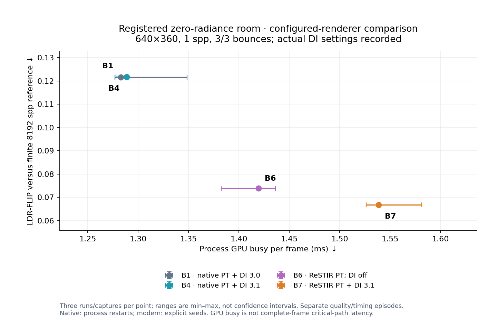
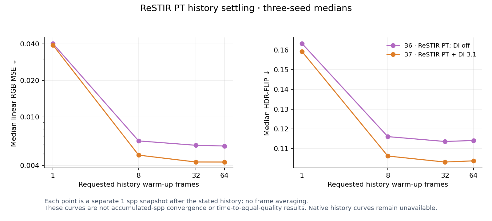
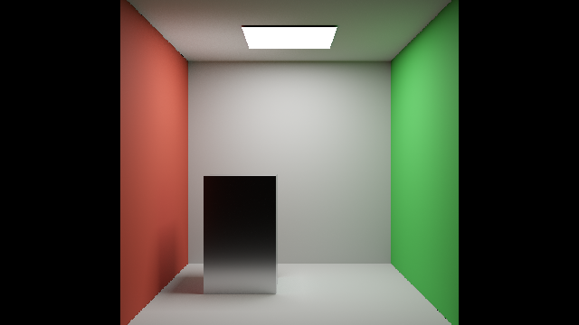

# Registered-room comparison: B1, B4, B6 and B7

**Measured 2026-10-29, RTX4090.** The missing native-PT-plus-DI control is now measured beside ReSTIR PT. In this scene, B7 costs19.41% more process GPU-busy time than B4 and has45.09% lower steady-state LDR-FLIP error. This is a configured-renderer cost/quality tradeoff, not a time-to-equal-quality speedup.

| Variant and actual algorithm; GI off throughout | GPU busy/frame, ms ↓ | CPU cadence, ms | Median LDR-FLIP ↓ | Encoded-sRGB MSE ↓ |
|---|---:|---:|---:|---:|
| B1: Native PT + ReSTIR DI3.0 | 1.28265 | 1.34105 | 0.121484 | 0.012337 |
| B4: Native PT + ReSTIR DI3.1 | 1.28865 | 1.34975 | 0.121719 | 0.012350 |
| B6: ReSTIR PT + native direct; DI off | 1.41950 | 1.49825 | 0.073817 | 0.004057 |
| B7: ReSTIR PT + ReSTIR DI3.1 | 1.53875 | 1.61595 | 0.066837 | 0.003196 |

Timing uses three fresh processes/configuration,45s wall warm-up and15s PresentMon, with rotated orders. Each process selects the last600 eligible target-process/swapchain rows after dropping16 tail frames. Quality uses three native process restarts or modern explicit seeds0,11,47 after64 requested warm-up frames. Native restarts are not claimed to be independent Monte Carlo seeds. These small samples remain exploratory.

Point ranges are min–max across the separate quality/timing repetitions, not confidence intervals. GPU busy is target-process engine active duration, not complete-frame critical-path GPU latency, exclusive DI/PT pass time or display FPS. The native partial perfLog excludes RTXDI passes and cannot attribute this difference.

## What the corrected control changes

The earlier0.806ms migrated native control had DI off. It was not a native PT+DI comparator. The new B4 control has DI on and costs1.289ms in this separately identified registered-environment fixture; B7 costs1.539ms. Do not pool these values with the old no-environment room dataset or infer that B7 itself became faster.

Both controls now include DI, but they are configured renderers with explicit policy differences. B1/B4 retain original native DI heuristics and approximate realtime NEE MIS. B6/B7 use the validated PT transport partition, full primary NEE where applicable, age rejection disabled with history mass cap8 and spatial/boost counts1/1. B7 additionally uses strict DI validation: boiling rejection, naive-neighbor discount and permutation sampling off, with raytraced bias correction. The comparison therefore does not isolate only the cost of adding path reservoirs. All actual settings and source identities are retained.

The original ReSTIR PT paper adjusted sample counts for approximately equal time. This experiment fixes1spp and records warmed-up history snapshots. Measured sample/candidate sweeps and accumulated-frame/error-versus-time curves are still required for an equal-time or equal-quality speedup claim.

## Fixture and immutable identities

Scene: `Testing/B2/Scenes/opaque-room-registered-env.scene.json`,640×360, total/diffuse limits3/3, static pinhole camera, exposure0, AA/denoiser/cache/subsampling off and post/firefly filters off. Models, original materials and camera are unchanged from the owned room. A registered environment light has actual runtime intensity0 and references a finite nonblack pinned texture for its unscaled importance PDF. Native first-frame receipts verify `envEnabled=1 envIntensity=0`.

The original room file is preserved. The added registration avoids the native control’s absent-environment-record underflow without patching its rendering shaders. This is a separate fixture identity; `fixture-identity.json` retains scene/model/environment hashes and the structural comparison. Original Convergence and Kitchen are never replaced by this room.

| Configuration | Base/adapter source | Executable SHA256 |
|---|---|---|
| B1: Native PT + ReSTIR DI3.0 | `4e380f9f85dba35b86b6a3bbd97e7acdfb324dec` | `6db074d35ed7050142ecfa42101e9ba79152e6155caa9b5d5954c093d3f5d362` |
| B4: Native PT + ReSTIR DI3.1 | `13d023fc6b8a7ff4ea6b6f5d5d7937bea4a86077` | `68cab907caa70c917e35ca6942745d5f45c6d03dd600128ff24ecf4c626d6810` |
| B6: ReSTIR PT + native direct; DI off | `80eac1bcf0ce9ae2c03535b8061c133d9f19a36c` | `8b8a65ca2ef174fac49e2eddecfb11b21ef86f7e03170677650f2ea938e8b28f` |
| B7: ReSTIR PT + ReSTIR DI3.1 | `80eac1bcf0ce9ae2c03535b8061c133d9f19a36c` | `8b8a65ca2ef174fac49e2eddecfb11b21ef86f7e03170677650f2ea938e8b28f` |

Modern B6/B7 use the current80eac1b renderer build with fixed-threshold reconnection and roulette off; they are not relabelled as the immutable de9fe651 executable. Runtime3.1’s64-byte packing and forced NEE were inherited. These runs do not activate the limited or full additional PT++ presets. All native renderer shader hashes, original dependency pins and protected baseline binaries remain preserved. Exact executable/DLL/cache bundles after timing are retained locally.

Separate post-timing diagnostics show134608 valid mid-path reconnections and nontrivial reused reservoir mass in each seed0 B6/B7 snapshot. Raw HDR and packed valid reservoir state are finite. These diagnostics establish activation in this case, not general unbiasedness. Large packed buffers remain local; hashes and statistics are exported.

## Raw HDR and finite reference

The reference is the current renderer’s native reference path at8192spp, seed101, pixel-center integration, with DI/GI/PT reuse off. It is separately identified from the unchanged B0 binary. A4096spp same-seed check and a second8192spp seed103 reference retain finite-reference discrepancy. No candidate brightness normalization is applied. Native original-shader B1/B4 controls do not export linear HDR, so the common four-way metric is LDR-FLIP; raw HDR metrics apply to B6/B7 only.

| Modern algorithm | Median linear RGB MSE ↓ | Median HDR-FLIP ↓ | Median signed mean luminance difference |
|---|---:|---:|---:|
| B6: ReSTIR PT + native direct; DI off | 0.005781 | 0.114122 | -0.083% |
| B7: ReSTIR PT + ReSTIR DI3.1 | 0.004269 | 0.103801 | -0.369% |

Official FLIP1.7 uses PPD67, ACES and the reference-only exposure interval[-3.2584481,4.6571803] with8exposures. Signed differences are reported rather than normalized away or interpreted as an unbiasedness test.

| Reference discrepancy versus primary8192spp | Linear RGB MSE | HDR-FLIP | Signed mean luminance difference |
|---|---:|---:|---:|
| reference4096 | 0.00000370 | 0.006293 | +0.0005% |
| reference8192-independent | 0.00000710 | 0.008059 | +0.0003% |

## History settling

Twenty-four B6/B7 captures cover three explicit seeds at1,8,32,64 requested history warm-up frames. Each point is a separate1spp snapshot, with no averaging of captured frames. The curves show how reuse history settles in this static scene. They are not accumulated-spp convergence or time-to-equal-quality curves; native variable-history curves remain unavailable.

## Frame caps and required scene coverage

All twelve accepted room timing runs passed effective app cap controls, fresh matching NVIDIA foreground/background cap0 and forced-off VSync, observed SyncInterval0, read-only RTSS audits at launch/start/end, zero PNG writes, no reported ETW loss and frozen source/executable/shader checks before/after capture. Every temporary exact-executable driver profile was restored and verified. The installed user Rtxpt.exe RTSS profile remains0 while global232 is unchanged. Other external limiters, background GPU work and unlocked clocks remain outside exclusive control.

| Mandatory scene | Native B1/B4 | ReSTIR PT B6/B7 |
|---|---|---|
| Original Convergence,1280×720,14/2 | Fresh DI-on quality and cap-verified timing in the native report | Unsupported by current transmission/material and binding diffuse-budget gates |
| Original Kitchen,1280×720,14/2 | Fresh DI-on quality and cap-verified timing in the native report | Unsupported by current transmission/BLEND/material and binding diffuse-budget gates |
| Owned room, explicit registered-env fixture,640×360,3/3 | Three quality processes and three timing processes/configuration | Three-seed history sweep and three timing processes/configuration |

Moving scenes, disocclusion recovery, reconstructed output, renderer-exclusive VRAM and equal-time/error sweeps remain pending. Whole-device allocation samples include background applications and are not claimed as renderer-exclusive memory.

## Inspect representative captures

Process1 or seed0 after64 warm-up frames is shown without selecting a favorable result. Click an image to enlarge; Escape closes the shared preview.

| B1: native PT + DI3.0 | B4: native PT + DI3.1 |
|---|---|
|  |  |

| B6: ReSTIR PT; DI off | B7: ReSTIR PT + DI3.1 |
|---|---|
|  |  |

## Evidence and next integration gate

Public-safe raw PFM/PNG, metrics, timing CSVs, effective settings, frozen hashes, reference checks and restoration receipts are retained in `Benchmarks/development/2026-10-29-registered-room`. [Native original-scene measurements](CANONICAL_NATIVE_DI_RESULTS.md), [canonical numbering](VERSION_MAPPING.md) and [B8 contribution design](B8_PARTITION_DESIGN.md) define the adjacent evidence and pending work.

B8–B10 are not activated. The seventeen exact CPU B8 tests validate prerequisite finite models; GI-short GPU production, PT-long ownership, fallback/reset behavior and GI reuse still need implementation and component validation. No renderer implementation follows merely from passing the CPU algebra.

## Summary and lessons learned

The DI-on native control reduces the apparent incremental cost of the tested ReSTIR PT configuration to about19% in this scene, with lower observed warmed-up image error. This corrects the comparison design; it is not a new PT optimization or a paper speedup reproduction. Preserve actual modes, reference uncertainty and missing original-scene coverage beside every result.
