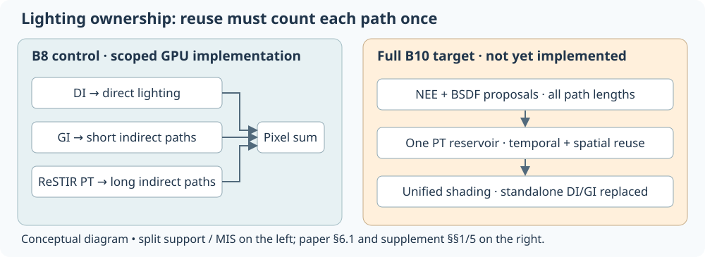
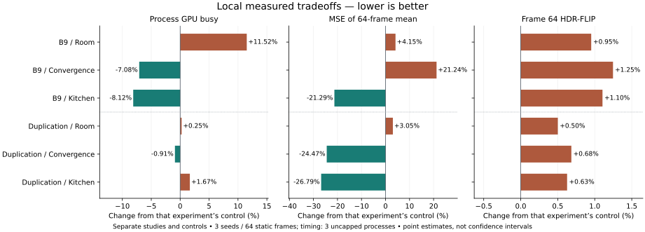
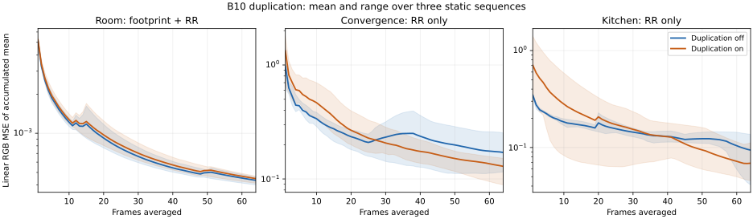
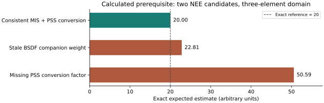

# Research summary and practical lessons

**As of 2026-10-30:** RTXPT 1.9 remains the reference. Native DI/GI controls and scoped ReSTIR PT integrations are measured; B10 is partial and B11–B16 are planned. This is a synthesis of existing research, GPU measurements and calculated checks, reusing preserved comparisons and the latest scoped integration diagnostics.

## What the research tells us

RTXPT supplies the renderer, scenes and native path tracer; RTXDI supplies reusable sampling/resampling components and integration examples. ReSTIR DI reuses direct-light samples, ReSTIR GI reuses indirect samples, and ReSTIR PT reuses path samples; native PT generates new paths. Their contributions need explicit ownership or correctly derived MIS: enabling all three does not make their estimates safe to add. Reuse adds work and memory, so its payoff needs matched-time or matched-error comparisons.

[PT++](https://cwyman.org/papers/i3d26_ReSTIRPT++.pdf) improves both work scheduling and sampling robustness: reciprocal pairing, reconnection tests, replay compaction, initial-only roulette, unified lighting, vector shading and history recovery. Its published speedup compares against the earlier ReSTIR PT prototype, not our modern RTXPT baseline. Supplied SDK code still needs application integration and activation checks. [Research sources and applicability](FOCUSED_A.md).

Our B8 control partitions short-GI and long-PT contributions. Full PT++ §6.1 instead uses one PT reservoir over direct and all indirect paths, replacing standalone DI/GI shading in that preset. A restricted finite-light RIS/PSS mode now implements that ownership; environment and composition with the other mechanisms remain unfinished. [Derivation and implementation gates](B10_UNIFIED_LIGHTING.md).

## What our experiments show

Each row compares against its own study's control. Quality uses three seeds and 64 static frames per seed; timing uses three separate uncapped processes. These are exploratory point estimates; [figure inputs and derived values](assets/research-summary/figure-data.json) are inspectable. GPU busy is not frame latency/FPS, and fixed-frame quality is not equal-time quality.

- **B9 versus B8:** GPU busy falls about 7–8% in original Convergence/Kitchen, but increases 11.5% in Room. Convergence's averaged-image MSE worsens about 21%; Kitchen's improves about 21%, with large uncertainty. Original scenes test roulette only; Room also tests footprint reconnection. [Full results](B9_RESULTS.md).
- **B10 duplication on versus off:** averaged-image MSE improves about 24–27% in the original scenes, while Room worsens 3%. Frame-64 HDR-FLIP is slightly worse in every scene. GPU cost is nearly unchanged in Room/Convergence and rises about 1.7% in Kitchen; no general speedup is established. This sample-dependent history reduction is deliberately biased. [Full results and uncertainty](B10_DUPLICATION_HISTORY.md).
- **Latest unified-lighting integration:** finite M=1/4 RIS/PSS MIS passes six Room snapshots and48,130identity checks, with actual PSS weights read back. The earlier M1 control is preserved. This is a correctness/activation checkpoint, without a quality or performance improvement claim. [Scope and evidence](B10_UNIFIED_LIGHTING.md).
- **Correctness mattered before optimization:** canonicalizing rejected zero-Jacobian shifts to a finite zero target stopped observed NaN propagation. Brightness residuals remain; exposure fitting would hide rather than explain them. [Finite-shift investigation](FINITE_SHIFT_GUARD.md).

Convergence evidence: the running mean across 64 frames

Bands show the three-seed minimum/maximum, not confidence intervals. This CPU average of unreconstructed real-time frames is not renderer 64-spp accumulation. Lower averaged error alone does not prove lower correlation, unbiasedness or better moving-camera behavior. [Quality definitions](QUALITY_METRICS.md).

## Why estimator details cannot be skipped

This is an exact finite-domain calculation, not a rendered scene or GPU simulation. With two NEE candidates, consistent MIS and primary-sample-space conversion preserve the known integral of 20. Updating only one companion weight gives 22.81; omitting the conversion gives 50.59. Eight prerequisite tests pass, but continuous measures, visibility, delta events and GPU reuse still need validation. These examples illustrate possible errors; they do not diagnose our remaining brightness residual. [Oracle and assumptions](B10_UNIFIED_LIGHTING.md).

## Where the next papers fit

The [newest-12 / wider-20 catalog](PAPER_CATALOG.md) supplies context; these seven focused techniques define the staged roadmap. Each addresses a different bottleneck, and the reviewed sources do not establish the complete combination as faster or unbiased.

| Stage | Research contribution | Integration lesson |
|---|---|---|
| **B10 · PT++** | More efficient reuse and more robust path sampling | Finish unified lighting, dual motion and broader queue/motion validation; preserve an explicit bias control. |
| **B11 · Compatibility-guided neighbors** | Prefer geometrically compatible reuse domains | Keep selection sample-independent; directed choices cannot automatically use reciprocal sharing. |
| **B12 · Stochastic pairwise MIS** | Evaluate a selected subset of a larger reuse population | Preserve selection support, multiplicity and canonical-domain accounting. |
| **B13 · ReSTIR LoD** | Reuse through changing geometry detail | Map both required vertices consistently and include surface-area Jacobians. |
| **B14 · ReSTIR BDPT, LW version** | Add light-side paths for difficult transport | Define LW scope, path ownership and technique-aware MIS; reproduce known rough-glass concerns. |
| **B15 · ReSTIR PG** | Use resampled paths to guide new proposals | Account for the guiding/BSDF mixture and training cost; reuse and guiding solve different problems. |
| **B16 · Multi-layer reservoir splatting** | Retain occluded histories in pixel-layer domains | Budget layer propagation, canonical candidates and visibility; do not assume off-screen or lens/time support. |

[Focused sampling papers](FOCUSED_A.md) · [Geometry/disocclusion/bidirectional papers](FOCUSED_B.md) · [Exact roadmap, including B10.75/.50/.25](ROADMAP.md).

## Summary and lessons learned

**Correct contribution ownership and weighting come first.** Separate paper findings, supplied code, active mechanisms and measured benefits. Preserve raw HDR and reference identities; compare performance, per-frame quality and convergence together. Correlated frames are not independent trials, and a component win can disappear in total GPU cost.

[NVIDIA's engineering guidance](NVIDIA_WHITEPAPERS.md) reinforces per-signal ray budgets, memory/occupancy and complete-pipeline profiling. Faster geometry structures complement LoD rendering; they do not supply its sampling mappings or Jacobians.

Next, finish paper-aligned B10 unification and motion recovery, then validate B11. Test full-scene coverage, reset/resize/disocclusion, memory and equal-time/equal-error behavior before broader claims. [All-version comparison](COMPARISON_OVERVIEW.md) · [Persistent history, retained data and reproduction](LOCAL_DATA_HISTORY.md).

Changelog: 2026-10-30 — compact synthesis of preserved research and experiments; three source-backed figures added, no new GPU acquisition.
